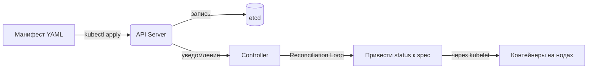

# Объекты Kubernetes — Декларативное управление состоянием

> Объект Kubernetes представляет собой запись о намерениях. Описание желаемого состояния задается в поле `spec`, после чего система через встроенные контроллеры приводит фактическое состояние (`status`) к заданному целевому значению. Все операции осуществляются с помощью декларативных манифестов в формате YAML или JSON.

---
## Содержание:

1. [[#Что такое объект Kubernetes|Что такое объект Kubernetes]]
2. [[#Структура объекта: spec vs status|Структура объекта: spec vs status]]
	1. [[#Структура объекта: spec vs status#Принцип работы Reconciliation Loop|Принцип работы Reconciliation Loop]]
3. [[#Обязательные поля манифеста|Обязательные поля манифеста]]
	1. [[#Обязательные поля манифеста#Минимальный шаблон манифеста|Минимальный шаблон манифеста]]
4. [[#Пример: Deployment|Пример: Deployment]]
	1. [[#Пример: Deployment#Команды применения манифестов|Команды применения манифестов]]
5. [[#Валидация полей: client-side vs server-side|Валидация полей: client-side vs server-side]]
	1. [[#Валидация полей: client-side vs server-side#Режимы флага `--validate` в kubectl|Режимы флага `--validate` в kubectl]]
6. [[#Справочник типов объектов|Справочник типов объектов]]
7. [[#Ключевые выводы|Ключевые выводы]]

---
## Что такое объект Kubernetes

|**Аспект**|**Описание**|
|---|---|
|**Определение**|Постоянная сущность в системе, представляющая состояние кластера или рабочей нагрузки|
|**Назначение**|Описание запущенных приложений, требуемых ресурсов и применяемых политик|
|**Принцип работы**|Создание объекта → чтение `spec` платформой → обработка данных для соответствия `status` полю `spec`|
|**Управление**|Взаимодействие через API Kubernetes (напрямую, через `kubectl` или клиентские библиотеки)|



Декларативная концепция исключает необходимость пошагового инструкционирования системы. Достаточно определить целевое состояние, после чего платформенные механизмы самостоятельно формируют последовательность действий для его достижения.

---
## Структура объекта: spec vs status

Большинство объектов Kubernetes содержат два ключевых раздела:

|**Поле**|**Кто заполняет**|**Назначение**|**Пример**|
|---|---|---|---|
|**`spec`**|Пользователь|**Желаемое состояние**: целевые параметры системы|`replicas: 3`, `image: nginx:1.25`, `resources.requests.cpu: 500m`|
|**`status`**|Система Kubernetes|**Фактическое состояние**: текущие показатели ресурса|`availableReplicas: 2`, `conditions: [{type: Ready, status: True}]`|

### Принцип работы Reconciliation Loop

При получении спецификации с указанием `replicas: 3` контроллер постоянно сравнивает это значение с текущим показателем `availableReplicas` в разделе `status`. В случае расхождения (например, при падении контейнеров и уменьшении доступных реплик до 1) контроллер инициирует создание недостающих экзепляров для достижения заданного в `spec` уровня.

---
## Обязательные поля манифеста

Манифест объекта Kubernetes в формате YAML или JSON должен содержать четыре обязательных поля:

|**Поле**|**Тип**|**Описание**|**Пример**|
|---|---|---|---|
|**`apiVersion`**|string|Версия API для текущего типа объекта|`apps/v1`, `v1` (core), `networking.k8s.io/v1`|
|**`kind`**|string|Тип создаваемого объекта|`Pod`, `Deployment`, `Service`, `ConfigMap`|
|**`metadata`**|object|Идентификаторы и метаданные ресурса|`name`, `namespace`, `labels`, `annotations`|
|**`spec`**|object|Желаемое состояние (структура определяется значением `kind`)|Зависит от спецификации объекта|
### Минимальный шаблон манифеста
 
```yaml
apiVersion: apps/v1
kind: Deployment
metadata:
  name: example-deployment
  namespace: default
  labels:
    app: my-app
spec:
  # специфичные поля объекта
```

---
## Пример: Deployment

```yaml
apiVersion: apps/v1          # Версия API
kind: Deployment             # Тип объекта
metadata:                    # Метаданные
  name: nginx-deployment
  labels:
    app: nginx
spec:                        # Желаемое состояние
  replicas: 2                # Количество реплик
  selector:                  # Селектор для управления подами
    matchLabels:
      app: nginx
  template:                  # Шаблон создания подов
    metadata:
      labels:
        app: nginx
    spec:
      containers:
      - name: nginx
        image: nginx:1.14.2  # Образ контейнера
        ports:
        - containerPort: 80  # Сетевой порт
```

### Команды применения манифестов

```bash
kubectl apply -f deployment.yaml

kubectl apply -f https://k8s.io/examples/application/deployment.yaml

kubectl get deployments
kubectl describe deployment nginx-deployment
```

Получение встроенной справочной информации по структуре полей выполняется утилитой `kubectl explain`:

```bash
kubectl explain deployment.spec.template.spec.containers
```

---
## Валидация полей: client-side vs server-side

Начиная с версии Kubernetes 1.25, в `kube-apiserver` внедрена серверная валидация полей, обеспечивающая обнаружение невалидных или неизвестных атрибутов манифеста.

### Режимы флага `--validate` в kubectl

|**Значение**|**Поведение**|**Назначение**|
|---|---|---|
|**`strict`** (или `true`)|Блокировка запроса при наличии неизвестных полей|Режим по умолчанию, предотвращение ошибок ввода|
|**`warn`**|Вывод предупреждения с сохранением выполнения запроса|Отладка и миграция устаревших манифестов|
|**`ignore`** (или `false`)|Отключение механизмов валидации|Динамическое добавление полей|

```bash
kubectl apply -f deploy.yaml --validate=strict
kubectl apply -f deploy.yaml --validate=warn
kubectl apply -f deploy.yaml --validate=ignore

kubectl apply -f deploy.yaml --dry-run=server -o yaml
```

При отсутствии связи с `kube-apiserver` клиент `kubectl` переходит на локальную клиентскую валидацию. Серверная валидация доступна во всех стабильных релизах начиная с Kubernetes 1.27.

---
## Справочник типов объектов

|**Категория**|**Объекты**|**Назначение**|
|---|---|---|
|**Базовые**|`Pod`, `Node`, `Namespace`|Примитивы: контейнеры на ноде, изоляция ресурсов|
|**Контроллеры**|`Deployment`, `StatefulSet`, `DaemonSet`, `Job`, `CronJob`|Управление жизненным циклом подов, масштабирование, расписания|
|**Сетевые**|`Service`, `Ingress`, `NetworkPolicy`, `EndpointSlice`|Сетевой доступ, маршрутизация трафика, балансировка и политики безопасности|
|**Хранение**|`PersistentVolume` (PV), `PersistentVolumeClaim` (PVC), `StorageClass`|Управление дисковыми хранилищами и их динамическое подключение|
|**Конфигурация**|`ConfigMap`, `Secret`, `ServiceAccount`|Внешние параметры, конфиденциальные данные, учетные записи сервисов|
|**Безопасность**|`Role`/`ClusterRole`, `RoleBinding`/`ClusterRoleBinding`|Модель разграничения доступа (RBAC)|
|**Расширения**|`CustomResourceDefinition` (CRD), `MutatingWebhookConfiguration`, `ValidatingWebhookConfiguration`|Расширение схемы API и настройка кастомной логики|

---
## Ключевые выводы

- Объект фиксирует намерение: пользователь задает раздел `spec`, а платформа приводит к нему состояние `status`.
- Поля `apiVersion`, `kind`, `metadata` и `spec` являются обязательными атрибутами любого манифеста.
- Декларативное управление через `kubectl apply -f` обеспечивает воспроизводимость инфраструктурных конфигураций.
- Безопасное обновление объектов достигается применением параметров `--validate=strict` и `--dry-run=server`