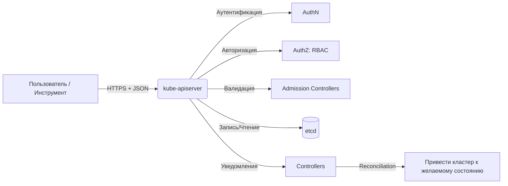

# Kubernetes API

> Интерфейс Kubernetes API представляет собой фундаментальную основу, обеспечивающую все процессы взаимодействия с кластером.

---
## Содержание

1. [[#Что такое Kubernetes API|Что такое Kubernetes API]]
2. [[#Способы взаимодействия с API|Способы взаимодействия с API]]
	1. [[#Способы взаимодействия с API#Пример прямого запроса к API|Пример прямого запроса к API]]
3. [[#API Discovery: механизмы обнаружения ресурсов|API Discovery: механизмы обнаружения ресурсов]]
	1. [[#API Discovery: механизмы обнаружения ресурсов#Два механизма обнаружения|Два механизма обнаружения]]
	2. [[#API Discovery: механизмы обнаружения ресурсов#Примеры запросов|Примеры запросов]]
	3. [[#API Discovery: механизмы обнаружения ресурсов#Структура ответа неагрегированного discovery|Структура ответа неагрегированного discovery]]
4. [[#OpenAPI спецификации: документация и валидация|OpenAPI спецификации: документация и валидация]]
	1. [[#OpenAPI спецификации: документация и валидация#Сравнение OpenAPI v2 и v3|Сравнение OpenAPI v2 и v3]]
	2. [[#OpenAPI спецификации: документация и валидация#Получение спецификации|Получение спецификации]]
5. [[#Сериализация данных: JSON и Protobuf|Сериализация данных: JSON и Protobuf]]
	1. [[#Сериализация данных: JSON и Protobuf#Запрос в формате Protobuf|Запрос в формате Protobuf]]
6. [[#Группы API и версионирование|Группы API и версионирование]]
	1. [[#Группы API и версионирование#Структура пути к ресурсу|Структура пути к ресурсу]]
	2. [[#Группы API и версионирование#Иерархия версионирования|Иерархия версионирования]]
	3. [[#Группы API и версионирование#Прозрачная конвертация версий|Прозрачная конвертация версий]]
7. [[#Жизненный цикл версий API|Жизненный цикл версий API]]
	1. [[#Жизненный цикл версий API#Отслеживание устаревших версий|Отслеживание устаревших версий]]
8. [[#Расширение API: CRD и Aggregation Layer|Расширение API: CRD и Aggregation Layer]]
	1. [[#Расширение API: CRD и Aggregation Layer#CustomResourceDefinitions (CRD)|CustomResourceDefinitions (CRD)]]
	2. [[#Расширение API: CRD и Aggregation Layer#Aggregation Layer|Aggregation Layer]]
	3. [[#Расширение API: CRD и Aggregation Layer#Веб-хуки валидации и мутации|Веб-хуки валидации и мутации]]
9. [[#Чек-лист проверки и работы с API|Чек-лист проверки и работы с API]]

---
## Что такое Kubernetes API

|**Аспект**|**Описание**|
|---|---|
|**Назначение**|Единый интерфейс для запроса и изменения состояния **всех** объектов кластера|
|**Реализация**|`kube-apiserver` — фронтенд плоскости управления, обрабатывающий HTTPS-запросы|
|**Протокол**|RESTful HTTP API + поддержка Protobuf для внутренней оптимизации|
|**Форматы данных**|JSON (по умолчанию), Protobuf (внутри кластера), YAML (на стороне клиента)|
|**Аутентификация**|Сертификаты, токены, OIDC, webhook-провайдеры|
|**Авторизация**|RBAC, ABAC, Node, Webhook|




Все компоненты Kubernetes функционируют в качестве объектов, содержащих разделы `spec` и `status`, управление которыми осуществляется через единый программный интерфейс. Даже утилита `kubectl` выполняет роль клиента, отправляющего стандартные HTTP-запросы.

---
## Способы взаимодействия с API

|**Способ**|**Когда использовать**|**Пример**|
|---|---|---|
|**`kubectl`**|Ручное управление, отладка, скрипты|`kubectl get pods`, `kubectl apply -f deploy.yaml`|
|**Прямые REST-запросы**|Низкоуровневая интеграция, кастомные инструменты|`curl -k https://<api>/api/v1/pods -H "Authorization: Bearer <token>"`|
|**Официальные клиентские библиотеки**|Разработка приложений под K8s|Go: `client-go`, Python: `kubernetes-client`, Java: `kubernetes-client`|
|**Динамические клиенты**|Работа с неизвестными заранее ресурсами (операторы, CRD)|Go: `dynamic.Interface`, Python: `DynamicClient`|
|**Server-side apply**|Декларативное управление с отслеживанием владения|`kubectl apply --server-side -f manifest.yaml`|

### Пример прямого запроса к API


```bash
TOKEN=$(kubectl config view --raw -o jsonpath='{.users[*].user.token}' 2>/dev/null || \
        cat /var/run/secrets/kubernetes.io/serviceaccount/token)

curl -k -H "Authorization: Bearer $TOKEN" \
     -H "Accept: application/json" \
     https://<api-server-endpoint>/api/v1/namespaces/default/pods

curl -k -X POST \
     -H "Authorization: Bearer $TOKEN" \
     -H "Content-Type: application/json" \
     -d @pod.json \
     https://<api-server-endpoint>/api/v1/namespaces/default/pods
```

Для отладки выполнения утилиты `kubectl` рекомендуется использовать флаг детализации `-v=6` для фильтрации сетевых запросов:

```bash
kubectl get pods -v=6 2>&1 | grep -E 'GET|POST|PUT'
```

---
## API Discovery: механизмы обнаружения ресурсов

Платформа публикует метаданные о доступных ресурсах для динамической адаптации клиентских приложений.

### Два механизма обнаружения

|                                          |                                                                                                  |                                             |                                                                                        |
| ---------------------------------------- | ------------------------------------------------------------------------------------------------ | ------------------------------------------- | -------------------------------------------------------------------------------------- |
| **Неагрегированное**                     | `/api`, `/apis`, `/apis/<group>/<version>`                                                       | Список групп/версий/ресурсов по отдельности | Простые клиенты, ручная отладка, совместимость со старыми версиями                     |
| **Агрегированное** _(стабильно с v1.30)_ | `/api`, `/apis` с `Accept: application/json;v=v2;g=apidiscovery.k8s.io;as=APIGroupDiscoveryList` | Сводный список всех ресурсов за 1–2 запроса | Эффективное кэширование, автодополнение в `kubectl`, операторы, инструменты управления |

### Примеры запросов

```bash
curl -k -H "Authorization: Bearer $TOKEN" https://<api>/apis

curl -k -H "Authorization: Bearer $TOKEN" https://<api>/apis/apps/v1

curl -k -H "Authorization: Bearer $TOKEN" \
     -H "Accept: application/json;v=v2;g=apidiscovery.k8s.io;as=APIGroupDiscoveryList" \
     https://<api>/apis

kubectl api-resources           
kubectl api-versions            
kubectl explain pod             
```

### Структура ответа неагрегированного discovery

```JSON
{
  "kind": "APIGroupList",
  "apiVersion": "v1",
  "groups": [
    {
      "name": "apps",
      "preferredVersion": { "groupVersion": "apps/v1", "version": "v1" },
      "versions": [
        { "groupVersion": "apps/v1", "version": "v1" },
        { "groupVersion": "apps/v1beta1", "version": "v1beta1" }
      ]
    }
  ]
}
```

---
## OpenAPI спецификации: документация и валидация

Сервер генерирует спецификации в машиночитаемом формате, используемые для автоматического создания клиентов, проверки манифестов и ведения документации.

### Сравнение OpenAPI v2 и v3

| **Характеристика** | **OpenAPI v2**                                     | **OpenAPI v3**                                        |
| ------------------ | -------------------------------------------------- | ----------------------------------------------------- |
| **Конечная точка** | `/openapi/v2`                                      | `/openapi/v3`                                         |
| **Статус**         | Стабильно                                          | Стабильно с v1.27                                     |
| **Полнота схемы**  | Частичная: упрощены `oneOf`, `nullable`, `default` | Полная: точное представление всех полей и ограничений |
| **Форматы**        | JSON, Protobuf                                     | JSON, Protobuf                                        |
| **Кэширование**    | Стандартные HTTP-заголовки                         | Неизменяемые URL с хешем + `Cache-Control: immutable` |
| **Рекомендация**   | Для обратной совместимости                         | **Предпочтительный вариант** для новых инструментов   |

### Получение спецификации

```Bash
curl -k -H "Authorization: Bearer $TOKEN" \
     https://<api>/openapi/v2 > openapi-v2.json

curl -k -H "Authorization: Bearer $TOKEN" \
     -H "Accept: application/com.github.proto-openapi.spec.v2@v1.0+protobuf" \
     https://<api>/openapi/v2 > openapi-v2.pb

curl -k -H "Authorization: Bearer $TOKEN" \
     https://<api>/openapi/v3 > openapi-v3-index.json

curl -k -H "Authorization: Bearer $TOKEN" \
     https://<api>/openapi/v3/apis/apps/v1 > apps-v1-openapi.json
```

Окончательная проверка корректности объектов выполняется непосредственно на стороне `kube-apiserver`. Ограничения admission-контроллеров, квот и политик применяются сервером независимо от клиентских схем. Для проведения предварительной проверки рекомендуется использовать режим сухого запуска на сервере:

```Bash
kubectl apply -f deployment.yaml --dry-run=server -o yaml > validated.yaml
```

---
## Сериализация данных: JSON и Protobuf

|**Формат**|**Плюсы**|**Минусы**|**Где используется**|
|---|---|---|---|
|**JSON**|Человекочитаемый, универсальный, удобен для отладки|Больший размер, медленнее парсинг|`kubectl`, внешние клиенты, конфиги, манифесты|
|**Protobuf**|Компактный (~30% размера), быстрый парсинг, типобезопасный|Требует `.proto`-схем, менее удобен для ручной правки|Внутренняя коммуникация компонентов, высоконагруженные операторы, watch-стримы|

### Запрос в формате Protobuf

```Bash
curl -k -H "Accept: application/com.github.proto-openapi.spec.v2@v1.0+protobuf" \
     https://<api>/openapi/v2
```

---
## Группы API и версионирование

### Структура пути к ресурсу

```bash
/api/v1/pods
/api/v1/namespaces/<ns>/services

/apis/<group>/<version>/namespaces/<ns>/<resource>/<name>

/apis/apps/v1/namespaces/default/deployments/my-app
/apis/networking.k8s.io/v1/ingresses/my-ingress
```

### Иерархия версионирования

|**Уровень**|**Пример**|**Назначение**|
|---|---|---|
|**Группа**|`apps`, `rbac.authorization.k8s.io`, `networking.k8s.io`|Логическое объединение связанных ресурсов|
|**Версия**|`v1`, `v1beta1`, `v2alpha1`|Эволюция схемы без поломки клиентов|
|**Ресурс**|`deployments`, `services`, `ingresses`|Тип объекта (во множественном числе)|
|**Объект**|Конкретный экземпляр (`name` + `namespace`)|Уникальный идентификатор|

### Прозрачная конвертация версий

Преобразование версий объектов происходит автоматически внутри плоскости управления. При чтении или записи данных API Server выполняет конвертацию схем на лету, что позволяет клиентам использовать поддерживаемые версии независимо от формата хранения данных в etcd.

---
## Жизненный цикл версий API

```
alpha → beta → GA (v1) → deprecated → removed
```

|**Стадия**|**Гарантии совместимости**|**Рекомендации**|
|---|---|---|
|**alpha**|Отсутствие обратной совместимости; возможность удаления в любом релизе|Только тестирование, исключение производственной эксплуатации|
|**beta**|Сохранение обратной совместимости в рамках ветки, возможны изменения в следующих циклах|Допустимо использование в production при готовности к последующей миграции|
|**GA (v1)**|Полная обратная совместимость; долгосрочная поддержка|Безопасно для производственных сред|
|**deprecated**|Функционирование сохраняется, ресурс помечен к удалению в будущих релизах|Планирование и выполнение миграции до момента удаления|
|**removed**|Полное удаление интерфейса|Обязательный переход на альтернативные версии|
### Отслеживание устаревших версий

```Bash
kubectl api-resources --output=wide | grep -i deprecated

kubectl logs -n kube-system -l component=kube-apiserver | grep -i deprecated

pluto detect ./manifests --target-version v1.30
```

---
## Расширение API: CRD и Aggregation Layer

Архитектура системы позволяет внедрять новые типы ресурсов и настраивать кастомную логику обработки без внесения изменений в исходный код ядра.

### CustomResourceDefinitions (CRD)

```yaml
apiVersion: apiextensions.k8s.io/v1
kind: CustomResourceDefinition
metadata:
  name: myapps.example.com
spec:
  group: example.com
  versions:
    - name: v1
      served: true
      storage: true
      schema:
        openAPIV3Schema:
          type: object
          properties:
            spec:
              type: object
              properties:
                replicas: { type: integer }
  scope: Namespaced
  names:
    plural: myapps
    singular: myapp
    kind: MyApp
    shortNames: [ma]
```

Применение и создание экземпляра кастомного ресурса:

```Bash
kubectl apply -f myapp-crd.yaml
kubectl get crd myapps.example.com

cat <<EOF | kubectl apply -f -
apiVersion: example.com/v1
kind: MyApp
metadata:
  name: demo
spec:
  replicas: 3
EOF
```

### Aggregation Layer

Aggregation Layer подключает внешние программные интерфейсы в качестве расширений стандартного API через единую точку доступа (`/apis/...`), наследуя механизмы аутентификации и авторизации кластера. Примером реализации выступает Metrics Server.

### Веб-хуки валидации и мутации

Для контроля и модификации создаваемых объектов применяются конфигурации веб-хуков:

```YAML
apiVersion: admissionregistration.k8s.io/v1
kind: ValidatingWebhookConfiguration
metadata:
  name: require-app-label.example.com
webhooks:
- name: validate.example.com
  rules:
  - apiGroups: [""]
    apiVersions: ["v1"]
    operations: ["CREATE", "UPDATE"]
    resources: ["pods"]
  clientConfig:
    service:
      namespace: admission-system
      name: validation-service
      path: /validate
```

---
## Чек-лист проверки и работы с API

- Исследовать доступные ресурсы и поддерживаемые версии через `kubectl api-resources --output=wide` и `kubectl api-versions`.
- Выполнять проверку манифестов перед применением с помощью серверного режима сухого запуска.
- Контролировать использование устаревших версий API посредством специализированных утилит анализа манифестов и логов `kube-apiserver`.
- Применять декларативный подход Server-side apply для точного отслеживания управляемых полей в объектах.