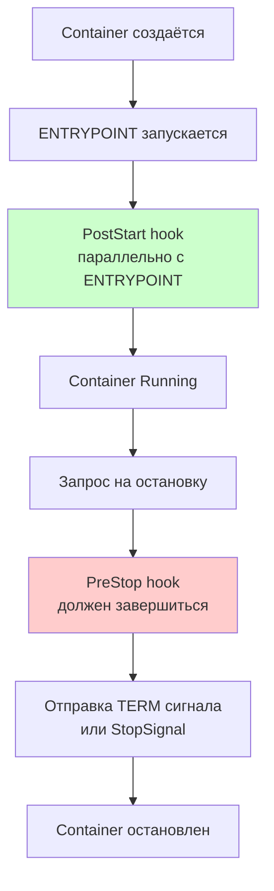

# Хуки жизненного цикла контейнеров в Kubernetes (Container Lifecycle Hooks)

>Kubernetes предоставляет механизм хуков жизненного цикла (`Container Lifecycle Hooks`), который позволяет отслеживать события внутри контейнера и выполнять заданные пользователем действия на определенных этапах его работы.

---
## Содержание

1. [[#Обзор хуков|Обзор хуков]]
	1. [[#Обзор хуков#Три хука жизненного цикла|Три хука жизненного цикла]]
	2. [[#Обзор хуков#Ключевые поведенческие особенности|Ключевые поведенческие особенности]]
2. [[#1. PostStart Hook|1. PostStart Hook]]
	1. [[#1. PostStart Hook#Назначение|Назначение]]
	2. [[#1. PostStart Hook#Пример конфигурации PostStart с exec|Пример конфигурации PostStart с exec]]
	3. [[#1. PostStart Hook#Пример конфигурации PostStart с sleep (начиная с Kubernetes v1.29+)|Пример конфигурации PostStart с sleep (начиная с Kubernetes v1.29+)]]
3. [[#2. PreStop Hook|2. PreStop Hook]]
	1. [[#2. PreStop Hook#Назначение|Назначение]]
	2. [[#2. PreStop Hook#Взаимодействие с terminationGracePeriodSeconds|Взаимодействие с terminationGracePeriodSeconds]]
	3. [[#2. PreStop Hook#Пример PreStop с exec (Graceful Shutdown)|Пример PreStop с exec (Graceful Shutdown)]]
	4. [[#2. PreStop Hook#Пример PreStop с sleep (Задержка для обновления сетевых маршрутов)|Пример PreStop с sleep (Задержка для обновления сетевых маршрутов)]]
4. [[#3. StopSignal|3. StopSignal]]
5. [[#Типы обработчиков хуков|Типы обработчиков хуков]]
6. [[#Гарантии доставки и требования к идемпотентности|Гарантии доставки и требования к идемпотентности]]
7. [[#Отладка хуков|Отладка хуков]]
8. [[#Инженерные рекомендации (Best Practices)|Инженерные рекомендации (Best Practices)]]

---

## Обзор хуков

### Три хука жизненного цикла

|**Хук**|**Когда вызывается**|**Что делает**|**Блокирует запуск?**|
|---|---|---|---|
|**PostStart**|Сразу после создания контейнера|Выполняет код после старта|Может задержать переход в статус `Running`|
|**PreStop**|Перед остановкой контейнера|Выполняет код перед остановкой (например, graceful shutdown)|Да, должен завершиться до отправки сигнала TERM|
|**StopSignal**|При остановке контейнера|Переопределяет стандартный сигнал остановки (`STOPSIGNAL`)|Нет|




### Ключевые поведенческие особенности

- **PostStart запускается параллельно** с `ENTRYPOINT` процесса приложения, а не после его завершения. По этой причине `PostStart` может завершиться до, во время или после старта основного процесса.
- Контейнер не перейдет в состояние `Running`, пока выполнение `PostStart` не завершится.
- `PreStop` вызывается **до** отправки сигнала завершения работы (`SIGTERM`). Общее время остановки (`terminationGracePeriodSeconds`) включает в себя время выполнения `PreStop` плюс время на штатное завершение работы приложения.
- Зависание хука может привести к зависанию пода в статусе `Terminating` до истечения отведенного `grace period`.
- Падение (ошибка) хука приводит к немедленному уничтожению контейнера.

---
## 1. PostStart Hook

### Назначение

Используется для инициализации состояния, отправки уведомлений о запуске, ожидания зависимостей или регистрации в системах Service Discovery.

### Пример конфигурации PostStart с exec

```yaml
apiVersion: v1
kind: Pod
metadata:
  name: lifecycle-demo
spec:
  containers:
  - name: lifecycle-demo-container
    image: nginx:1.25
    lifecycle:
      postStart:
        exec:
          command: ["/bin/sh", "-c", "echo 'Container started' > /usr/share/message.html"]
```

### Пример конфигурации PostStart с sleep (начиная с Kubernetes v1.29+)

```yaml
apiVersion: v1
kind: Pod
metadata:
  name: lifecycle-demo
spec:
  containers:
  - name: app
    image: my-app:latest
    lifecycle:
      postStart:
        sleep:
          seconds: 5    # Пауза 5 секунд перед окончательным переходом в Running
```

---
## 2. PreStop Hook

### Назначение

Применяется для реализации graceful shutdown (мягкого завершения), вывода пула соединений из работы (connection drain), сохранения состояния перед выключением или удаления из балансировщиков нагрузки.

### Взаимодействие с terminationGracePeriodSeconds

```
Timeline при остановке пода:
┌─────────────────────────────────────────────────────────┐
│ 0s          PreStop starts        TERM sent             60s
│ │           │                     │                     │
│ ▼           ▼                     ▼                     ▼
│ ┌───────────┬─────────────────────┬─────────────────────┐
│ │ PreStop   │                     │ Container shutdown  │
│ │ hook      │                     │ (SIGTERM → SIGKILL) │
│ │ (55s)     │                     │ (10s)               │
│ └───────────┴─────────────────────┴─────────────────────┘
│                                                           │
│         terminationGracePeriodSeconds = 60s               │
│                                                           │
│         Если PreStop (55s) + shutdown (10s) = 65s > 60s  │
│         → Контейнер будет убит через 60s (SIGKILL)       │
└─────────────────────────────────────────────────────────┘
```

### Пример PreStop с exec (Graceful Shutdown)

```yaml
apiVersion: v1
kind: Pod
metadata:
  name: lifecycle-demo
spec:
  terminationGracePeriodSeconds: 60
  containers:
  - name: app
    image: my-app:latest
    lifecycle:
      preStop:
        exec:
          command: ["/bin/sh", "-c", "curl -X POST http://localhost:8080/shutdown"]
```

### Пример PreStop с sleep (Задержка для обновления сетевых маршрутов)

```yaml
apiVersion: v1
kind: Pod
metadata:
  name: lifecycle-demo
spec:
  terminationGracePeriodSeconds: 30
  containers:
  - name: app
    image: my-app:latest
    lifecycle:
      preStop:
        sleep:
          seconds: 10    # Пауза перед отправкой TERM для обновления endpoints в kube-proxy
```

---
## 3. StopSignal

Параметр `stopSignal` позволяет переопределить стандартный сигнал прекращения работы (`SIGTERM`).

```yaml
apiVersion: v1
kind: Pod
metadata:
  name: lifecycle-demo
spec:
  containers:
  - name: app
    image: my-app:latest
    stopSignal: SIGINT    # Отправка SIGINT вместо SIGTERM
```

---
## Типы обработчиков хуков

|**Тип**|**Описание**|**Особенности**|
|---|---|---|
|**`exec`**|Выполнение команды внутри файловой системы контейнера|Высокая гибкость, ресурсы учитываются в лимитах контейнера|
|**`httpGet`**|Отправка HTTP GET запроса|Интеграция с внутренними API|
|**`sleep`** (v1.29+)|Прямая приостановка выполнения на заданное число секунд|Фиксированная пауза без запуска дополнительных процессов|

---
## Гарантии доставки и требования к идемпотентности

Хуки жизненного цикла реализуют семантику **at-least-once delivery** (доставка "как минимум один раз"). Это означает, что обработчик при определенных сбоях инфраструктуры или перезапусках `kubelet` может быть вызван повторно.

- **Идемпотентность кода хука является обязательным требованием**. Повторный запуск скрипта или команды не должен приводить к повреждению данных или неконсистентному состоянию.
- Код должен выполняться быстро и надежно, так как нештатное завершение хука влечет за собой уничтожение контейнера.

Пример идемпотентной реализации через перезапись файла вместо добавления строк:

```yaml
# Хорошо (идемпотентно — файл перезаписывается)
lifecycle:
  postStart:
    exec:
      command: ["/bin/sh", "-c", "echo 'Started' > /tmp/status"]
```

---
## Отладка хуков

Логи выполнения обработчиков хуков **не выводятся** стандартной командой `kubectl logs`. Для их анализа необходимо использовать системные события пода:

```bash
kubectl describe pod lifecycle-demo | grep -A20 'Events:'
```

Индикаторные сообщения в поле `Events`:

- **`FailedPostStartHook`** — сбой при выполнении постстарт-хука.
- **`FailedPreStopHook`** — ошибка в обработчике предстоп-хука.
- **`Killing`** — принудительное завершение работы контейнера вследствие падения хука.

---
## Инженерные рекомендации (Best Practices)

- Всегда проектируйте код хуков как **идемпотентный**.
- Закладывайте достаточный запас времени в `terminationGracePeriodSeconds` с учетом длительности работы `PreStop`.
- Тестируйте команды хуков вручную внутри запущенного контейнера с помощью `kubectl exec`.
- Не завязывайте критическую логику инициализации приложения на `PostStart`, поскольку он выполняется параллельно с точкой входа (`ENTRYPOINT`).