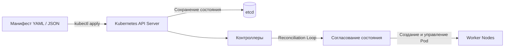

# Объекты Kubernetes — декларативное управление состоянием


> **Объекты Kubernetes (Kubernetes objects)** — постоянные сущности системы, с помощью которых Kubernetes описывает и хранит состояние кластера.


1. [[#Что такое объект Kubernetes|Что такое объект Kubernetes]]
	1. [[#Что такое объект Kubernetes#Объекты определяют:|Объекты определяют:]]
	2. [[#Что такое объект Kubernetes#Принцип декларативного управления|Принцип декларативного управления]]
2. [[#Структура объекта: `spec` и `status`|Структура объекта: `spec` и `status`]]
	1. [[#Структура объекта: `spec` и `status`#Как работает Reconciliation Loop|Как работает Reconciliation Loop]]
3. [[#Описание объекта: манифесты|Описание объекта: манифесты]]
	1. [[#Описание объекта: манифесты#Обязательные поля манифеста|Обязательные поля манифеста]]
	2. [[#Описание объекта: манифесты#Минимальный пример манифеста|Минимальный пример манифеста]]
	3. [[#Описание объекта: манифесты#Пример: Deployment|Пример: Deployment]]
	4. [[#Описание объекта: манифесты#Применение манифеста|Применение манифеста]]
	5. [[#Описание объекта: манифесты#Полезные команды для работы с объектами:|Полезные команды для работы с объектами:]]
4. [[#Валидация полей: client-side и server-side|Валидация полей: client-side и server-side]]
	1. [[#Валидация полей: client-side и server-side#Режимы флага `--validate`|Режимы флага `--validate`]]
	2. [[#Валидация полей: client-side и server-side#Особенности совместимости версий|Особенности совместимости версий]]
5. [[#Основные категории объектов Kubernetes|Основные категории объектов Kubernetes]]
6. [[#Ключевые выводы|Ключевые выводы]]

---
## Что такое объект Kubernetes

**Объект Kubernetes** — это запись о намерениях (`record of intent`). Создавая объект, пользователь описывает желаемое состояние кластера (`desired state`). Kubernetes постоянно стремится привести фактическое состояние кластера к этому описанию.

### Объекты определяют:

- Какие контейнеризированные приложения должны работать и на каких узлах.
- Какие ресурсы необходимы приложениям.
- Какие политики регулируют их поведение: перезапуск, обновление, отказоустойчивость и другие параметры.


Управление объектами выполняется через **Kubernetes API**:

- `kubectl` — CLI, который формирует и отправляет запросы к API.
- Client Libraries — библиотеки для взаимодействия с Kubernetes API из программ.
- Прямые HTTP-запросы к Kubernetes API.

### Принцип декларативного управления

Пользователь описывает конечное состояние системы, а Kubernetes самостоятельно определяет и выполняет необходимые действия для его достижения.



## Структура объекта: `spec` и `status`

Большинство объектов Kubernetes содержат два ключевых поля:

| Поле     | Назначение                                            | Кто отвечает за содержимое                                       |
| -------- | ----------------------------------------------------- | ---------------------------------------------------------------- |
| `spec`   | Желаемое состояние объекта (desired state)            | Обычно задается пользователем или другим управляющим компонентом |
| `status` | Текущее наблюдаемое состояние объекта (current state) | Обновляется системой Kubernetes и ее компонентами                |

Примеры содержимого:

```yaml
spec:
  replicas: 3
```

```yaml
status:
  availableReplicas: 2
```

Важно: не каждый объект обязательно содержит `spec`. Кроме того, `status` не всегда является точной копией всех фактических характеристик объекта: он отражает состояние в соответствии с API конкретного ресурса.

### Как работает Reconciliation Loop

Например, в `Deployment` задано:

```yaml
spec:
  replicas: 3
```

Это означает, что Kubernetes должен поддерживать три реплики приложения.

1. Контроллер Deployment считывает желаемое количество реплик.
2. Сопоставляет его с фактическим состоянием управляемых ReplicaSet и Pod.
3. Если реплик недостаточно, инициирует создание недостающих экземпляров через соответствующие контроллеры.
4. Система продолжает контролировать состояние и восстанавливает его при возникновении отклонений.

Например, если один Pod перестанет работать, Kubernetes предпримет действия для восстановления требуемого количества реплик.

Примечание: контроллер Deployment управляет ReplicaSet, а ReplicaSet отвечает за поддержание количества Pod. Поэтому согласование состояния может выполняться несколькими взаимодействующими контроллерами.

---
## Описание объекта: манифесты

Для создания объекта необходимо передать Kubernetes описание его желаемого состояния и основные метаданные.

Обычно для этого используют манифест (manifest) — файл в формате YAML или JSON.

При отправке запроса `kubectl` преобразует содержимое манифеста в JSON и передает его через Kubernetes API.

### Обязательные поля манифеста

|Поле|Тип|Назначение|Примеры|
|---|---|---|---|
|`apiVersion`|`string`|Версия API, к которой относится объект|`apps/v1`, `v1`, `networking.k8s.io/v1`|
|`kind`|`string`|Тип создаваемого объекта|`Pod`, `Deployment`, `Service`|
|`metadata`|`object`|Метаданные и идентификация объекта|`name`, `namespace`, `labels`, `annotations`|
|`spec`|`object`|Желаемое состояние объекта, если оно предусмотрено его API|`replicas`, `containers`, `selector`|

Особенности:

- `metadata.name` задает имя объекта.
- `metadata.namespace` определяет пространство имен для namespaced-объектов. Если поле не указано, используется namespace по умолчанию для запроса.
- `metadata.uid` — уникальный идентификатор объекта, который назначается Kubernetes при создании, а не задается пользователем в обычном манифесте.
- Структура `spec` зависит от типа объекта (`kind`).
- Для некоторых объектов поле `spec` не предусмотрено.

### Минимальный пример манифеста

```yaml
apiVersion: apps/v1
kind: Deployment
metadata:
  name: example-deployment
  namespace: default
  labels:
    app: my-app
spec:
  # Специфичные для Deployment параметры
```

### Пример: Deployment

```yaml
apiVersion: apps/v1
kind: Deployment
metadata:
  name: nginx-deployment
spec:
  selector:
    matchLabels:
      app: nginx
  replicas: 2
  template:
    metadata:
      labels:
        app: nginx
    spec:
      containers:
      - name: nginx
        image: nginx:1.14.2
        ports:
        - containerPort: 80
```

В этом примере:

- `apiVersion: apps/v1` — используется API `apps/v1`.
- `kind: Deployment` — создается объект Deployment.
- `metadata.name` — имя объекта.
- `spec.replicas` — требуемое количество реплик.
- `spec.selector` — определяет, какими Pod управляет Deployment через ReplicaSet.
- `spec.template` — шаблон Pod, которые будут создаваться контроллером.

> [!TIP] Важное требование: 
> Метки (`labels`) в `spec.template.metadata.labels` должны соответствовать селектору `spec.selector.matchLabels`. В противном случае Deployment не сможет корректно управлять своими Pod.

### Применение манифеста

```bash
kubectl apply -f deployment.yaml

kubectl apply -f https://k8s.io/examples/application/deployment.yaml
```

Пример успешного выполнения:

```bash
deployment.apps/nginx-deployment created
```

### Полезные команды для работы с объектами:

```bash
# Получить список Deployment
kubectl get deployments

# Получить подробную информацию об объекте
kubectl describe deployment nginx-deployment

# Посмотреть структуру полей API
kubectl explain deployment.spec.template.spec.containers
```

> `kubectl explain` позволяет изучать доступные поля объектов и их структуру без необходимости вручную просматривать весь API Reference.

---
## Валидация полей: client-side и server-side

Начиная с *Kubernetes v1.25*, API Server поддерживает серверную валидацию полей (`Server-side Field Validation`).

Она позволяет обнаруживать:

- Неизвестные поля, отсутствующие в схеме API объекта.
- Повторяющиеся поля в манифесте.

Это помогает выявлять ошибки конфигурации до того, как они приведут к неожиданному поведению объекта.

### Режимы флага `--validate`

В `kubectl` используется флаг `--validate`, определяющий строгость проверки.

| Значение             | Поведение                                                   |
| -------------------- | ----------------------------------------------------------- |
| `strict` или `true`  | Ошибка валидации приводит к отклонению запроса              |
| `warn`               | Ошибки отображаются как предупреждения, запрос продолжается |
| `ignore` или `false` | Серверная проверка полей отключается                        |

> По умолчанию используется `--validate=true`, то есть строгий режим.

Примеры:

```bash
kubectl apply -f deploy.yaml --validate=strict
kubectl apply -f deploy.yaml --validate=warn
kubectl apply -f deploy.yaml --validate=ignore
```

### Особенности совместимости версий

- Kubernetes v1.25 впервые предоставил серверную валидацию полей.
- Начиная с Kubernetes v1.27, серверная валидация доступна во всех релизах.
- Если `kubectl` не может использовать серверную валидацию, он переходит к клиентской проверке.

Дополнительно можно проверить манифест на стороне API Server без фактического сохранения изменений:

```bash
kubectl apply -f deploy.yaml --dry-run=server -o yaml
```

`--dry-run=server` отправляет запрос на API Server для проверки и обработки объекта, но не сохраняет изменения в etcd.

Практическая рекомендация: перед применением важных изменений используйте строгую валидацию и серверный dry-run, чтобы обнаруживать ошибки до фактического изменения состояния кластера.

---
## Основные категории объектов Kubernetes

|Категория|Объекты|Назначение|
|---|---|---|
|Базовые ресурсы|`Pod`, `Node`, `Namespace`|Запуск контейнеров, представление узлов и логическая изоляция ресурсов|
|Контроллеры рабочих нагрузок|`Deployment`, `StatefulSet`, `DaemonSet`, `Job`, `CronJob`, `ReplicaSet`|Управление жизненным циклом Pod, масштабирование и выполнение задач|
|Сетевые ресурсы|`Service`, `Ingress`, `NetworkPolicy`, `EndpointSlice`|Сетевой доступ к приложениям, маршрутизация и управление сетевыми политиками|
|Хранение|`PersistentVolume` (PV), `PersistentVolumeClaim` (PVC), `StorageClass`|Управление постоянным хранилищем и его подключением|
|Конфигурация|`ConfigMap`, `Secret`|Хранение конфигурационных параметров и чувствительных данных|
|Учетные записи и безопасность|`ServiceAccount`, `Role`, `ClusterRole`, `RoleBinding`, `ClusterRoleBinding`|Идентификация приложений и разграничение доступа через RBAC|
|Расширения API|`CustomResourceDefinition` (CRD), `MutatingWebhookConfiguration`, `ValidatingWebhookConfiguration`|Расширение API и настройка дополнительной логики обработки объектов|

---
## Ключевые выводы

- Объект Kubernetes — постоянная сущность, описывающая состояние кластера или его компонентов.
- Kubernetes использует декларативную модель управления: пользователь задает желаемое состояние, а система стремится привести к нему фактическое.
- `spec` описывает желаемое состояние, `status` отражает текущее состояние объекта.
- Основные поля манифеста: `apiVersion`, `kind`, `metadata` и, если предусмотрено API объекта, `spec`.
- Манифесты обычно создаются в формате YAML и применяются через `kubectl apply -f`.
- Структура полей зависит от типа объекта. Для изучения доступных параметров используются Kubernetes API Reference и `kubectl explain`.
- Server-side Field Validation помогает обнаруживать неизвестные и дублирующиеся поля.
- `kubectl apply --dry-run=server` позволяет проверить обработку манифеста API Server без сохранения изменений.

Официальная документация: [Kubernetes — Objects](https://kubernetes.io/docs/concepts/overview/working-with-objects/?utm_source=chatgpt.com)