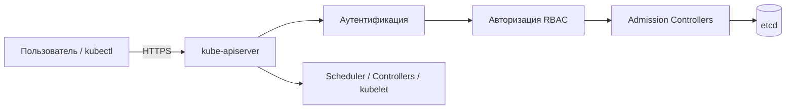

# Kubernetes API

1. [[#Что такое Kubernetes API|Что такое Kubernetes API]]
2. [[#Способы взаимодействия с API|Способы взаимодействия с API]]
3. [[#Discovery API: обнаружение ресурсов|Discovery API: обнаружение ресурсов]]
4. [[#OpenAPI: схемы и валидация|OpenAPI: схемы и валидация]]
5. [[#Сериализация: JSON и Protobuf|Сериализация: JSON и Protobuf]]
6. [[#Группы API и версионирование|Группы API и версионирование]]
	1. [[#Группы API и версионирование#Структура путей|Структура путей]]
	2. [[#Группы API и версионирование#Конвертация версий|Конвертация версий]]
7. [[#Жизненный цикл версий API|Жизненный цикл версий API]]
8. [[#Расширение API|Расширение API]]
	1. [[#Расширение API#CustomResourceDefinitions (CRD)|CustomResourceDefinitions (CRD)]]
	2. [[#Расширение API#Aggregation Layer|Aggregation Layer]]
9. [[#Практические команды|Практические команды]]

## Что такое Kubernetes API

**Kubernetes API** — это HTTP API, предоставляемый `kube-apiserver`, через который пользователи, компоненты кластера и внешние системы запрашивают и изменяют состояние объектов (Pod, Namespace, ConfigMap, Events и др.) . Все операции с кластером в конечном счёте сводятся к вызовам этого API; `kubectl`, `kubeadm` и другие инструменты являются его клиентами.

Управляющий слой Kubernetes построен вокруг API server: только он взаимодействует с etcd напрямую, а все остальные компоненты (scheduler, controller-manager, kubelet, kube-proxy) общаются через него .



## Способы взаимодействия с API

| Способ | Назначение |
|---|---|
| `kubectl` | Ручное управление, отладка, скрипты |
| Прямые REST-запросы | Низкоуровневая интеграция, кастомные инструменты |
| Клиентские библиотеки (`client-go`, `kubernetes-client`) | Разработка приложений |
| Динамические клиенты | Работа с ресурсами, неизвестными на этапе компиляции (CRD, операторы) |

Пример прямого запроса:

```bash
TOKEN=$(kubectl config view --raw -o jsonpath='{.users[*].user.token}')
curl -k -H "Authorization: Bearer $TOKEN" \
     -H "Accept: application/json" \
     https://<api-server>/api/v1/namespaces/default/pods
```

## Discovery API: обнаружение ресурсов

Kubernetes публикует перечень доступных групп, версий и ресурсов через Discovery API. Для каждого ресурса указываются имя, область видимости (cluster/namespaced), URL эндпоинта, поддерживаемые verbs, альтернативные имена, а также group/version/kind .

Discovery доступен в двух формах:

| Форма | Эндпоинты | Особенности |
|---|---|---|
| **Агрегированная** (стабильна с v1.30) | `/api`, `/apis` с заголовком `Accept: application/json;v=v2;g=apidiscovery.k8s.io;as=APIGroupDiscoveryList` | Все ресурсы за 1–2 запроса; поддерживает ETag и protobuf |
| **Неагрегированная** | `/api`, `/apis`, затем `/apis/<group>/<version>` | Иерархическая: сначала список групп/версий, затем отдельный запрос на каждую группу |

Без специального `Accept` заголовка `/api` и `/apis` возвращают неагрегированный документ .

```bash
kubectl api-resources
kubectl api-versions
kubectl explain pod
```

## OpenAPI: схемы и валидация

API server публикует OpenAPI-спецификации, используемые для генерации клиентов, валидации и документации.

| Характеристика | OpenAPI v2 | OpenAPI v3 |
|---|---|---|
| Эндпоинт | `/openapi/v2` | `/openapi/v3` |
| Статус | Стабильно | Стабильно с v1.27  |
| Полнота | Частичная: теряются `default`, `nullable`, `oneOf` | Полная (lossless) для CRD и встроенных типов  |
| Кэширование | Стандартные HTTP-заголовки | Неизменяемые URL с хешем, `Cache-Control: immutable`  |

OpenAPI v3 предпочтителен для новых инструментов. Спецификация v2 всё ещё поддерживается для обратной совместимости .

**Ограничение валидации**: правила, публикуемые в OpenAPI-схемах, неполны. Окончательная проверка выполняется внутри API server, включая admission-контроллеры. Для точной проверки используйте серверный dry-run :

```bash
kubectl apply -f manifest.yaml --dry-run=server
```

## Сериализация: JSON и Protobuf

| Формат | Применение |
|---|---|
| JSON | Внешние клиенты, `kubectl`, отладка; человекочитаемый |
| Protobuf | Внутрикластерная коммуникация; компактнее и быстрее |

Protobuf-сериализация предназначена в первую очередь для взаимодействия компонентов внутри кластера. IDL-файлы схем находятся в Go-пакетах, определяющих API-объекты .

## Группы API и версионирование

### Структура путей

```text
/api/v1/...                                    # core group (без имени)
/apis/<group>/<version>/...                    # именованные группы
/apis/apps/v1/namespaces/default/deployments
/apis/networking.k8s.io/v1/ingresses
```

Группы API позволяют расширять Kubernetes и независимо управлять версиями. Core-группа находится по пути `/api/v1` и в `apiVersion: v1` не указывается .

### Конвертация версий

API server прозрачно конвертирует версии: все версии представляют одни и те же сохранённые данные. Объект, созданный через `v1beta1`, можно читать и обновлять через `v1` до тех пор, пока `v1beta1` не будет удалён .

## Жизненный цикл версий API

| Стадия | Гарантии | Рекомендации |
|---|---|---|
| **Alpha** (`v1alpha1`) | Может быть удалена в любом релизе; несовместимые изменения | Только тестирование |
| **Beta** (`v1beta1`) | Максимальный срок жизни: 9 месяцев или 3 minor-релиза до deprecation, и столько же до удаления  | Допустимо в production при готовности к миграции |
| **GA** (`v1`) | Полная обратная совместимость; не удаляется в рамках major-версии | Безопасно для production |
| **Deprecated** | Функционирует, но запросы возвращают `Warning` header и метрику `apiserver_requested_deprecated_apis`  | Планировать миграцию |
| **Removed** | API больше не обслуживается | Обязательный переход |

## Расширение API

### CustomResourceDefinitions (CRD)

CRD позволяет декларативно определить новый тип ресурса, который API server будет обслуживать наравне со встроенными. Схема CRD задаётся в формате OpenAPI v3 (structural schema) .

```yaml
apiVersion: apiextensions.k8s.io/v1
kind: CustomResourceDefinition
metadata:
  name: myapps.example.com
spec:
  group: example.com
  versions:
    - name: v1
      served: true
      storage: true
      schema:
        openAPIV3Schema:
          type: object
          properties:
            spec:
              type: object
              properties:
                replicas: { type: integer }
  scope: Namespaced
  names:
    plural: myapps
    singular: myapp
    kind: MyApp
```

### Aggregation Layer

Aggregation Layer позволяет подключить внешний API-сервер к основному API Kubernetes через `APIService`. Внешний сервер наследует аутентификацию и авторизацию кластера. Пример реализации — Metrics Server.

## Практические команды

```bash
# Проверка доступных ресурсов и версий
kubectl api-resources --output=wide
kubectl api-versions

# Серверная валидация перед применением
kubectl apply -f manifest.yaml --dry-run=server

# Прямой запрос к Discovery
curl -k -H "Authorization: Bearer $TOKEN" \
     https://<api-server>/apis/apps/v1

# Получение OpenAPI v3
curl -k -H "Authorization: Bearer $TOKEN" \
     https://<api-server>/openapi/v3
```
