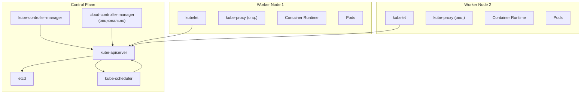

# Архитектура кластера Kubernetes


1. [[#Общая модель|Общая модель]]
2. [[#Компоненты плоскости управления|Компоненты плоскости управления]]
	1. [[#Компоненты плоскости управления#Примечание о cloud-controller-manager|Примечание о cloud-controller-manager]]
3. [[#Компоненты узлов|Компоненты узлов]]
4. [[#Add-ons|Add-ons]]
5. [[#Варианты развёртывания плоскости управления|Варианты развёртывания плоскости управления]]
6. [[#Размещение рабочих нагрузок|Размещение рабочих нагрузок]]
7. [[#Гибкость и расширяемость|Гибкость и расширяемость]]
8. [[#Диагностика кластера|Диагностика кластера]]

---
## Общая модель

Кластер Kubernetes состоит из **плоскости управления (control plane)** и набора **рабочих машин — узлов (nodes)**, на которых выполняются контейнеризованные приложения. Каждому кластеру нужен как минимум один рабочий узел для запуска Pod'ов .

Плоскость управления принимает глобальные решения о кластере (например, планирование) и реагирует на события (например, запускает новый Pod, когда поле `replicas` у Deployment не удовлетворено). В production плоскость управления обычно распределена между несколькими машинами, а кластер содержит несколько узлов — это обеспечивает отказоустойчивость и высокую доступность .



## Компоненты плоскости управления

Компоненты плоскости управления могут работать на любой машине кластера; для простоты установочные скрипты часто размещают их все на одной машине и не запускают там пользовательские контейнеры .

| Компонент                    | Роль                                                                                                                                                                                                                                                                                                                                                                                                                                                                                             |
| ---------------------------- | ------------------------------------------------------------------------------------------------------------------------------------------------------------------------------------------------------------------------------------------------------------------------------------------------------------------------------------------------------------------------------------------------------------------------------------------------------------------------------------------------ |
| **kube-apiserver**           | Предоставляет Kubernetes API и является фронтендом плоскости управления. Обрабатывает REST-запросы, выполняет аутентификацию, авторизацию, валидацию и admission-контроль. Проектируется для горизонтального масштабирования: можно запускать несколько экземпляров и балансировать трафик между ними                                                                                                                                                                                            |
| **etcd**                     | Согласованное и высокодоступное key-value хранилище — резервное хранилище всех данных кластера. Требует наличия плана резервного копирования                                                                                                                                                                                                                                                                                                                                                     |
| **kube-scheduler**           | Наблюдает за новыми Pod'ами без назначенного узла и выбирает для них узел. Учитывает индивидуальные и коллективные требования к ресурсам, аппаратные/программные/политические ограничения, affinity и anti-affinity, локальность данных, интерференцию рабочих нагрузок и дедлайны                                                                                                                                                                                                               |
| **kube-controller-manager**  | Запускает процессы контроллеров. Логически каждый контроллер — отдельный процесс, но для снижения сложности они скомпилированы в один бинарник и работают в одном процессе. **Примеры контроллеров**: `Node controller` (реагирует на недоступность узлов), `Job controller` (создаёт Pod'ы для выполнения Job до завершения), `EndpointSlice controller` (заполняет EndpointSlice для связи Service и Pod'ов), `ServiceAccount controller` (создаёт default ServiceAccount для новых namespace) |
| **cloud-controller-manager** | Встраивает логику, специфичную для облачного провайдера, и отделяет компоненты, взаимодействующие с облачной платформой, от компонентов, работающих только с кластером. Отсутствует в локальных и учебных кластерах . К контроллерам с облачными зависимостями относятся Node controller (проверка, удалён ли узел в облаке), Route controller (настройка маршрутов) и Service controller (создание, обновление и удаление облачных балансировщиков нагрузки)                                    |

### Примечание о cloud-controller-manager

Как и `kube-controller-manager`, `cloud-controller-manager` объединяет несколько логически независимых циклов управления в один бинарник, запускаемый как один процесс. Его можно горизонтально масштабировать для повышения производительности или отказоустойчивости .

## Компоненты узлов

Компоненты узлов работают на каждом узле, поддерживая запущенные Pod'ы и обеспечивая среду выполнения Kubernetes .

| Компонент | Роль |
|---|---|
| **kubelet** | Агент, работающий на каждом узле. Получает набор PodSpec (через различные механизмы) и гарантирует, что описанные в них контейнеры запущены и здоровы. **Не управляет контейнерами, созданными вне Kubernetes**  |
| **kube-proxy** (опционально) | Сетевой прокси, работающий на каждом узле и реализующий часть концепции Service. Поддерживает сетевые правила, позволяющие сетевым сессиям внутри или вне кластера взаимодействовать с Pod'ами. Использует уровень фильтрации пакетов ОС, если он доступен; иначе перенаправляет трафик сам . **Если используется сетевой плагин, который сам реализует перенаправление пакетов для Service с эквивалентным поведением, kube-proxy на узлах не требуется**  |
| **Container Runtime** | Фундаментальный компонент, обеспечивающий выполнение контейнеров и управление их жизненным циклом. Kubernetes поддерживает containerd, CRI-O и любые другие реализации CRI (Container Runtime Interface)  |

## Add-ons

Add-ons используют ресурсы Kubernetes (DaemonSet, Deployment и др.) для реализации функций уровня кластера. Поскольку это кластерные функции, namespaced-ресурсы add-ons обычно размещаются в namespace `kube-system` .

| Add-on | Назначение |
|---|---|
| **DNS** | Хотя остальные add-ons не являются строго обязательными, все кластеры Kubernetes должны иметь cluster DNS, так как многие примеры на него полагаются. Это DNS-сервер, обслуживающий DNS-записи для сервисов Kubernetes; контейнеры автоматически включают его в свои DNS-поиски  |
| **Web UI (Dashboard)** | Веб-интерфейс общего назначения для управления и диагностики приложений и самого кластера  |
| **Container resource monitoring** | Записывает общие time-series метрики о контейнерах в центральную базу данных и предоставляет UI для просмотра  |
| **Cluster-level logging** | Сохраняет логи контейнеров в центральное хранилище с интерфейсом поиска и просмотра  |
| **Network plugins** | Реализуют спецификацию CNI (Container Network Interface): выделяют Pod'ам IP-адреса и обеспечивают их взаимодействие внутри кластера  |

## Варианты развёртывания плоскости управления

| Вариант | Описание |
|---|---|
| **Traditional** | Компоненты плоскости управления работают напрямую на выделенных машинах или VM, часто как systemd-сервисы |
| **Static Pods** | Компоненты плоскости управления развёрнуты как статические Pod'ы, управляемые kubelet на определённых узлах. Типичный подход для kubeadm |
| **Self-hosted** | Плоскость управления работает как Pod'ы внутри самого кластера под управлением Deployment, StatefulSet или других примитивов Kubernetes |
| **Managed Kubernetes services** | Облачные провайдеры абстрагируют плоскость управления, управляя её компонентами в рамках своей услуги |

## Размещение рабочих нагрузок

Размещение компонентов плоскости управления и пользовательских нагрузок зависит от размера кластера, требований к производительности и операционных политик:

- В небольших или development-кластерах компоненты плоскости управления и пользовательские нагрузки могут работать на одних узлах.
- Крупные production-кластеры часто выделяют специальные узлы для плоскости управления, отделяя их от пользовательских нагрузок.
- Некоторые организации запускают критичные add-ons или инструменты мониторинга на узлах плоскости управления.

## Гибкость и расширяемость

Архитектура Kubernetes допускает значительную кастомизацию:

- **Пользовательские планировщики** могут работать параллельно со стандартным `kube-scheduler` или заменять его.
- **API-сервер** может расширяться через CustomResourceDefinitions и API Aggregation.
- **Облачные провайдеры** могут глубоко интегрироваться с Kubernetes через `cloud-controller-manager`.

## Диагностика кластера

```bash
# Статус узлов
kubectl get nodes -o wide

# Компоненты плоскости управления (в managed-кластерах могут быть недоступны)
kubectl get pods -n kube-system

# Версии container runtime и kubelet
kubectl get nodes -o jsonpath='{.items[*].status.nodeInfo.containerRuntimeVersion}'
kubectl get nodes -o jsonpath='{.items[*].status.nodeInfo.kubeletVersion}'
```
