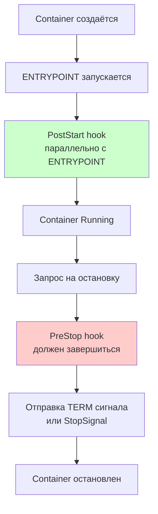

# Хуки жизненного цикла контейнеров (Container Lifecycle Hooks)


1. [[#Обзор|Обзор]]
2. [[#Хуки, доступные контейнерам|Хуки, доступные контейнерам]]
	1. [[#Хуки, доступные контейнерам#PostStart|PostStart]]
	2. [[#Хуки, доступные контейнерам#PreStop|PreStop]]
	3. [[#Хуки, доступные контейнерам#StopSignal|StopSignal]]
3. [[#Типы обработчиков хуков|Типы обработчиков хуков]]
4. [[#Выполнение обработчиков хуков|Выполнение обработчиков хуков]]
5. [[#Гарантии доставки|Гарантии доставки]]
6. [[#Отладка обработчиков хуков|Отладка обработчиков хуков]]

---
## Обзор

По аналогии со многими программными фреймворками, имеющими хуки жизненного цикла компонентов (например, Angular), Kubernetes предоставляет контейнерам lifecycle hooks. Хуки позволяют контейнерам узнавать о событиях в своём управляемом жизненном цикле и запускать код, реализованный в обработчике, при выполнении соответствующего хука .



## Хуки, доступные контейнерам

### PostStart

Выполняется сразу после создания контейнера. **Запускается параллельно с ENTRYPOINT (основным процессом) контейнера**, то есть хук может выполняться до, во время или после старта основного процесса. Параметры в обработчик не передаются .

**Важное следствие**: поскольку хук выполняется параллельно с процессом контейнера, он может задерживать обновление статуса контейнера — контейнер может не перейти в состояние `Running`, пока хук не завершится .

**Практический вывод**: обычно не имеет смысла использовать HTTP-хук для `PostStart`, так как нет гарантии, что процесс контейнера полностью запустится к моменту выполнения хука. Если `PostStart` выполняется слишком долго или зависает, это может помешать контейнеру перейти в состояние `running` .

### PreStop

Вызывается непосредственно перед завершением контейнера — по API-запросу или управляющему событию (сбой liveness/startup probe, вытеснение, конкуренция за ресурсы и т.п.). Вызов `PreStop` завершается ошибкой, если контейнер уже находится в состоянии terminated или completed. Хук **должен завершиться до того, как может быть отправлен сигнал TERM** для остановки контейнера. Параметры в обработчик не передаются .

**Отсчёт grace period начинается до выполнения PreStop**: обратный отсчёт `terminationGracePeriodSeconds` Pod'а начинается **до** выполнения `PreStop`, поэтому независимо от результата обработчика контейнер в конечном итоге будет завершён в пределах grace period Pod'а .

**PreStop не выполняется асинхронно относительно сигнала остановки**: хук должен завершить выполнение до отправки TERM. Если `PreStop` зависает, фаза Pod'а становится `Terminating` и остаётся таковой, пока Pod не будет убит по истечении `terminationGracePeriodSeconds`. Grace period применяется к **суммарному времени** выполнения `PreStop` и нормальной остановки контейнера. Пример: если `terminationGracePeriodSeconds` = 60, хук занимает 55 секунд, а контейнер после получения сигнала останавливается за 10 секунд, контейнер будет убит до нормальной остановки, так как 55+10 > 60 .

**Если PostStart или PreStop завершается ошибкой — контейнер убивается** .

Пользователям следует делать обработчики хуков настолько лёгкими, насколько возможно. Однако бывают случаи, когда длительные команды оправданы — например, сохранение состояния перед остановкой контейнера .

### StopSignal

Позволяет определить сигнал остановки, который будет отправлен контейнеру при его остановке. Если задан, переопределяет любую инструкцию `STOPSIGNAL`, определённую в образе контейнера .

## Типы обработчиков хуков

Контейнеры могут реализовать и зарегистрировать обработчик для хука. Доступны три типа обработчиков :

| Тип | Описание | Особенности |
|---|---|---|
| **Exec** | Выполняет конкретную команду (например, `pre-stop.sh`) внутри cgroups и namespaces контейнера | Ресурсы, потребляемые командой, учитываются в счёт контейнера |
| **HTTP** | Выполняет HTTP-запрос к конкретному эндпоинту на контейнере | — |
| **Sleep** | Приостанавливает контейнер на указанную длительность | Beta-функция, включена по умолчанию с v1.30; с v1.33 поддерживает нулевую длительность (feature gate `PodLifecycleSleepActionAllowZero` включён по умолчанию)  |

**Важно о `tcpSocket`**: `tcpSocket` указан как **deprecated** в документации. Он не поддерживается как LifecycleHandler и сохранён только для обратной совместимости. Валидация этого поля отсутствует, и lifecycle hooks завершатся ошибкой в runtime, если указан tcp-обработчик .

## Выполнение обработчиков хуков

При вызове хука управления жизненным циклом контейнера система управления Kubernetes выполняет обработчик согласно действию хука. `httpGet`, `tcpSocket` (deprecated) и `sleep` выполняются процессом **kubelet**, а `exec` — **внутри контейнера** .

## Гарантии доставки

Доставка хуков имеет семантику **at least once** (как минимум один раз): хук может быть вызван несколько раз для любого заданного события, например `PostStart` или `PreStop`. Корректная обработка этого лежит на реализации хука .

Обычно выполняется только однократная доставка. Например, если HTTP-приёмник хука недоступен и не может принимать трафик, повторная отправка не предпринимается. Однако в редких случаях возможна двойная доставка: например, если kubelet перезапускается в середине отправки хука, хук может быть отправлен повторно после восстановления kubelet .

## Отладка обработчиков хуков

**Логи обработчика хука не отображаются в событиях Pod'а**. Если обработчик завершается ошибкой, он генерирует событие: для `PostStart` — `FailedPostStartHook`, для `PreStop` — `FailedPreStopHook` .

Пример вывода событий при неудачном `PostStart` (команда `badcommand`) :

```
Events:
  Type     Reason               Age              From               Message
  ----     ------               ----             ----               -------
  Normal   Scheduled            7s               default-scheduler  Successfully assigned default/lifecycle-demo to ip-XXX...
  Normal   Pulled               6s               kubelet            Successfully pulled image "nginx" in 229.604315ms
  Normal   Pulling              4s (x2 over 6s)  kubelet            Pulling image "nginx"
  Normal   Created              4s (x2 over 5s)  kubelet            Created container lifecycle-demo-container
  Normal   Started              4s (x2 over 5s)  kubelet            Started container lifecycle-demo-container
  Warning  FailedPostStartHook  4s (x2 over 5s)  kubelet            Exec lifecycle hook ([badcommand]) for Container "lifecycle-demo-container" in Pod "lifecycle-demo_default(...)" failed - error: command 'badcommand' exited with 126: ...
  Normal   Killing              4s (x2 over 5s)  kubelet            FailedPostStartHook
  Warning  BackOff              2s (x2 over 3s)  kubelet            Back-off restarting failed container
```
