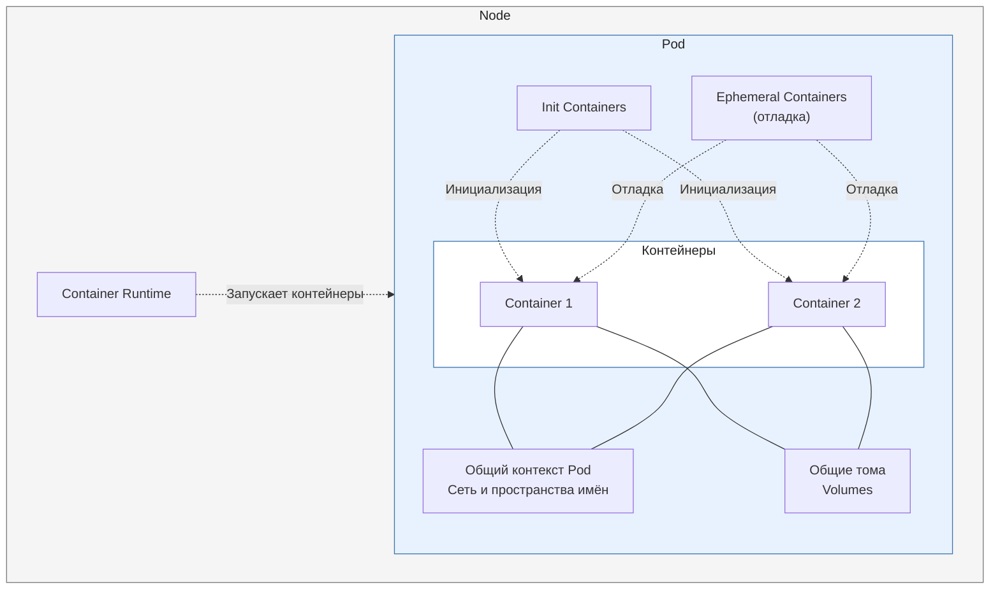
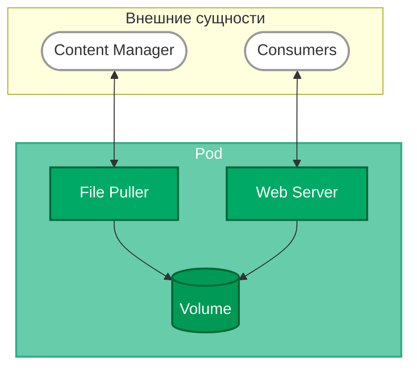

# Pods

> **Pods** — это наименьшие развёртываемые единицы вычислений, которые можно создавать и которыми можно управлять в Kubernetes.

---

1. [[#Концептуальная архитектура|Концептуальная архитектура]]
2. [[#Что такое Pod?|Что такое Pod?]]
3. [[#Использование Pods|Использование Pods]]
	1. [[#Использование Pods#Пример Pod'а, состоящего из контейнера с образом `nginx:1.14.2`.|Пример Pod'а, состоящего из контейнера с образом `nginx:1.14.2`.]]
	2. [[#Использование Pods#Ресурсы рабочих нагрузок для управления Pods|Ресурсы рабочих нагрузок для управления Pods]]
4. [[#Работа с Pods|Работа с Pods]]
	1. [[#Работа с Pods#Операционная система Pod|Операционная система Pod]]
	2. [[#Работа с Pods#Pods и контроллеры|Pods и контроллеры]]
	3. [[#Работа с Pods#Указание группы планирования|Указание группы планирования]]
	4. [[#Работа с Pods#Шаблоны Pod|Шаблоны Pod]]
5. [[#Обновление и замена Pod|Обновление и замена Pod]]
	1. [[#Обновление и замена Pod#Подресурсы Pod|Подресурсы Pod]]
	2. [[#Обновление и замена Pod#Pod generation|Pod generation]]
		1. [[#Pod generation#Прямые обновления статуса|Прямые обновления статуса]]
		2. [[#Pod generation#Косвенные обновления статуса|Косвенные обновления статуса]]
6. [[#Совместное использование ресурсов и взаимодействие|Совместное использование ресурсов и взаимодействие]]
	1. [[#Совместное использование ресурсов и взаимодействие#Хранилище в Pods|Хранилище в Pods]]
	2. [[#Совместное использование ресурсов и взаимодействие#Сетевое взаимодействие Pod|Сетевое взаимодействие Pod]]
7. [[#Настройки безопасности Pod|Настройки безопасности Pod]]
8. [[#Запросы ресурсов и ограничения|Запросы ресурсов и ограничения]]
9. [[#Статические Pods|Статические Pods]]
10. [[#Pods с несколькими контейнерами|Pods с несколькими контейнерами]]
11. [[#Пробы контейнеров|Пробы контейнеров]]

---
## Концептуальная архитектура

**Pod** — это объект Kubernetes, объединяющий один или несколько контейнеров, которые размещаются на одном узле и запускаются в общем контексте. Он моделирует «логический хост» для приложения, предоставляя контейнерам возможность совместно использовать сетевые ресурсы и тома.

Помимо основных контейнеров приложения, Pod может содержать `init`-контейнеры, которые выполняются до запуска контейнеров приложения, и эфемерные контейнеры, предназначенные для отладки работающего Pod.



---
## Что такое Pod?

> [!TIP] Примечание
> Для запуска Pods на узлах кластера на каждом узле необходимо установить среду выполнения контейнеров.

Общий контекст Pod включает пространства имён Linux, группы управления (`cgroups`) и другие механизмы изоляции и управления ресурсами. При этом отдельные контейнеры могут иметь дополнительные уровни изоляции.

В Kubernetes Pods используются двумя основными способами:

- Pod с одним контейнером. Наиболее распространённая модель использования Kubernetes. Pod служит оболочкой для контейнера, а Kubernetes управляет Pods, а не отдельными контейнерами напрямую.

- Pod с несколькими взаимодействующими контейнерами. Объединяет тесно связанные контейнеры, которым необходимо совместное размещение и доступ к общим ресурсам. Они образуют единую согласованно работающую единицу.

  > Объединение нескольких контейнеров в один Pod — относительно сложный сценарий. Используйте этот подход только при тесной взаимосвязи контейнеров.
  > 
    > Для репликации не требуется запускать несколько контейнеров в одном Pod. Для повышения отказоустойчивости или пропускной способности можно использовать несколько реплик. Подробнее см. раздел «[[01.workload_management|Управление рабочими нагрузками]]»..

---
## Использование Pods

### Пример Pod'а, состоящего из контейнера с образом `nginx:1.14.2`.

```yaml
apiVersion: v1
kind: Pod
metadata:
  name: nginx
spec:
  containers:
  - name: nginx
    image: nginx:1.14.2
    ports:
    - containerPort: 80
```

Чтобы создать Pod, выполняется команда:

```bash
kubectl apply -f https://k8s.io/examples/pods/simple-pod.yaml
```

> Как правило, Pods не создают напрямую, а используют для этого ресурсы рабочих нагрузок.

### Ресурсы рабочих нагрузок для управления Pods

Обычно Pods не создают напрямую, даже если Pod содержит только один контейнер. Вместо этого используют ресурсы рабочих нагрузок, такие как `Deployment` или `Job`. Если приложению необходимо сохранять состояние, используют `StatefulSet`.

Каждый Pod предназначен для запуска одного экземпляра приложения. Для горизонтального масштабирования запускают дополнительные Pods — по одному на каждый экземпляр. В Kubernetes это называется репликацией. Обычно реплицируемые Pods создаются и управляются как группа с помощью ресурса рабочей нагрузки и его контроллера.

Подробнее о том, как ресурсы рабочих нагрузок и их контроллеры обеспечивают масштабирование приложений и автоматическое восстановление после сбоев, см. раздел «[[#Pods и контроллеры]]».

Pods предоставляют входящим в них контейнерам два общих ресурса: сеть и хранилище.

---
## Работа с Pods

Pods предназначены для относительно недолговечного использования и могут быть удалены в любой момент. После создания Pod — напрямую пользователем или через контроллер — планировщик назначает его узлу кластера. Pod остаётся на этом узле, пока не завершит выполнение, не будет удалён или вытеснен из-за нехватки ресурсов либо узел не выйдет из строя.

>[!TIP] Примечание
 Перезапуск контейнера не означает перезапуск Pod. Pod — не процесс, а среда для выполнения одного или нескольких контейнеров. Он существует, пока его объект не будет удалён.

Имя Pod должно соответствовать формату допустимого DNS-поддомена, однако это может приводить к неожиданным результатам при формировании имени хоста. Для лучшей совместимости рекомендуется использовать более строгие правила DNS-метки.

### Операционная система Pod

> **Состояние функции:** *стабильная начиная с Kubernetes v1.25.*

В поле `.spec.os.name` укажите `windows` или `linux`, чтобы обозначить операционную систему, для которой предназначены контейнеры Pod. На данный момент Kubernetes поддерживает только эти две ОС.

Kubelet отказывается запускать Pod, если значение `.spec.os.name` не соответствует ОС узла. Однако в Kubernetes v1.37 это поле не влияет на выбор узла планировщиком `kube-scheduler`.

Если кластер содержит узлы с разными ОС, задайте на каждом узле метку `kubernetes.io/os` и укажите в `nodeSelector` Pod требуемое значение этой метки. Без такого ограничения планировщик может назначить Pod узлу с несовместимой ОС.

Стандарты безопасности Pod также учитывают `.spec.os.name`, чтобы не применять политики, не относящиеся к указанной ОС.

### Pods и контроллеры

Ресурсы рабочих нагрузок позволяют создавать и управлять группами Pods. Контроллер отвечает за репликацию, обновление и автоматическое восстановление после сбоев. Например, если узел выходит из строя, контроллер обнаруживает, что размещённые на нём Pods перестали работать, и создаёт замену. Планировщик назначает новый Pod исправному узлу.

Примеры ресурсов рабочих нагрузок, управляющих одним или несколькими Pods:

- `Deployment`
- `StatefulSet`
- `DaemonSet`

### Указание группы планирования

> **Состояние функции:** бета-версия начиная с Kubernetes v1.37; по умолчанию отключена.

По умолчанию Kubernetes планирует каждый Pod отдельно. Однако некоторым тесно связанным приложениям требуется, чтобы группа Pods планировалась одновременно для корректной работы.

Pod можно связать с `PodGroup` с помощью *поля группы планирования (`spec.schedulingGroup`)*. Это сообщает `kube-scheduler`, что Pod принадлежит определённой группе, и позволяет планировщику согласованно принимать решения о размещении всей группы одновременно.

### Шаблоны Pod

Контроллеры ресурсов рабочих нагрузок создают и управляют Pods на основе шаблона Pod от имени пользователя.

**PodTemplate** — это спецификация создания Pods, включаемая в ресурсы рабочих нагрузок, такие как `Deployment`, `Job` и `DaemonSet`. Контроллер использует этот шаблон для создания Pods, соответствующих желаемому состоянию ресурса.

В шаблоне также можно задать переменные окружения для контейнеров, которые будут запускаться в Pod.

Ниже приведён манифест **Job** с шаблоном `template`, запускающим один контейнер. Контейнер выводит сообщение, а затем приостанавливает выполнение.

```yaml
apiVersion: batch/v1
kind: Job
metadata:
  name: hello
spec:
  template:
    # This is the pod template
    spec:
      containers:
      - name: hello
        image: busybox:1.28
        command: ['sh', '-c', 'echo "Hello, Kubernetes!" && sleep 3600']
      restartPolicy: OnFailure
    # The pod template ends here
```

*Изменение шаблона Pod или переход на новый шаблон не влияет напрямую на уже существующие Pods.* При изменении шаблона в ресурсе рабочей нагрузки контроллер создаёт новые Pods на его основе.

Например, контроллер `StatefulSet` обеспечивает соответствие работающих Pods текущему шаблону Pod. *Если шаблон изменяется*, контроллер начинает *создавать новые Pods на его основе*. В конечном итоге старые Pods заменяются новыми, и обновление завершается.

Каждый ресурс рабочей нагрузки обрабатывает изменения шаблона Pod по собственным правилам. Подробнее о `StatefulSet` см. раздел «Стратегия обновления» в руководстве по основам StatefulSet.

На узлах `kubelet` не отслеживает и не управляет непосредственно шаблонами Pod и их обновлениями: эти аспекты от него скрыты. Такое разделение ответственности упрощает семантику системы и позволяет расширять поведение кластера без изменения существующего кода.

---
## Обновление и замена Pod

При изменении шаблона Pod в ресурсе рабочей нагрузки контроллер создаёт новые Pods на основе обновлённого шаблона, а не обновляет существующие Pods и не применяет к ним изменения частично.

Kubernetes не запрещает напрямую управлять Pods. Некоторые поля работающего Pod можно обновлять на месте. Однако операции обновления Pod, такие как `patch` и `replace`, имеют ряд ограничений:

- Большинство метаданных Pod неизменяемы. Например, нельзя изменить поля `namespace`, `name`, `uid` или `creationTimestamp`.
- Если задано `metadata.deletionTimestamp`, добавить новые элементы в список `metadata.finalizers` нельзя.
- При обновлении Pod нельзя изменять поля, кроме `spec.containers[*].image`, `spec.initContainers[*].image`, `spec.activeDeadlineSeconds`, `spec.terminationGracePeriodSeconds`, `spec.tolerations` и `spec.schedulingGates`. Для `spec.tolerations` разрешено только добавлять новые элементы.
- При обновлении поля `spec.activeDeadlineSeconds` допускаются два типа изменений:
    1. Установка ранее не заданного поля в положительное значение.
    2. Изменение положительного значения на меньшее неотрицательное значение.

### Pod subresources

Указанные выше правила относятся к обычному обновлению Pod. Другие поля Pod можно изменять с помощью подресурсов.

- Изменение размера: подресурс `resize` позволяет обновлять ресурсы контейнеров (`spec.containers[*].resources`). Подробнее см. раздел «[Изменение ресурсов контейнеров](https://kubernetes.io/docs/tasks/configure-pod-container/resize-container-resources/)».
- Эфемерные контейнеры: подресурс `ephemeralContainers` позволяет добавлять в Pod эфемерные контейнеры. Подробнее см. раздел «Эфемерные контейнеры».
- Статус: подресурс `status` позволяет обновлять статус Pod. Обычно его используют только kubelet и другие системные контроллеры.
- Привязка: подресурс `binding` позволяет задать `spec.nodeName` Pod с помощью запроса `Binding`. Обычно его использует только планировщик.

### Pod generation

- Поле `metadata.generation` уникально. Система задаёт его автоматически: новые Pods получают значение `metadata.generation`, равное 1, а при каждом обновлении изменяемых полей в спецификации Pod это значение увеличивается на 1.

> **Состояние функции:** *стабильная начиная с Kubernetes v1.35.*

- `observedGeneration` — поле в разделе `status` объекта Pod. Kubelet задаёт `status.observedGeneration`, чтобы отслеживать соответствие состояния Pod текущему статусу. Значение `status.observedGeneration` отражает значение `metadata.generation` на момент формирования отчёта о состоянии Pod.

>[!TIP] Примечание
  Полем `status.observedGeneration` управляет kubelet. Внешние контроллеры не должны изменять это поле.

Разные поля статуса могут быть связаны либо со значением `metadata.generation` текущего цикла синхронизации, либо со значением предыдущего цикла. Ключевое различие заключается в том, отражается ли изменение `spec` непосредственно в `status` или является косвенным результатом работы запущенного процесса.

#### Прямые обновления статуса

Для полей статуса, непосредственно отражающих назначенную спецификацию, `observedGeneration` соответствует текущему значению `metadata.generation` (поколение N).

Это поведение относится к следующим полям:

- Статус изменения размера: состояние операции изменения размера ресурсов.
- Выделенные ресурсы: ресурсы, выделенные Pod после изменения размера.
- Эфемерные контейнеры: ситуация, когда добавлен новый эфемерный контейнер, находящийся в состоянии `Waiting`.

#### Косвенные обновления статуса

Для полей статуса, которые являются косвенным результатом выполнения спецификации, `observedGeneration` соответствует значению `metadata.generation`предыдущего цикла синхронизации (поколение N-1).

Это поведение относится к следующим полям:

- Образ контейнера: `ContainerStatus.ImageID` отражает образ предыдущего поколения, пока новый образ не будет загружен и контейнер не будет обновлён.
- Фактические ресурсы: во время выполнения изменения размера фактически используемые ресурсы по-прежнему соответствуют запросу предыдущего поколения.
- Состояние контейнера: во время изменения размера при политике перезапуска, требующей перезапуска, состояние контейнера отражает запрос предыдущего поколения.
- `activeDeadlineSeconds`, `terminationGracePeriodSeconds` и `deletionTimestamp`: влияние этих полей на статус Pod является результатом ранее наблюдавшейся спецификации.

---
## Совместное использование ресурсов и взаимодействие

Pods позволяют входящим в них контейнерам обмениваться данными и взаимодействовать друг с другом.

### Хранилище в Pods

В Pod можно указать набор общих томов хранения. Все контейнеры Pod могут обращаться к этим томам и обмениваться данными. Томы также позволяют сохранять данные Pod при перезапуске одного из его контейнеров. Подробнее о реализации общего хранилища в Kubernetes и его предоставлении Pods см. раздел «[Хранилище](https://kubernetes.io/docs/concepts/storage/)».

### Сетевое взаимодействие Pod

Каждому Pod назначается уникальный IP-адрес для каждого семейства адресов. Все контейнеры Pod используют общее сетевое пространство имён, включая IP-адрес и сетевые порты. Внутри Pod — и только внутри него — контейнеры могут взаимодействовать друг с другом через `localhost`. При взаимодействии с объектами за пределами Pod контейнеры должны согласовывать использование общих сетевых ресурсов, например портов. Контейнеры Pod используют общее пространство IP-адресов и портов и могут находить друг друга через `localhost`.

Контейнеры Pod также могут взаимодействовать с помощью стандартных средств межпроцессного взаимодействия, например семафоров SystemV или разделяемой памяти POSIX. Контейнеры в разных Pods имеют разные IP-адреса и не могут взаимодействовать с помощью IPC на уровне операционной системы без специальной настройки. Для взаимодействия с контейнером в другом Pod можно использовать IP-сеть.

Внутри Pod все контейнеры видят системное имя хоста, совпадающее со значением `name`, заданным для Pod. Подробнее об этом см. раздел «[Сетевое взаимодействие](https://kubernetes.io/docs/concepts/cluster-administration/networking/)».

---
## Настройки безопасности Pod

Для задания ограничений безопасности Pods и контейнеров используется поле `securityContext` в спецификации Pod. Оно позволяет гибко управлять действиями, доступными Pod или отдельным контейнерам. Подробнее см. раздел «Расширенная настройка Pod».

Для базовой настройки безопасности следует соблюдать базовый стандарт безопасности Pod и запускать контейнеры не от имени root. Пример простой настройки контекста безопасности:

```yaml
apiVersion: v1
kind: Pod
metadata:
  name: security-context-demo
spec:
  securityContext:
    runAsUser: 1000
    runAsGroup: 3000
    fsGroup: 2000
  containers:
  - name: sec-ctx-demo
    image: busybox
    command: ["sh", "-c", "sleep 1h"]
```

Подробнее о расширенной настройке контекста безопасности, включая `capabilities`, профили `seccomp` и дополнительные параметры безопасности, см. раздел «Концепции безопасности».

- Информацию об ограничениях безопасности на уровне ядра см. в разделе «Ограничения безопасности ядра Linux для Pods и контейнеров».
- Подробнее о контексте безопасности Pod см. в разделе «Настройка контекста безопасности для Pod или контейнера».
---
## Запросы ресурсов и ограничения

При описании Pod можно указать, сколько ресурсов требуется каждому контейнеру. Чаще всего указывают CPU и память (RAM).

При задании запроса ресурсов для контейнеров Pod планировщик `kube-scheduler` использует эту информацию, чтобы выбрать узел для размещения Pod. При задании ограничения ресурсов для контейнера kubelet обеспечивает его соблюдение, не позволяя работающему контейнеру использовать больше ресурсов, чем разрешено.

Ограничения CPU обеспечиваются посредством ограничения времени процессора. Когда контейнер приближается к установленному лимиту CPU, ядро ограничивает доступ контейнера к процессорному времени. Ограничения памяти обеспечиваются ядром: если контейнер превышает лимит, он завершается из-за нехватки памяти `(OOM)`.

> [!TIP] Примечание
  Установка ограничений CPU предполагает компромисс. Такие ограничения помогают предотвращать ситуации, когда одна рабочая нагрузка чрезмерно потребляет ресурсы и лишает их другие нагрузки на том же узле. Это особенно важно в многопользовательских средах. Однако ограничения CPU могут вызывать ограничение процессорного времени даже при наличии свободных ресурсов CPU на узле, что потенциально ухудшает производительность рабочих нагрузок, чувствительных к задержкам. Решение об установке ограничений CPU зависит от среды, характеристик рабочей нагрузки и требований к изоляции.

Подробнее о единицах измерения ресурсов, механизмах обеспечения ограничений и примерах настройки см. раздел «[Управление ресурсами для Pods и контейнеров](https://kubernetes.io/docs/concepts/configuration/manage-resources-containers/)».

---
## Статические Pods

Статическими Pods напрямую управляет демон kubelet на определённом узле, без наблюдения за ними со стороны API-сервера. Большинство Pods управляются плоскостью управления, например через Deployment, а статическими Pods kubelet управляет напрямую и перезапускает их в случае сбоя.

Статические Pods всегда привязаны к одному экземпляру kubelet на определённом узле. Основное назначение статических Pods — запуск автономной плоскости управления, то есть использование kubelet для контроля отдельных компонентов плоскости управления.

---
## Pods с несколькими контейнерами

Pods предназначены для поддержки нескольких взаимодействующих процессов (в виде контейнеров), которые вместе образуют единую функциональную единицу. Контейнеры Pod автоматически размещаются и планируются к запуску на одной физической или виртуальной машине в кластере. Они могут совместно использовать ресурсы и зависимости, взаимодействовать друг с другом и согласовывать порядок и условия завершения работы.

Pods в кластере Kubernetes используются двумя основными способами:

- Pods с одним контейнером. Модель «один контейнер на Pod» — наиболее распространённый сценарий использования Kubernetes. В этом случае Pod можно рассматривать как оболочку для одного контейнера. Kubernetes управляет Pods, а не отдельными контейнерами напрямую.
- Pods с несколькими взаимодействующими контейнерами. Pod может объединять приложение, состоящее из нескольких совместно размещённых контейнеров, тесно связанных между собой и нуждающихся в общих ресурсах. Эти контейнеры образуют единую функциональную единицу, например когда один контейнер предоставляет пользователям данные из общего тома, а отдельный контейнер sidecar обновляет эти файлы. Pod объединяет контейнеры, ресурсы хранения и временную сетевую идентичность в единое целое.

Например, один контейнер может работать как веб-сервер, предоставляющий файлы из общего тома, а отдельный контейнер sidecar — обновлять эти файлы из удалённого источника, как показано на следующей схеме:



Некоторые Pods содержат init-контейнеры наряду с контейнерами приложения. По умолчанию init-контейнеры запускаются и завершаются до запуска контейнеров приложения.

Также можно использовать контейнеры **sidecar**, предоставляющие вспомогательные службы основному приложению Pod, например сетку сервисов `(service mesh)`.

> **Состояние функции:** *стабильная начиная с Kubernetes v1.33.*

Включённый по умолчанию механизм `SidecarContainers` позволяет задавать `restartPolicy: Always` для `init`-контейнеров. Эта политика перезапуска гарантирует, что соответствующие контейнеры будут рассматриваться как sidecar-контейнеры и продолжат работать в течение всего жизненного цикла Pod. Контейнеры, явно определённые как sidecar, запускаются до основного приложения Pod и продолжают работать до завершения работы Pod.

---
## Пробы контейнеров

Проба — это диагностическая проверка контейнера, которую kubelet выполняет периодически. Для диагностики kubelet может использовать разные действия:

- `ExecAction` (выполняется с помощью среды выполнения контейнеров).
- `TCPSocketAction` (проверяется непосредственно kubelet).
- `HTTPGetAction` (проверяется непосредственно kubelet).