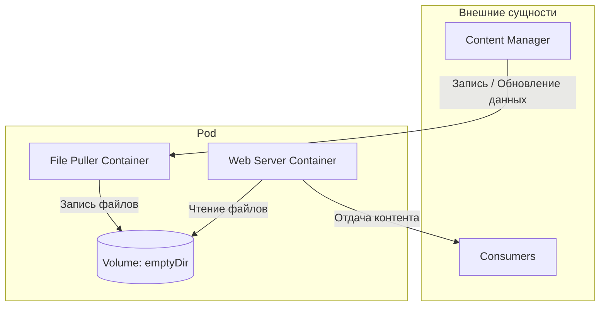

# Жизненный цикл Pod

> Здесь описан жизненный цикл Pod. Он следует определённой последовательности состояний: начинается с фазы `Pending`, переходит в `Running`, если хотя бы один из основных контейнеров успешно запускается, а затем — в `Succeeded` или `Failed` в зависимости от того, завершился ли какой-либо контейнер Pod с ошибкой.

---
1. [[#Архитектурные принципы|Архитектурные принципы]]
2. [[#Операционное управление и жизненный цикл|Операционное управление и жизненный цикл]]
	1. [[#Операционное управление и жизненный цикл#Модель планирования и привязки|Модель планирования и привязки]]
	2. [[#Операционное управление и жизненный цикл#Структура состояния в API|Структура состояния в API]]
	3. [[#Операционное управление и жизненный цикл#Поведение Pod при сбоях и механизмы восстановления|Поведение Pod при сбоях и механизмы восстановления]]
	4. [[#Операционное управление и жизненный цикл#Взаимосвязанный жизненный цикл зависимых объектов|Взаимосвязанный жизненный цикл зависимых объектов]]
	5. [[#Операционное управление и жизненный цикл#Архитектурная модель многоконтейнерного Pod|Архитектурная модель многоконтейнерного Pod]]
3. [[#Фаза Pod (Pod Phase)|Фаза Pod (Pod Phase)]]
	1. [[#Фаза Pod (Pod Phase)#Возможные значения фазы|Возможные значения фазы]]
	2. [[#Фаза Pod (Pod Phase)#Различие статуса и фазы|Различие статуса и фазы]]
	3. [[#Фаза Pod (Pod Phase)#Завершение и жизненный цикл|Завершение и жизненный цикл]]
4. [[#Состояния контейнеров|Состояния контейнеров]]
	1. [[#Состояния контейнеров#Waiting|Waiting]]
	2. [[#Состояния контейнеров#Running|Running]]
	3. [[#Состояния контейнеров#Terminated|Terminated]]
5. [[#Обработка сбоев контейнеров|Обработка сбоев контейнеров]]
	1. [[#Обработка сбоев контейнеров#Алгоритм обработки сбоев|Алгоритм обработки сбоев]]
	2. [[#Обработка сбоев контейнеров#Причины возникновения `CrashLoopBackOff`|Причины возникновения `CrashLoopBackOff`]]
	3. [[#Обработка сбоев контейнеров#Действия для выяснения причины `CrashLoopBackOff`|Действия для выяснения причины `CrashLoopBackOff`]]
6. [[#Перезапуск контейнеров|Перезапуск контейнеров]]
	1. [[#Перезапуск контейнеров#Перезапуск контейнеров и отказоустойчивость|Перезапуск контейнеров и отказоустойчивость]]
	2. [[#Перезапуск контейнеров#Политика перезапуска контейнеров на уровне Pod|Политика перезапуска контейнеров на уровне Pod]]
	3. [[#Перезапуск контейнеров#Сравнение поведения при перезапуске|Сравнение поведения при перезапуске]]
	4. [[#Перезапуск контейнеров#Примеры сценариев|Примеры сценариев]]
		1. [[#Примеры сценариев#Пример 1. Веб-сервер с `restartPolicy: Always` (типичный вариант для Deployment)|Пример 1. Веб-сервер с `restartPolicy: Always` (типичный вариант для Deployment)]]
		2. [[#Примеры сценариев#Пример 2. Пакетная задача с `restartPolicy: OnFailure`|Пример 2. Пакетная задача с `restartPolicy: OnFailure`]]
		3. [[#Примеры сценариев#Пример 3. Одноразовая задача с `restartPolicy: Never`|Пример 3. Одноразовая задача с `restartPolicy: Never`]]
	5. [[#Перезапуск контейнеров#Sidecar-контейнеры и политики перезапуска|Sidecar-контейнеры и политики перезапуска]]
		1. [[#Sidecar-контейнеры и политики перезапуска#Пример Pod с sidecar-контейнером|Пример Pod с sidecar-контейнером]]
	6. [[#Перезапуск контейнеров#Индивидуальные политики и правила перезапуска контейнеров|Индивидуальные политики и правила перезапуска контейнеров]]
		1. [[#Индивидуальные политики и правила перезапуска контейнеров#Примеры конфигурации|Примеры конфигурации]]
			1. [[#Примеры конфигурации#Перезапуск лишь определённых контейнеров Pod|Перезапуск лишь определённых контейнеров Pod]]
			2. [[#Примеры конфигурации#Завершение Pod при неудачной инициализации|Завершение Pod при неудачной инициализации]]
			3. [[#Примеры конфигурации#Различение ошибок по кодам завершения|Различение ошибок по кодам завершения]]
	7. [[#Перезапуск контейнеров#Перезапуск всех контейнеров|Перезапуск всех контейнеров]]
		1. [[#Перезапуск всех контейнеров#Как работает перезапуск Pod на месте|Как работает перезапуск Pod на месте]]
		2. [[#Перезапуск всех контейнеров#Пример конфигурации|Пример конфигурации]]
	8. [[#Перезапуск контейнеров#Уменьшение задержки перезапуска контейнеров|Уменьшение задержки перезапуска контейнеров]]
	9. [[#Перезапуск контейнеров#Настраиваемая задержка перезапуска контейнеров|Настраиваемая задержка перезапуска контейнеров]]
		1. [[#Настраиваемая задержка перезапуска контейнеров#Примеры конфигурации kubelet:|Примеры конфигурации kubelet:]]
7. [[#Условия Pod|Условия Pod]]
	1. [[#Условия Pod#Готовность Pod|Готовность Pod]]
		1. [[#Готовность Pod#Статус готовности Pod|Статус готовности Pod]]
	2. [[#Условия Pod#Готовность Pod к запуску контейнеров|Готовность Pod к запуску контейнеров]]
8. [[#Изменение размера Pods|Изменение размера Pods]]
	1. [[#Изменение размера Pods#Изменение размера Pod на месте|Изменение размера Pod на месте]]
	2. [[#Изменение размера Pods#Изменение размера путём создания замещающих Pods|Изменение размера путём создания замещающих Pods]]
9. [[#Пробы контейнеров|Пробы контейнеров]]
	1. [[#Пробы контейнеров#Проба запуска|Проба запуска]]
	2. [[#Пробы контейнеров#Проба работоспособности|Проба работоспособности]]
	3. [[#Пробы контейнеров#Проба готовности|Проба готовности]]
10. [[#Завершение работы Pods|Завершение работы Pods]]
	1. [[#Завершение работы Pods#Сигналы остановки|Сигналы остановки]]
	2. [[#Завершение работы Pods#Настройка пользовательских сигналов остановки|Настройка пользовательских сигналов остановки]]
		1. [[#Настройка пользовательских сигналов остановки#Пример спецификации Pod с пользовательским сигналом остановки:|Пример спецификации Pod с пользовательским сигналом остановки:]]
	3. [[#Завершение работы Pods#Последовательность завершения Pod|Последовательность завершения Pod]]
		1. [[#Последовательность завершения Pod#Пример завершения Pod:|Пример завершения Pod:]]
	4. [[#Завершение работы Pods#Принудительное завершение Pod|Принудительное завершение Pod]]
	5. [[#Завершение работы Pods#Завершение Pod и sidecar-контейнеры|Завершение Pod и sidecar-контейнеры]]
11. [[#Сборка мусора для Pods|Сборка мусора для Pods]]
12. [[#Поведение Pods при перезапуске kubelet|Поведение Pods при перезапуске kubelet]]
	1. [[#Поведение Pods при перезапуске kubelet#Обнаружение перезапусков kubelet|Обнаружение перезапусков kubelet]]


---
## Архитектурные принципы

Абстракция `Pod` является эфемерной (недолговечной) вычислительной единицей в архитектуре Kubernetes. При инициализации объект получает уникальный идентификатор (UID) и жестко привязывается к назначенному узлу до момента деструкции или завершения технологического цикла.

Оркестрацию и контроль состояния на уровне узла осуществляет агент `kubelet`, выполняющий следующие функции:

- Трансформация декларативной спецификации (`.spec`) в императивные инструкции для среды выполнения контейнеров (Container Runtime).
- Проведение регулярных проверок (проб) для мониторинга работоспособности и авторизации статуса контейнеров.
- Реализация локального регуляторного цикла (Reconciliation Loop) для восстановления работоспособности деградировавших контейнеров посредством их перезапуска.

Сбой физического или виртуального узла влечет за собой принудительную маркировку и последующую терминацию размещенных на нем объектов плоскостью управления (Control Plane). Объекты `Pod` не обладают свойством самовосстановления: если инстанс не удалось запустить на назначенном узле (включая сбои инфраструктуры до момента старта), текущий экземпляр безвозвратно уничтожается и не подлежит повторному перепланированию.

---
## Операционное управление и жизненный цикл

### Модель планирования и привязки

Жизненный цикл `Pod` в контексте размещения на инфраструктуре кластера состоит из двух дискретных фаз, которые выполняются строго однократно:

1. **Планирование (Scheduling):** Процесс выбора оптимального вычислительного узла на основе требований к ресурсам и политик ограничений.
2. **Привязка (Binding):** Регистрация жесткой логической связи между объектом `Pod` и выбранным узлом в базе данных кластера.

Управлять моментом запуска фазы планирования позволяет механизм готовности (`Pod Scheduling Readiness`). Путем внедрения ограничителей планирования (`scheduling gates`) система приостанавливает обработку объекта планировщиком (Scheduler). Данный функционал применяется для атомарного или группового развертывания, когда инициализация пула объектов должна начаться только после гарантированного создания всех элементов группы.

### Структура состояния в API

Информационная модель `Pod` в API-сервере разграничена на два базовых блока данных:

- **Спецификация (`.spec`):** Эталонное (желаемое) состояние конфигурации, определяемое пользователем или оператором.
- **Статус (`.status`):** Фактическое состояние объекта в текущий момент времени.

Раздел статуса оперирует динамическим массивом условий (`Pod Conditions`). Архитектура Kubernetes поддерживает расширение стандартной модели статусов, позволяя внешним компонентам или самому приложению интегрировать кастомные маркеры готовности (Readiness Gates) непосредственно в структуру условий API.

### Поведение Pod при сбоях и механизмы восстановления

При выходе из строя отдельного контейнера внутри Pod осуществляется попытка его изолированного перезапуска. Если деградация Pod достигает критического уровня, исключающего восстановление работоспособности силами кластера, попытки восстановления прекращаются, а объект подлежит удалению. Дальнейшее автоматическое восстановление делегируется высокоуровневым компонентам (контроллерам).

Объект Pod является эфемерным и уничтожается в следующих сценариях:

- Отказ вычислительного узла, на котором размещен объект.
- Принудительное вытеснение вследствие дефицита ресурсов (eviction).
- Технологическое обслуживание узла.

Конкретный экземпляр Pod, идентифицируемый через `.metadata.uid`, жестко привязан к узлу и не подлежит повторному перепланированию на другие узлы кластера. Восстановление вычислительной мощности реализуется путем создания замещающего Pod. Новый экземпляр может наследовать идентификатор `.metadata.name` заменяемого объекта, но всегда получает уникальный `.metadata.uid`. Назначение замещающего Pod на тот же вычислительный узел не гарантируется.

### Взаимосвязанный жизненный цикл зависимых объектов

Связывание жизненного цикла внешнего объекта (например, тома) со сроком жизни Pod означает, что данный объект существует исключительно в период активности конкретного экземпляра Pod с определенным значением `.metadata.uid`. Удаление Pod по любой причине влечет за собой безвозвратное уничтожение связанного объекта. Замещающий экземпляр Pod инициализирует полностью новый зависимый объект, совместное использование артефактов между старым и новым UID невозможно.

### Архитектурная модель многоконтейнерного Pod

Ниже представлена структурная схема взаимодействия компонентов многоконтейнерного Pod, использующего временный том `emptyDir` в качестве общего хранилища для обмена данными между веб-сервером и sidecar-контейнером загрузки файлов.




---
## Фаза Pod (Pod Phase)

Поле `status` объекта `PodStatus` содержит поле `phase`, представляющее собой высокоуровневую сводку текущего этапа жизненного цикла Pod. Данный параметр не является исчерпывающей моделью конечных состояний и не заменяет детальные данные о состоянии контейнеров. Количество и значения фаз строго определены; дополнительные предположения на их основе недопустимы.

### Возможные значения фазы

- **Pending**: Pod принят кластером Kubernetes, но один или несколько контейнеров не настроены или не готовы к запуску (включая ожидание планирования и загрузку образов по сети).
- **Running**: Pod привязан к узлу, контейнеры созданы. Как минимум один контейнер функционирует, находится в процессе запуска или перезапуска.
- **Succeeded**: Все контейнеры завершили работу успешно и не подлежат перезапуску.
- **Failed**: Все контейнеры завершили работу, при этом как минимум один контейнер завершился с ошибкой (ненулевой код возврата либо остановка системой без автоматического перезапуска).
- **Unknown**: Определение состояния Pod невозможно вследствие ошибки связи с узлом.

### Различие статуса и фазы

Статусные индикаторы в выводе команд `kubectl` (например, `CrashLoopBackOff` или `Terminating`) не являются фазой Pod. Фаза представляет собой явную часть модели данных Kubernetes и API Pod.

```bash
  NAMESPACE               NAME               READY   STATUS             RESTARTS   AGE
  alessandras-namespace   alessandras-pod    0/1     CrashLoopBackOff   200        2d9h
```

### Завершение и жизненный цикл

- **Период завершения**: Стандартное время ожидания для корректного завершения Pod составляет 30 секунд. Принудительное завершение реализуется с помощью флага `--force`.
- **Перевод в терминальную фазу (начиная с версии 1.27)**: Перед удалением из API-сервера kubelet переводит Pod в конечную фазу (`Failed` или `Succeeded` в зависимости от кодов завершения). Исключение составляют статические Pod (управляемые kubelet напрямую через зеркальные Pod) и Pod, удаленные принудительно без финализатора.
- **Отказ узла**: При выходе узла из строя или потере связи с кластером фаза всех размещенных на нем Pod устанавливается в `Failed`.

---
## Состояния контейнеров

Помимо общей фазы Pod, Kubernetes отслеживает состояние каждого контейнера внутри него. Для запуска определенных действий на различных этапах жизненного цикла используются соответствующие хуки.

После назначения Pod узлу планировщиком `kubelet` инициирует создание контейнеров через среду выполнения. Контейнер находится в одном из трёх состояний: `Waiting`, `Running` или `Terminated`.

Для проверки состояния контейнеров применяется команда:

```bash
kubectl describe pod <name-of-pod>
```

> В выводе отображается текущее состояние каждого контейнера.

### Waiting

Если контейнер не находится в состоянии `Running` или `Terminated`, он считается находящимся в состоянии `Waiting`. Выполняются операции, необходимые для запуска (например, загрузка образа из реестра или применение данных `Secret`). При запросе сведений с помощью `kubectl` дополнительно отображается поле `Reason`, объясняющее причину текущего состояния.

### Running

Статус `Running` означает, что контейнер функционирует без сбоев. Если для него был настроен хук `postStart`, к данному моменту он уже выполнен. При запросе сведений через `kubectl` выводится информация о времени перехода в это состояние.

### Terminated

Контейнер в состоянии `Terminated` начал выполнение, а затем завершил работу либо завершился с ошибкой. При запросе сведений отображаются:

- причина завершения;
- код возврата;
- время начала и окончания выполнения.

Если для контейнера настроен хук `preStop`, он исполняется до перехода контейнера в состояние `Terminated`.

----
## Обработка сбоев контейнеров

Kubernetes управляет сбоями контейнеров внутри Pods с помощью политики перезапуска `restartPolicy`, заданной в спецификации Pod. Эта политика определяет реакцию Kubernetes на завершение контейнера из-за ошибки или по другой причине.

### Алгоритм обработки сбоев

1. **Первый сбой**: Kubernetes пытается немедленно перезапустить контейнер в соответствии с политикой `restartPolicy`.
2. **Повторные сбои**: После первого сбоя Kubernetes применяет экспоненциально увеличивающуюся задержку перед последующими перезапусками. Это предотвращает перегрузку системы из-за частых повторных попыток.
3. **Состояние `CrashLoopBackOff`**: Указывает на то, что контейнер многократно завершается с ошибкой и перезапускается, и для него в данный момент действует механизм задержки перед очередным перезапуском.
4. **Сброс задержки**: Если контейнер успешно работает в течение определённого времени (например, 10 минут), Kubernetes сбрасывает задержку, и при следующем сбое процесс начинается заново.

На практике `CrashLoopBackOff` отображается в выводе команд `kubectl` при просмотре сведений о Pods или их списка, когда контейнер не может корректно запуститься и постоянно повторяет неудачные попытки.

### Причины возникновения `CrashLoopBackOff`

- **Ошибки приложения**, приводящие к аварийному завершению контейнера.
- **Ошибки конфигурации**, например неверные переменные окружения или отсутствующие файлы конфигурации.
- **Ограничения ресурсов**: контейнеру не хватает оперативной памяти (RAM) или процессора (CPU) для корректного запуска.
- **Сбои проверок состояния**: приложение не начинает обслуживать запросы в ожидаемый срок.
- **Пробы готовности или запуска**: пробы готовности к работе контейнера или пробы запуска возвращают результат `Failure`.

### Действия для выяснения причины `CrashLoopBackOff`

- **Проверить журналы**: выполнить `kubectl logs <name-of-pod>`, чтобы просмотреть журналы контейнера. Это самый прямой способ определить причину сбоев.
- **Изучить события**: выполнить `kubectl describe pod <name-of-pod>`, чтобы просмотреть события Pod. Они могут указывать на проблемы с конфигурацией или ресурсами.
- **Проверить конфигурацию**: убедиться, что конфигурация Pod, включая переменные окружения и подключённые тома, задана правильно и все необходимые внешние ресурсы доступны.
- **Проверить ограничения ресурсов**: убедиться, что контейнеру выделено достаточно CPU и памяти. При необходимости увеличить ресурсы в описании Pod.
- **Отладить приложение**: устранить ошибки или неправильные настройки в коде приложения. Запуск образа контейнера локально или в среде разработки помогает выявить проблемы, связанные с приложением.

---
## Перезапуск контейнеров

Когда контейнер в Pod останавливается или завершается с ошибкой, Kubernetes может перезапустить его. Однако перезапуск уместен не всегда: например, `init`-контейнеры выполняются только один раз при запуске Pod, если завершаются успешно. Перезапуски можно настроить с помощью политики, действующей для всех Pods, параметров отдельных контейнеров (например, при определении `sidecar`-контейнера) или переопределяющих правил на уровне контейнера.

### Перезапуск контейнеров и отказоустойчивость

Проект Kubernetes рекомендует придерживаться принципов облачно-ориентированной разработки, в том числе проектировать системы с учётом неожиданных или произвольных перезапусков. Этого можно добиться двумя способами: завершать Pod и полагаться на его автоматическую замену либо обеспечивать отказоустойчивость на уровне контейнеров. Оба подхода помогают поддерживать доступность рабочей нагрузки при частичных сбоях.

### Политика перезапуска контейнеров на уровне Pod

В спецификации Pod есть поле `restartPolicy`, которое может принимать значения `Always`, `OnFailure` и `Never`. По умолчанию используется `Always`.

Политика перезапуска Pod применяется к контейнерам приложения и обычным `init`-контейнерам. На `sidecar`-контейнеры политика `restartPolicy` на уровне Pod не распространяется: в Kubernetes `sidecar` определяется как элемент `initContainers`, у которого политика перезапуска на уровне контейнера установлена в `Always`. Если `init`-контейнер завершается с ошибкой, `kubelet` перезапускает его, когда политика на уровне Pod равна `OnFailure` или `Always`.

- **Always**: автоматически перезапускать контейнер после любого завершения.
- **OnFailure**: перезапускать контейнер только при завершении с ошибкой (ненулевой код возврата).
- **Never**: не перезапускать завершившийся контейнер автоматически.

### Сравнение поведения при перезапуске

В таблице показано, как контейнеры ведут себя при разных политиках перезапуска и кодах завершения.

| **Код завершения**     | **restartPolicy: Always** | **restartPolicy: OnFailure** | **restartPolicy: Never** | **sidecar-контейнеры** |
| ---------------------- | ------------------------- | ---------------------------- | ------------------------ | ---------------------- |
| **0 (успех)**          | Перезапускается           | Не перезапускается           | Не перезапускается       | Всегда перезапускаются |
| **Ненулевой (ошибка)** | Перезапускается           | Перезапускается              | Не перезапускается       | Всегда перезапускаются |

> [!TIP] Примечание
  Поведение при перезапуске особенно важно при выборе между `Deployment` и `Job`:
 >- В `Deployment` обычно используется `restartPolicy: Always` — единственное допустимое значение, позволяющее поддерживать непрерывную работу приложений.
> - В `Job` обычно используется `restartPolicy: OnFailure` или `restartPolicy: Never`, чтобы корректно выполнять пакетные задачи.
> - `Sidecar`-контейнеры — это `init`-контейнеры, которые всегда перезапускаются независимо от политики Pod, поскольку для них задана собственная политика на уровне контейнера `restartPolicy: Always`.

### Примеры сценариев

Примеры поведения при различных политиках перезапуска.

#### Пример 1. Веб-сервер с `restartPolicy: Always` (типичный вариант для Deployment)

```yaml
apiVersion: v1
kind: Pod
metadata:
  name: web-server
spec:
  restartPolicy: Always  # Container restarts regardless of exit code
  containers:
  - name: nginx
    image: nginx:1.14.2
    # If this container crashes or exits for any reason, it will be restarted
```

#### Пример 2. Пакетная задача с `restartPolicy: OnFailure`

```yaml
apiVersion: batch/v1
kind: Job
metadata:
  name: data-processor
spec:
  template:
    spec:
      restartPolicy: OnFailure  # Only restart on non-zero exit codes
      containers:
      - name: processor
        image: busybox:1.28
        command: ['sh', '-c', 'echo "Processing data..."; exit 0']
        # Exit code 0: Job completes successfully, no restart
        # Exit code 1+: Container restarts to retry the task
```

#### Пример 3. Одноразовая задача с `restartPolicy: Never`

```yaml
apiVersion: v1
kind: Pod
metadata:
  name: migration-task
spec:
  restartPolicy: Never  # Never restart, regardless of exit code
  containers:
  - name: migrate
    image: busybox:1.28
    command: ['sh', '-c', 'echo "Running migration..."; exit 1']
    # Even with exit code 1 (failure), the container will not restart
    # The Pod will remain in Failed state
```

### Sidecar-контейнеры и политики перезапуска

Sidecar-контейнеры перезапускаются иначе, чем обычные контейнеры приложения:

- **Игнорирование политики Pod**: Sidecar-контейнеры используют собственное поле `restartPolicy` на уровне контейнера, всегда установленное в `Always`.
- **Независимый жизненный цикл**: Sidecar-контейнеры могут перезапускаться независимо от основного контейнера приложения.
- **Непрерывная работа**: Sidecar-контейнеры работают в течение всего жизненного цикла Pod, предоставляя вспомогательные службы.

#### Пример Pod с sidecar-контейнером

```yaml
apiVersion: v1
kind: Pod
metadata:
  name: app-with-sidecar
spec:
  restartPolicy: OnFailure  # Applies to main container only
  initContainers:
  - name: logging-sidecar    # This is a sidecar container
    image: fluent/fluent-bit:1.8
    restartPolicy: Always    # Sidecar always restarts regardless of exit code
    # Provides logging services throughout Pod lifetime
  containers:
  - name: main-app          # This follows Pod-level restartPolicy
    image: nginx:1.14.2
    # Will only restart on failure (non-zero exit) due to Pod's OnFailure policy
```

> [!TIP] Примечание
  Основной контейнер приложения подчиняется политике `restartPolicy: OnFailure` на уровне Pod, а sidecar-контейнер перезапускается независимо от кода завершения, поскольку для sidecar-контейнеров на уровне контейнера всегда задано `restartPolicy: Always`.

Когда kubelet перезапускает контейнеры в соответствии с настроенной политикой, это касается только создания новых контейнеров взамен завершившихся внутри того же Pod на том же узле. После завершения контейнеров kubelet перезапускает их с экспоненциально увеличивающейся задержкой: 10, 20, 40 секунд и так далее, но не более 300 секунд (5 минут). Если контейнер работает без проблем в течение 10 минут, kubelet сбрасывает таймер задержки перезапуска для этого контейнера. В разделе «Sidecar-контейнеры и жизненный цикл Pod» описано поведение init-контейнеров при задании для них поля `restartPolicy`.

### Индивидуальные политики и правила перезапуска контейнеров

>  **Состояние функции** *: бета-версия начиная с Kubernetes v1.35; включена по умолчанию.*

Если в кластере включён механизм `ContainerRestartRules`, можно задавать `restartPolicy` и `restartPolicyRules` для отдельных контейнеров, переопределяя политику перезапуска Pod. Индивидуальные политики и правила перезапуска применяются к контейнерам приложения и обычным `init`-контейнерам.

У `sidecar`-контейнера, реализованного средствами Kubernetes, политика перезапуска на уровне контейнера установлена в `Always`.

Перезапуск контейнеров использует ту же экспоненциальную задержку, что и политика перезапуска Pod, описанная выше. Поддерживаются следующие политики перезапуска контейнеров:

- **Always**: автоматически перезапускать контейнер после любого завершения.
- **OnFailure**: перезапускать контейнер только при завершении с ошибкой (ненулевой код возврата).
- **Never**: не перезапускать завершившийся контейнер автоматически.

Кроме того, для отдельных контейнеров можно задать `restartPolicyRules`. Если указано поле `restartPolicyRules`, необходимо также указать `restartPolicy` контейнера. `restartPolicyRules` определяет список правил, применяемых при завершении контейнера. Каждое правило включает условие и действие.

Поддерживается условие `exitCodes`, которое сравнивает код завершения контейнера со списком заданных значений. Поддерживаемое действие `Restart` означает, что контейнер будет перезапущен. Правила проверяются по порядку. При первом совпадении выполняется соответствующее действие. Если ни одно условие не совпало, Kubernetes использует настроенную для контейнера политику перезапуска.

#### Примеры конфигурации

##### Перезапуск лишь определённых контейнеров Pod

Можно создать Pod с политикой перезапуска `OnFailure` и контейнером, который должен запускаться только один раз.

```yaml
apiVersion: v1
kind: Pod
metadata:
  name: on-failure-pod
spec:
  restartPolicy: OnFailure
  containers:
  - name: try-once-container    # This container will run only once because the restartPolicy is Never.
    image: registry.k8s.io/busybox:1.27.2
    command: ['sh', '-c', 'echo "Only running once" && sleep 10 && exit 1']
    restartPolicy: Never     
  - name: on-failure-container  # This container will be restarted on failure.
    image: registry.k8s.io/busybox:1.27.2
    command: ['sh', '-c', 'echo "Keep restarting" && sleep 1800 && exit 1']
```

##### Завершение Pod при неудачной инициализации

Можно создать Pod с политикой перезапуска `Always` и `init`-контейнером, который запускается только один раз. Если `init`-контейнер завершается с ошибкой, Pod также завершается с ошибкой. Это позволяет завершить Pod при неудачной инициализации, но продолжить работу после успешной инициализации.

```yaml
apiVersion: v1
kind: Pod
metadata:
  name: fail-pod-if-init-fails
spec:
  restartPolicy: Always
  initContainers:
  - name: init-once      # This init container will only try once. If it fails, the pod will fail.
    image: registry.k8s.io/busybox:1.27.2
    command: ['sh', '-c', 'echo "Failing initialization" && sleep 10 && exit 1']
    restartPolicy: Never
  containers:
  - name: main-container # This container will always be restarted once initialization succeeds.
    image: registry.k8s.io/busybox:1.27.2
    command: ['sh', '-c', 'sleep 1800 && exit 0']
```

##### Различение ошибок по кодам завершения

Также можно создать Pod с политикой перезапуска `Never` и контейнером, который обычно не перезапускается, но перезапускается при определённых кодах завершения. Это позволяет различать ошибки, допускающие повторную попытку, и ошибки, после которых перезапускать контейнер не нужно.

```yaml
apiVersion: v1
kind: Pod
metadata:
  name: restart-on-exit-codes
spec:
  restartPolicy: Never
  containers:
  - name: restart-on-exit-codes
    image: registry.k8s.io/busybox:1.27.2
    command: ['sh', '-c', 'sleep 60 && exit 0']
    restartPolicy: Never     # Container restart policy must be specified if rules are specified
    restartPolicyRules:      # Only restart the container if it exits with code 42
    - action: Restart
      exitCodes:
        operator: In
        values: [42]
```

> [!TIP] Примечание
  Правила перезапуска можно использовать для более сложных сценариев управления жизненным циклом. Учтите, что на них распространяются те же ограничения и несогласованности, что и на обычную политику перезапуска. Перезапуски `kubelet`, сборка мусора средой выполнения контейнеров и временные проблемы связи с плоскостью управления могут приводить к потере состояния и повторному запуску контейнеров даже в тех случаях, когда ожидается, что они не будут перезапущены.

### Перезапуск всех контейнеров

> **Состояние функции**: *бета-версия начиная с Kubernetes v1.36; включена по умолчанию.*

Если в кластере включён механизм `RestartAllContainersOnContainerExits`, в `restartPolicyRules` на уровне контейнера можно указать действие `RestartAllContainers`. Когда завершение контейнера соответствует правилу с этим действием, весь Pod завершается и перезапускается на месте.

Такой перезапуск «на месте» позволяет эффективнее сбрасывать состояние Pod, чем его полное удаление и создание заново. Это особенно полезно для рабочих нагрузок, при которых повторное планирование обходится дорого, например для пакетных задач или обучения моделей ИИ/машинного обучения.

#### Как работает перезапуск Pod на месте

Когда срабатывает действие `RestartAllContainers`, `kubelet` выполняет следующие шаги:

1. **Быстрое завершение**: Все работающие контейнеры Pod завершаются. Настроенный `terminationGracePeriodSeconds` не учитывается, а заданные хуки `preStop` не выполняются. Это обеспечивает быстрое завершение работы.
2. **Сохранение ресурсов Pod**: Основные ресурсы Pod сохраняются:
    - UID Pod, IP-адрес и сетевое пространство имён;
    - изолированная среда Pod (sandbox) и подключённые устройства;
    - все тома, включая `emptyDir` и подключённые тома.
3. **Обновление статуса Pod**: В статус Pod добавляется условие `PodRestartInPlace` со значением `True`. Благодаря этому процесс перезапуска можно отслеживать.
4. **Полная последовательность перезапуск**: После завершения всех контейнеров условие `PodRestartInPlace` устанавливается в `False`, и Pod проходит стандартную последовательность запуска:
    - `init`-контейнеры запускаются повторно по порядку;
    - запускаются `sidecar`-контейнеры и обычные контейнеры.

> Важная особенность этого механизма заключается в том, что перезапускаются все контейнеры, включая те, которые ранее завершились успешно или с ошибкой. Действие `RestartAllContainers` имеет приоритет над любой заданной политикой перезапуска на уровне контейнера или Pod.

Этот механизм полезен в сценариях, когда всем контейнерам необходимо начать работу с чистого состояния. Например:

- Если `init`-контейнер подготавливает окружение, которое впоследствии может быть повреждено, этот механизм позволяет повторно выполнить подготовку.
- `Sidecar`-контейнер может отслеживать состояние основного приложения и инициировать полный перезапуск Pod, если приложение переходит в состояние, из которого невозможно восстановиться.

#### Пример конфигурации

Рассмотрим рабочую нагрузку, в которой `sidecar`-контейнер наблюдения отвечает за перезапуск основного приложения из заведомо исправного состояния при возникновении ошибки. Для запуска полного перезапуска Pod с рабочим процессом на месте наблюдатель может завершиться с определённым кодом.

```yaml
apiVersion: v1
kind: Pod
metadata:
  name: ml-worker
spec:
  restartPolicy: Never # The pod itself should not restart unless explicitly told to.
  initContainers:
  - name: setup-environment
    image: registry.k8s.io/busybox:1.27.2
    command: ['sh', '-c', 'echo "Setting up environment"']
    # This init container runs once to prepare the environment.
    # It will run again after a RestartAllContainers action.
  - name: watcher-sidecar
    image: registry.k8s.io/busybox:1.27.2
    # In a real-world scenario, this would be a dedicated watcher image.
    # This command simulates the watcher exiting with a special code.
    command: ['sh', '-c', 'sleep 60; exit 88']
    restartPolicy: Always
    restartPolicyRules:
    - action: RestartAllContainers
      exitCodes:
        # Exit code 88 triggers a full pod restart.
        operator: In
        values: [88]
  containers:
  - name: main-application
    image: registry.k8s.io/busybox:1.27.2
    command: ['sh', '-c', 'echo "Application is running"; sleep 3600']
```

> - Общая политика перезапуска Pod установлена в `Never`.
> - `Sidecar`-контейнер наблюдения выполняет команду и завершается с кодом 88.
> - Код завершения соответствует правилу, запускающему действие `RestartAllContainers`.
> - Весь Pod, включая `init`-контейнер `setup-environment` и контейнер `main-application`, перезапускается на месте. При этом сохраняются UID Pod, его изолированная среда, IP-адрес и тома.

### Уменьшение задержки перезапуска контейнеров

> **Состояние функции:** *альфа-версия начиная с Kubernetes v1.33; по умолчанию отключена.*

При включении альфа-механизма `ReduceDefaultCrashLoopBackOffDecay` задержка между повторными попытками запуска контейнеров в кластере сокращается: начальное значение составляет 1 секунду вместо 10, а затем удваивается после каждого перезапуска до максимума в 60 секунд вместо 300 секунд (5 минут).

Если использовать этот механизм вместе с альфа-функцией `KubeletCrashLoopBackOffMax`, описанной ниже, максимальная задержка может различаться на разных узлах.

### Настраиваемая задержка перезапуска контейнеров

> **Состояние функции:** *бета-версия начиная с Kubernetes v1.35; включена по умолчанию.*

При включении механизма `KubeletCrashLoopBackOffMax` можно изменить максимальную задержку между повторными попытками запуска контейнера. По умолчанию она составляет 300 секунд (5 минут). Эта настройка задаётся отдельно для каждого узла в конфигурации kubelet.

В конфигурации kubelet в разделе `crashLoopBackOff` укажите поле `maxContainerRestartPeriod` со значением от `"1s"` до `"300s"`. Как описано выше в разделе о политике перезапуска контейнеров, задержка на этом узле по-прежнему будет начинаться с 10 секунд и удваиваться после каждого перезапуска, но теперь ограничиваться заданным максимальным значением. Если настроенное значение `maxContainerRestartPeriod` меньше стандартной начальной задержки в 10 секунд, начальная задержка будет равна заданному максимуму.

#### Примеры конфигурации kubelet:

```yaml
# container restart delays will start at 10s, increasing
# 2x each time they are restarted, to a maximum of 100s
kind: KubeletConfiguration
crashLoopBackOff:
    maxContainerRestartPeriod: "100s"

# delays between container restarts will always be 2s
kind: KubeletConfiguration
crashLoopBackOff:
    maxContainerRestartPeriod: "2s"
```

Если использовать этот механизм вместе с альфа-функцией `ReduceDefaultCrashLoopBackOffDecay`, описанной выше, значения задержки по умолчанию для кластера изменятся: начальная задержка составит 1 секунду, а максимальная — 60 секунд вместо 10 и 300 секунд соответственно. Настройка отдельного узла имеет приоритет над значениями по умолчанию, заданными механизмом `ReduceDefaultCrashLoopBackOffDecay`, даже если в результате максимальная задержка на этом узле окажется больше, чем на других узлах кластера.

---
## Условия Pod

У Pod есть объект `PodStatus`, содержащий массив `PodConditions` — условий, которым Pod может соответствовать или не соответствовать. Kubelet управляет следующими условиями Pod:

- `PodScheduled`: Pod назначен узлу.
- `PodReadyToStartContainers`: изолированная среда Pod успешно создана, сеть настроена, тома хранения подключены и, если запрошено, выделены динамические ресурсы.
- `ContainersReady`: все контейнеры Pod готовы.
- `Initialized`: все init-контейнеры успешно завершились.
- `Ready`: Pod готов обслуживать запросы и должен быть включён в пулы балансировки нагрузки всех соответствующих ему Service.
- `DisruptionTarget`: Pod готовится к завершению из-за нарушения нормальной работы, например вытеснения, принудительного удаления или сборки мусора.
- `PodResizePending`: запрошено изменение размера Pod, но применить его не удалось. См. раздел о статусе изменения размера Pod.
- `PodResizeInProgress`: выполняется изменение размера Pod. См. раздел о статусе изменения размера Pod.

|Имя поля|Описание|
|---|---|
|`type`|Имя условия Pod.|
|`status`|Указывает, выполняется ли условие. Возможные значения: `"True"`, `"False"` или `"Unknown"`.|
|`lastProbeTime`|Временная метка последней проверки условия Pod.|
|`lastTransitionTime`|Временная метка последнего перехода Pod из одного состояния в другое.|
|`reason`|Машиночитаемый текст в формате UpperCamelCase, указывающий причину последнего изменения условия.|
|`message`|Человекочитаемое сообщение с подробностями последнего изменения статуса.|

### Готовность Pod

> **Состояние функции:** *стабильная начиная с Kubernetes v1.14.*

Приложение может передавать дополнительные сведения или сигналы о готовности Pod через `PodStatus`. Для этого задайте в спецификации Pod поле `readinessGates`, содержащее список дополнительных условий, которые kubelet будет учитывать при определении готовности Pod.

Готовность с учётом этих дополнительных условий определяется текущими значениями полей `status.condition` Pod. Если Kubernetes не находит соответствующее условие в поле `status.conditions` объекта Pod, его статус по умолчанию устанавливается в `"False"`.

 **Пример:**

```yaml
kind: Pod
...
spec:
  readinessGates:
    - conditionType: "www.example.com/feature-1"
status:
  conditions:
    - type: Ready                              # a built-in PodCondition
      status: "False"
      lastProbeTime: null
      lastTransitionTime: 2018-01-01T00:00:00Z
    - type: "www.example.com/feature-1"        # an extra PodCondition
      status: "False"
      lastProbeTime: null
      lastTransitionTime: 2018-01-01T00:00:00Z
  containerStatuses:
    - containerID: docker://abcd...
      ready: true
...
```

> Имена добавляемых условий Pod должны соответствовать формату ключей меток Kubernetes.

#### Статус готовности Pod

Команда `kubectl patch` не поддерживает изменение статуса объекта. Чтобы задать значения `status.conditions` для Pod, приложения и операторы должны использовать операцию `PATCH`. Для написания кода, задающего пользовательские условия готовности Pod, можно воспользоваться клиентской библиотекой Kubernetes.

Pod с пользовательскими условиями считается готовым, только если выполняются оба условия:

- Все контейнеры Pod готовы.
- Все условия, указанные в `readinessGates`, имеют значение `True`.

Если контейнеры Pod готовы, но хотя бы одно пользовательское условие отсутствует или имеет значение `False`, kubelet устанавливает для Pod условие `ContainersReady`.

### Готовность Pod к запуску контейнеров

> **Состояние функции:** *стабильная начиная с Kubernetes v1.37.*

> [!TIP] Примечание
  На ранних этапах разработки это условие называлось `PodHasNetwork`.

После назначения Pod узлу kubelet должен допустить его к запуску и подключить все необходимые тома хранения. После завершения этих этапов kubelet взаимодействует со средой выполнения контейнеров через интерфейс **Container Runtime Interface (CRI)**, чтобы создать изолированную среду выполнения и настроить сеть Pod. Если Pod использует динамическое выделение ресурсов, ресурсы также выделяются на этом этапе. После этого в поле `status.conditions` Pod добавляется условие `PodReadyToStartContainers`.

Kubelet устанавливает для этого условия значение `False`, если обнаруживает, что у Pod нет изолированной среды выполнения с настроенной сетью. Это происходит в следующих случаях:

- На раннем этапе жизненного цикла Pod, когда kubelet ещё не приступил к созданию изолированной среды с помощью среды выполнения контейнеров.
- На более позднем этапе, когда изолированная среда Pod была уничтожена из-за одного из следующих событий:
    - перезагрузки узла без вытеснения Pod;
    - перезагрузки виртуальной машины изолированной среды Pod в средах выполнения контейнеров, использующих виртуальные машины для изоляции. В этом случае необходимо создать новую изолированную среду и заново настроить сеть контейнеров.

После создания изолированной среды, настройки сети, подключения томов и, если требуется, выделения динамических ресурсов kubelet устанавливает для условия `PodReadyToStartContainers` значение `True`. Загрузка образов и создание контейнеров происходят после этого этапа.

Для Pod с init-контейнерами kubelet устанавливает условие `Initialized` в `True` после успешного завершения всех init-контейнеров. Это происходит после успешного создания изолированной среды и настройки сети модулем среды выполнения. Для Pod без init-контейнеров kubelet устанавливает `Initialized` в `True` до начала создания изолированной среды и настройки сети.

---
## Изменение размера Pods

> **Состояние функции:** *стабильная начиная с Kubernetes v1.35.*

> **Состояние функции:** *бета-версия начиная с Kubernetes v1.36; включена по умолчанию.*

Kubernetes позволяет изменять выделенные Pods ресурсы CPU и памяти после создания. Для других инфраструктурных ресурсов потребуются отдельные, специфичные для них методы. Существует два основных способа изменения CPU и памяти.

### Изменение размера Pod на месте

Можно изменить ресурсы CPU и памяти на уровне контейнеров Pod без пересоздания самого Pod. Это также называется вертикальным масштабированием Pod на месте. Такой подход позволяет корректировать выделение ресурсов работающим контейнерам, потенциально избегая нарушения работы приложения.

Если ресурсы указаны на уровне Pod, их также можно изменять на месте. Подробнее см. раздел «[Изменение ресурсов CPU и памяти, выделенных Pods](https://kubernetes.io/docs/tasks/configure-pod-container/resize-pod-resources/)».

Чтобы изменить размер на месте, обновите желаемое состояние Pod с помощью подресурса `/resize`. Затем kubelet пытается применить новые значения ресурсов к работающим контейнерам. Условия Pod `PodResizePending` и `PodResizeInProgress`, описанные в разделе об условиях Pod, показывают состояние операции изменения размера. Подробнее см. раздел «Статус изменения размера контейнера».

При изменении размера на месте учитывайте следующие особенности:

- На месте можно изменять только ресурсы CPU и памяти.
- Класс качества обслуживания Pod (QoS) определяется при создании и не может быть изменён посредством изменения размера.
- С помощью `resizePolicy` в спецификации контейнера можно настроить, требуется ли перезапуск контейнера при изменении размера.

Подробные инструкции по изменению размера на месте см. в разделе «Изменение ресурсов CPU и памяти, выделенных контейнерам».

### Изменение размера путём создания замещающих Pods

Более соответствующий облачно-ориентированному подход к изменению ресурсов Pod — использовать управляющий им ресурс рабочей нагрузки, например Deployment или StatefulSet. Когда вы обновляете спецификацию ресурсов в шаблоне Pod, контроллер рабочей нагрузки создаёт новые Pods с обновлёнными ресурсами и завершает работу старых Pods в соответствии со стратегией обновления.

Этот подход:

- Работает во всех версиях Kubernetes.
- Позволяет изменять любые поля спецификации Pod, а не только ресурсы.
- Приводит к замене Pods, поэтому рабочую нагрузку следует проектировать с учётом плановых перерывов в работе. Для управления доступностью рассмотрите возможность использования PodDisruptionBudget.
- Требует, чтобы Pods управлялись ресурсом рабочей нагрузки.

Также можно использовать VerticalPodAutoscaler для автоматического формирования рекомендаций по ресурсам Pod и управления их обновлением.

---
## Пробы контейнеров

Kubernetes позволяет настраивать пробы для постоянного контроля состояния контейнеров Pod. Проба — это диагностическая проверка контейнера, которую kubelet выполняет периодически. Для проверки kubelet либо запускает код внутри контейнера, либо отправляет сетевой запрос.

На основании результатов проб Kubernetes может перезапускать неработоспособные контейнеры или прекращать отправку трафика контейнерам, которые ещё не готовы.

Kubelet может выполнять три типа проб для работающих контейнеров и реагировать на их результаты. Каждая проба предназначена для своей задачи. Информацию о механизмах проб (`exec`, `grpc`, `httpGet`, `tcpSocket`), полях конфигурации и подробные инструкции см. в разделе «Пробы работоспособности, готовности и запуска».

### Проба запуска

Проба запуска проверяет, запустилось ли приложение внутри контейнера. Если проба запуска настроена, Kubernetes не выполняет пробы работоспособности и готовности до тех пор, пока проба запуска не завершится успешно. Это даёт приложению время на завершение инициализации.

В отличие от проб работоспособности и готовности, которые выполняются периодически, проба запуска используется только на этапе запуска.

Если проба запуска завершается неудачно, kubelet останавливает контейнер, после чего к нему применяется настроенная политика перезапуска.

### Проба работоспособности

Проба работоспособности определяет, когда контейнер необходимо перезапустить. Например, она может обнаружить взаимную блокировку, при которой приложение продолжает работать, но не может выполнять дальнейшие действия. Перезапуск такого контейнера может повысить доступность приложения, несмотря на ошибки в его коде.

Если контейнер превышает заданное количество неудачных проверок работоспособности, kubelet перезапускает его. Проба работоспособности не ожидает успешного прохождения пробы готовности. Если перед выполнением пробы работоспособности нужно выждать время, можно задать `initialDelaySeconds` или использовать пробу запуска.

### Проба готовности

Проба готовности определяет, когда контейнер готов принимать трафик. Это полезно, если приложению требуется время на выполнение начальных задач, например установление сетевых соединений, загрузку файлов или прогрев кешей. Пробы готовности могут быть полезны и на более поздних этапах жизненного цикла контейнера, например при восстановлении после временных сбоев или перегрузки.

Если проба готовности завершается неудачно, контроллер EndpointSlice удаляет IP-адрес Pod из объектов EndpointSlice всех Service, соответствующих этому Pod.

Пробы готовности выполняются на протяжении всего жизненного цикла контейнера.

---
## Завершение работы Pods

Поскольку Pods представляют процессы, работающие на узлах кластера, важно обеспечить их корректное завершение, когда они больше не нужны, вместо внезапной остановки сигналом `KILL`, не оставляющей возможности выполнить очистку.

Цель такого подхода — позволить запросить удаление и отслеживать завершение процессов, одновременно гарантируя, что удаление в конечном итоге завершится. Когда вы запрашиваете удаление Pod, кластер фиксирует и отслеживает период ожидания, по истечении которого Pod можно будет принудительно остановить. Учитывая этот срок, kubelet пытается выполнить корректное завершение работы.

Обычно при корректном завершении Pod kubelet обращается к среде выполнения контейнеров с просьбой остановить контейнеры. Сначала основному процессу каждого контейнера отправляется сигнал `TERM` (также известный как `SIGTERM`) с заданным периодом ожидания. Запросы на остановку контейнеров обрабатываются средой выполнения асинхронно, поэтому порядок их обработки не гарантируется. Многие среды выполнения контейнеров учитывают значение `STOPSIGNAL`, заданное в образе контейнера, и, если оно отличается, отправляют именно этот сигнал вместо `TERM`.

После истечения периода ожидания оставшимся процессам отправляется сигнал `KILL`, а затем Pod удаляется из API-сервера. Если во время ожидания завершения процессов перезапускается kubelet или служба управления средой выполнения контейнеров, кластер повторяет процедуру с самого начала, включая весь исходный период ожидания.

### Сигналы остановки

Сигнал, используемый для остановки контейнера, можно задать в образе контейнера с помощью инструкции `STOPSIGNAL`. Если сигнал остановки в образе не указан, используется сигнал по умолчанию для среды выполнения контейнеров: `SIGTERM` как для containerd, так и для CRI-O.

### Настройка пользовательских сигналов остановки

> **Состояние функции:** *альфа-версия начиная с Kubernetes v1.33; по умолчанию отключена.*

Если включён механизм `ContainerStopSignals`, можно настроить пользовательский сигнал остановки контейнеров в разделе `lifecycle`. Для определения сигналов остановки в жизненном цикле контейнера обязательно должно быть задано поле `.spec.os.name` Pod. Допустимые сигналы зависят от операционной системы узла, на который назначен Pod. Для Pods на узлах Windows поддерживаются только сигналы `SIGTERM` и `SIGKILL`.

#### Пример спецификации Pod с пользовательским сигналом остановки:

```yaml
spec:
  os:
    name: linux
  containers:
    - name: my-container
      image: container-image:latest
      lifecycle:
        stopSignal: SIGUSR1
```

> Если сигнал остановки задан в `lifecycle`, он переопределяет сигнал, указанный в образе контейнера. Если в спецификации контейнера сигнал остановки не задан, используется поведение по умолчанию.

### Последовательность завершения Pod

#### Пример завершения Pod:

1. С помощью `kubectl` вручную удаляется определённый Pod с периодом ожидания по умолчанию — 30 секунд.
2.  Объект Pod в API-сервере обновляется: в нём указывается время, после которого Pod считается завершённым, а также период ожидания. Если проверить удаляемый Pod командой `kubectl describe`, в его статусе будет отображаться `Terminating`. На узле, где работает Pod, `kubelet` начинает локальную процедуру завершения сразу после того, как обнаруживает, что Pod помечен для завершения и для него задан период ожидания.
    
    - Если для одного из контейнеров Pod задан хук `preStop` и в спецификации Pod значение `terminationGracePeriodSeconds` не равно 0, `kubelet` выполняет этот хук внутри контейнера. По умолчанию `terminationGracePeriodSeconds` равен 30 секундам.
    - Если хук `preStop` продолжает выполняться после истечения периода ожидания, `kubelet` запрашивает однократное продление периода ещё на 2 секунды.
    
    >[!TIP] Примечание
    >Если для выполнения `preStop` требуется больше времени, чем предусмотрено периодом ожидания по умолчанию, необходимо соответствующим образом изменить `terminationGracePeriodSeconds`.


	- Kubelet инициирует отправку средой выполнения контейнеров сигнала `TERM` процессу с PID 1 внутри каждого контейнера.
	- Если в Pod определены sidecar-контейнеры, применяется специальный порядок завершения. В противном случае контейнеры Pod получают сигнал `TERM` в разное время и в произвольном порядке. Если порядок остановки важен, рассмотрите возможность использования хука `preStop` для синхронизации или перехода на sidecar-контейнеры.  

3. Одновременно с началом корректного завершения Pod плоскость управления определяет, нужно ли удалить завершающийся Pod из объектов `EndpointSlice`, представляющих `Service` с настроенным селектором. `ReplicaSet` и другие ресурсы рабочих нагрузок перестают считать завершающийся Pod действующей репликой, обслуживающей запросы.
    
    - Pods, завершение которых занимает много времени, не должны продолжать обслуживать обычный трафик. Они должны начать завершение работы и закончить обработку открытых соединений. Некоторым приложениям требуется более корректное завершение, чем простое закрытие соединений, например завершение пользовательских сеансов и обработка оставшихся запросов.
    
    - Конечные точки, соответствующие завершающимся Pods, не удаляются из `EndpointSlice` немедленно. API `EndpointSlice` предоставляет статус, указывающий на завершение работы. Для обратной совместимости с версиями до 1.26 у завершающихся конечных точек значение `ready` всегда равно `false`, поэтому балансировщики нагрузки не используют их для обычного трафика.
    
    - Если при завершении Pod требуется дренирование трафика, фактическую готовность можно проверять по условию `serving`. Подробнее о реализации дренирования соединений см. в руководстве по последовательности завершения Pods и конечных точек.
    
4. Kubelet обеспечивает остановку и завершение Pod.
    
    - Если период ожидания истёк, а в Pod ещё работают контейнеры, kubelet инициирует принудительное завершение. Среда выполнения контейнеров отправляет `SIGKILL` всем процессам, которые продолжают работать в контейнерах Pod. Если среда выполнения контейнеров использует скрытый контейнер `pause`, kubelet также очищает его.
    - Kubelet переводит Pod в конечную фазу (`Failed` или `Succeeded` в зависимости от итогового состояния контейнеров).
    - Kubelet инициирует принудительное удаление объекта Pod из API-сервера, устанавливая период ожидания в `0`, что означает немедленное удаление.
    - API-сервер удаляет объект Pod, после чего он перестаёт быть видимым для клиентов.


### Принудительное завершение Pod

> [!WARNING] Предупреждение
  Принудительное удаление может нарушить работу некоторых рабочих нагрузок и `Pods`.

По умолчанию все объекты удаляются с корректным завершением, для которого отводится 30 секунд. Команда `kubectl delete` поддерживает параметр `--grace-period=<seconds>`, позволяющий переопределить период ожидания по умолчанию и указать собственное значение.

Установка периода ожидания в `0` приводит к немедленному принудительному удалению Pod из API-сервера. Если Pod всё ещё работает на узле, принудительное удаление заставляет `kubelet` немедленно начать очистку.

Для принудительного удаления с помощью `kubectl` необходимо указать дополнительный флаг `--force` вместе с `--grace-period=0`.

При принудительном удалении API-сервер не ждёт подтверждения от `kubelet`, что Pod завершён на узле, где он работал. Pod немедленно удаляется из API, поэтому можно создать новый Pod с тем же именем. На самом узле Pods, помеченные для немедленного завершения, всё же получают небольшой период ожидания перед принудительной остановкой.

> [!WARNING] Предупреждение
  Немедленное удаление не предполагает ожидания подтверждения, что работающий ресурс действительно завершён. Ресурс может продолжать работать в кластере неограниченно долго.

> Если требуется принудительно удалить Pods, принадлежащие StatefulSet, см.[инструкции по удалению Pods из StatefulSet.](https://kubernetes.io/docs/tasks/configure-pod-container/resize-pod-resources/)

### Завершение Pod и sidecar-контейнеры

Pod содержит один или несколько sidecar-контейнеров (init-контейнеров с политикой перезапуска `Always`), `kubelet` откладывает отправку сигнала `TERM` этим контейнерам до полного завершения последнего основного контейнера. Sidecar-контейнеры завершаются в порядке, обратном порядку их определения в спецификации Pod. Это позволяет им продолжать обслуживать остальные контейнеры Pod, пока в них есть необходимость.

Поэтому медленное завершение основного контейнера также задерживает остановку sidecar-контейнеров. Если период ожидания истечёт до завершения процедуры, Pod может перейти к принудительному завершению. В этом случае все оставшиеся контейнеры Pod будут остановлены одновременно с коротким периодом ожидания.

Аналогично, если хук `preStop` Pod выполняется дольше допустимого периода ожидания, может произойти аварийное завершение. В целом, если раньше хуки `preStop` использовались для управления порядком остановки без sidecar-контейнеров, теперь их можно убрать и позволить `kubelet` автоматически управлять завершением sidecar-контейнеров.

---
## Сборка мусора для Pods

Объекты API завершившихся с ошибкой Pods остаются в API кластера, пока человек или контроллер явно не удалит их.

Сборщик мусора Pod (PodGC), являющийся контроллером плоскости управления, очищает завершённые Pods (с фазой `Succeeded` или `Failed`), когда их количество превышает настроенный порог. Этот порог задаётся параметром `terminated-pod-gc-threshold` в `kube-controller-manager`. Такой механизм предотвращает утечку ресурсов по мере создания и завершения Pods.

Кроме того, PodGC очищает Pods, соответствующие хотя бы одному из следующих условий:

- Pod является осиротевшим — привязан к узлу, которого больше не существует.
- Pod находится в процессе завершения, но ещё не был назначен узлу.
- Pod находится в процессе завершения и привязан к неготовому узлу, помеченному меткой `node.kubernetes.io/out-of-service`.

При очистке Pods PodGC также помечает их как завершившиеся с ошибкой, если они ещё не находятся в конечной фазе. Кроме того, при очистке осиротевшего Pod PodGC добавляет условие нарушения доступности Pod. Подробнее см. раздел об условиях нарушения доступности Pod.

---
## Поведение Pods при перезапуске kubelet

При перезапуске kubelet Pods и их контейнеры продолжают работать. Если на узле есть работающие Pods, остановка или перезапуск kubelet на этом узле не приводит к тому, что kubelet сначала останавливает все локальные Pods. Чтобы остановить Pods на узле, можно использовать команду `kubectl drain`.

### Обнаружение перезапусков kubelet

> **Состояние функции:** *устаревшая начиная с Kubernetes v1.35; по умолчанию отключена*.

При запуске kubelet проверяет, существует ли уже узел, к которому привязаны Pods. Если условие `Ready` узла остаётся неизменным — то есть не переходит из `true` в `false`, — Kubernetes распознаёт это как перезапуск kubelet. Перезапуск kubelet может происходить и по другим причинам, например для исправления ошибки узла. В таких случаях Kubernetes выбирает безопасный вариант и рассматривает ситуацию так, будто kubelet сначала остановили, а затем снова запустили.

После перезапуска kubelet обработка статусов контейнеров зависит от настройки механизма управления функциями:

- По умолчанию kubelet не изменяет статусы контейнеров после перезапуска. Контейнеры, у которых было установлено `ready: true`, сохраняют готовность.
- Если kubelet остановлен настолько надолго, что узел перестаёт проходить несколько последовательных проверок heartbeat, а затем вы запускаете kubelet снова не сразу, Kubernetes может начать вытеснять Pods с этого узла. Однако даже после начала вытеснения Kubernetes не устанавливает для отдельных контейнеров этих Pods значение `ready: false`. Вытеснение на уровне Pod начинается после того, как плоскость управления помечает узел меткой `node.kubernetes.io/not-ready` из-за отсутствия heartbeat.
- В Kubernetes 1.37 можно включить прежнее поведение, при котором после перезапуска kubelet всегда устанавливает для контейнеров значение готовности `false`.
- Это прежнее поведение долгое время использовалось по умолчанию, но вызывало проблемы у пользователей Kubernetes, особенно в крупных развёртываниях. Хотя механизм управления функциями позволяет временно вернуться к прежнему поведению, проект Kubernetes рекомендует сообщать об ошибках, если возникают проблемы. В будущем механизм `ChangeContainerStatusOnKubeletRestart` будет удалён.