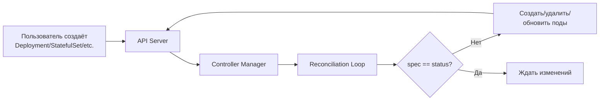

# Управление рабочими нагрузками в Kubernetes (Workload Management)

> Kubernetes предоставляет набор специализированных **контроллеров рабочих нагрузок (workload controllers)** для управления жизненным циклом подов, автоматизации масштабирования, обновлений и обеспечения отказоустойчивости.

---

1. [[#Зачем нужны workload-контроллеры|Зачем нужны workload-контроллеры]]
	1. [[#Зачем нужны workload-контроллеры#Проблема управления подами напрямую|Проблема управления подами напрямую]]
	2. [[#Зачем нужны workload-контроллеры#Принцип работы контроллеров|Принцип работы контроллеров]]
2. [[#Сравнение типов workload-контроллеров|Сравнение типов workload-контроллеров]]
3. [[#Deployment: Stateless-приложения|Deployment: Stateless-приложения]]
	1. [[#Deployment: Stateless-приложения#Сценарии применения|Сценарии применения]]
	2. [[#Deployment: Stateless-приложения#Архитектурные особенности|Архитектурные особенности]]
	3. [[#Deployment: Stateless-приложения#Пример манифеста|Пример манифеста]]
4. [[#StatefulSet: Stateful-приложения|StatefulSet: Stateful-приложения]]
	1. [[#StatefulSet: Stateful-приложения#Сценарии применения|Сценарии применения]]
	2. [[#StatefulSet: Stateful-приложения#Архитектурные особенности|Архитектурные особенности]]
	3. [[#StatefulSet: Stateful-приложения#Пример манифеста|Пример манифеста]]
5. [[#DaemonSet: Системные агенты на узлах|DaemonSet: Системные агенты на узлах]]
	1. [[#DaemonSet: Системные агенты на узлах#Сценарии применения|Сценарии применения]]
	2. [[#DaemonSet: Системные агенты на узлах#Архитектурные особенности|Архитектурные особенности]]
	3. [[#DaemonSet: Системные агенты на узлах#Пример манифеста|Пример манифеста]]
6. [[#Job: Одноразовые задачи|Job: Одноразовые задачи]]
	1. [[#Job: Одноразовые задачи#Сценарии применения|Сценарии применения]]
	2. [[#Job: Одноразовые задачи#Архитектурные особенности|Архитектурные особенности]]
	3. [[#Job: Одноразовые задачи#Пример манифеста|Пример манифеста]]
7. [[#CronJob: Задачи по расписанию|CronJob: Задачи по расписанию]]
	1. [[#CronJob: Задачи по расписанию#Сценарии применения|Сценарии применения]]
	2. [[#CronJob: Задачи по расписанию#Архитектурные особенности|Архитектурные особенности]]
	3. [[#CronJob: Задачи по расписанию#Пример манифеста|Пример манифеста]]
8. [[#Критерии выбора типа контроллера|Критерии выбора типа контроллера]]
9. [[#Best Practices|Best Practices]]

---
## Зачем нужны workload-контроллеры

### Проблема управления подами напрямую

При создании подов напрямую (объект вида `kind: Pod`) возникают следующие инфраструктурные ограничения:

- В случае аварийного падения пода не создается автоматически новый экземпляр взамен вышедшего из строя.
- Масштабирование до нескольких реплик требует ручного создания каждого экземпляра.
- Обновление версий образов сопряжено с необходимостью ручного удаления старых и развертывания новых подов.
- При выходе из строя физического узла поды не переносятся автоматически на исправные ноды.

Для решения этих задач применяются контроллеры рабочих нагрузок, которые отслеживают соответствие между желаемым состоянием (`spec`) и фактическим состоянием кластера, автоматически выполняя операции создания, удаления и обновления.

### Принцип работы контроллеров




> Контроллер *непрерывно* выполняет цикл согласования (reconciliation loop), приводя фактическое состояние инфраструктуры в соответствие с декларативной спецификацией.

---
## Сравнение типов workload-контроллеров

|**Контроллер**|**Назначение**|**Тип приложения**|**Идентичность подов**|**Хранилище**|**Стратегия обновления**|**Масштабирование**|
|---|---|---|---|---|---|---|
|**Deployment**|Управление stateless-приложениями|Веб-сервисы, API, микросервисы|Взаимозаменяемы|Не привязано|Rolling update, откаты|Ручное, через HPA|
|**StatefulSet**|Управление stateful-приложениями|Базы данных, очереди сообщений|Уникальные имена и порядок|Привязано к подам (PVC)|Упорядоченный rolling update|Ручное|
|**DaemonSet**|Развертывание системных агентов|Системы сбора логов, мониторинг, CNI|Один под на узел|Опционально (HostPath)|Rolling update|Автоматически при добавлении нод|
|**Job**|Выполнение одноразовых задач|Миграции БД, пакетная обработка, ETL|Взаимозаменяемы|Опционально|Не применимо|Параллелизм (`parallelism`)|
|**CronJob**|Запуск задач по расписанию|Резервное копирование, отчеты, очистка|Взаимозаменяемы|Опционально|Не применимо|Параллелизм|

---
## Deployment: Stateless-приложения

### Сценарии применения

- Развертывание веб-серверов и корпоративных API. 
- Реализация stateless-микросервисов, не требующих сохранения локального состояния на диске.
- Среды с необходимостью быстрого горизонтального масштабирования.

### Архитектурные особенности

- Поды являются взаимозаменяемыми единицами без фиксированной уникальной идентичности.
- Управление репликами делегируется внутреннему объекту ReplicaSet.
- Поддерживается стратегия плавного обновления без простоя (rolling update) и возможность отката (rollback).

### Пример манифеста

```yaml
apiVersion: apps/v1
kind: Deployment
metadata:
  name: nginx-deployment
spec:
  replicas: 3
  selector:
    matchLabels:
      app: nginx
  template:
    metadata:
      labels:
        app: nginx
    spec:
      containers:
      - name: nginx
        image: nginx:1.25
        ports:
        - containerPort: 80
```

---
## StatefulSet: Stateful-приложения

### Сценарии применения

- Развертывание реляционных и нереляционных баз данных (PostgreSQL, MySQL, Cassandra). 
- Запуск брокеров сообщений и распределенных очередей (Apache Kafka, RabbitMQ).
- Поддержание распределенных хранилищ данных (etcd, Zookeeper).

### Архитектурные особенности

- Каждый под получает стабильное и уникальное сетевое имя по схеме `<name>-0`, `<name>-1` и так далее.
- Операции создания, масштабирования и удаления выполняются в строгом порядке (от меньшего индекса к большему и наоборот).
- Каждый экземпляр жестко привязан к индивидуальному тому через шаблон `volumeClaimTemplates`.
- Для корректного разрешения сетевых имен требуется предварительное создание headless-сервиса (`clusterIP: None`).

### Пример манифеста

```yaml
apiVersion: apps/v1
kind: StatefulSet
metadata:
  name: postgres
spec:
  serviceName: postgres-headless
  replicas: 3
  selector:
    matchLabels:
      app: postgres
  template:
    metadata:
      labels:
        app: postgres
    spec:
      containers:
      - name: postgres
        image: postgres:15
        volumeMounts:
        - name: data
          mountPath: /var/lib/postgresql/data
  volumeClaimTemplates:
  - metadata:
      name: data
    spec:
      accessModes: ["ReadWriteOnce"]
      resources:
        requests:
          storage: 10Gi
```

---
## DaemonSet: Системные агенты на узлах

### Сценарии применения

- Сбор системных логов и метрик (Fluent Bit, Prometheus Node Exporter). 
- Развертывание сетевых плагинов (CNI) и драйверов хранения (CSI).
- Установка агентов безопасности и инфраструктурных служб узла (kube-proxy).

### Архитектурные особенности

- Гарантирует запуск ровно одного экземпляра пода на каждом подходящем узле кластера (или на узлах, удовлетворяющих условиям селекторов).
- Автоматически развертывает поды на вновь добавляемые в кластер узлы.
- Поддерживает фильтрацию целевых нод через механизмы `nodeSelector`, `nodeAffinity` и `tolerations`. 

### Пример манифеста

```yaml
apiVersion: apps/v1
kind: DaemonSet
metadata:
  name: fluent-bit
spec:
  selector:
    matchLabels:
      app: fluent-bit
  template:
    metadata:
      labels:
        app: fluent-bit
    spec:
      containers:
      - name: fluent-bit
        image: fluent/fluent-bit:2.1
        volumeMounts:
        - name: varlog
          mountPath: /var/log
      volumes:
      - name: varlog
        hostPath:
          path: /var/log
```

---
## Job: Одноразовые задачи

### Сценарии применения

- Выполнение миграций структуры базы данных перед выкаткой новой версии приложения.
- Пакетная обработка данных, операции ETL (Extract, Transform, Load).
- Первичная инициализация системных данных и запуск интеграционных тестов.

### Архитектурные особенности

- Контроллер управляет выполнением задачи до ее успешного завершения или исчерпания лимита попыток сбоя (`backoffLimit`).
- По завершении работы поды сохраняются в кластере в статусах `Completed` или `Failed` для возможности изучения логов.
- Поддерживает параллельное выполнение нескольких потоков задачи (`parallelism` и `completions`).

### Пример манифеста

```yaml
apiVersion: batch/v1
kind: Job
metadata:
  name: db-migration
spec:
  completions: 1
  parallelism: 1
  backoffLimit: 3
  ttlSecondsAfterFinished: 3600
  template:
    spec:
      containers:
      - name: migrate
        image: my-app:1.0
        command: ["python", "manage.py", "migrate"]
      restartPolicy: Never
```

## CronJob: Задачи по расписанию

### Сценарии применения

- Регулярное резервное копирование баз данных и файлов конфигурации.
- Периодическая генерация аналитических отчетов.
- Очистка устаревших логов, кэшей и временных файлов.

### Архитектурные особенности

- Создает объекты `Job` по расписанию, заданному в стандартном формате cron (`минута час день месяц день_недели`).
- Позволяет настраивать политику параллельных запусков (`concurrencyPolicy`) и ограничения на хранение истории завершенных запусков.

### Пример манифеста

```yaml
apiVersion: batch/v1
kind: CronJob
metadata:
  name: daily-backup
spec:
  schedule: "0 2 * * *"
  concurrencyPolicy: Forbid
  successfulJobsHistoryLimit: 3
  failedJobsHistoryLimit: 1
  jobTemplate:
    spec:
      template:
        spec:
          containers:
          - name: backup
            image: backup-tool:1.0
            command: ["/backup.sh"]
          restartPolicy: OnFailure
```

---
## Критерии выбора типа контроллера

При проектировании архитектуры рабочих нагрузок рекомендуется руководствоваться следующими принципами:

- Если приложение не сохраняет локальное состояние и требует горизонтального масштабирования — применяется **Deployment**.
- Если приложению необходима уникальная сетевая идентичность, стабильное имя и привязка к хранилищу — используется **StatefulSet**.
- Если требуется запуск вспомогательного агента на каждом узле кластера — выбирается **DaemonSet**.
- Для выполнения завершаемых вычислительных процедур или разовых процедур подходят **Job**.
- Для периодических регулярных процедур по расписанию применяются **CronJob**.
 
---
## Best Practices

- Всегда использовать контроллеры рабочих нагрузок вместо прямого создания подов для обеспечения самовосстановления и управляемости.
- Обязательно определять параметры гарантированных ресурсов (`resources.requests`) и ограничения (`resources.limits`) для каждого контейнера.
- Настраивать проверки здоровья (`livenessProbe`, `readinessProbe`, `startupProbe`) для своевременного выявления сбоев и управления сетевым трафиком.
- Осуществлять декларативное управление инфраструктурой путем хранения манифестов в системах контроля версий и применения через команды вида `kubectl apply`.
- Избегать антипаттернов вроде запуска фоновых процессов cron внутри долгоживущих подов приложений вместо использования специализированных ресурсов `CronJob`