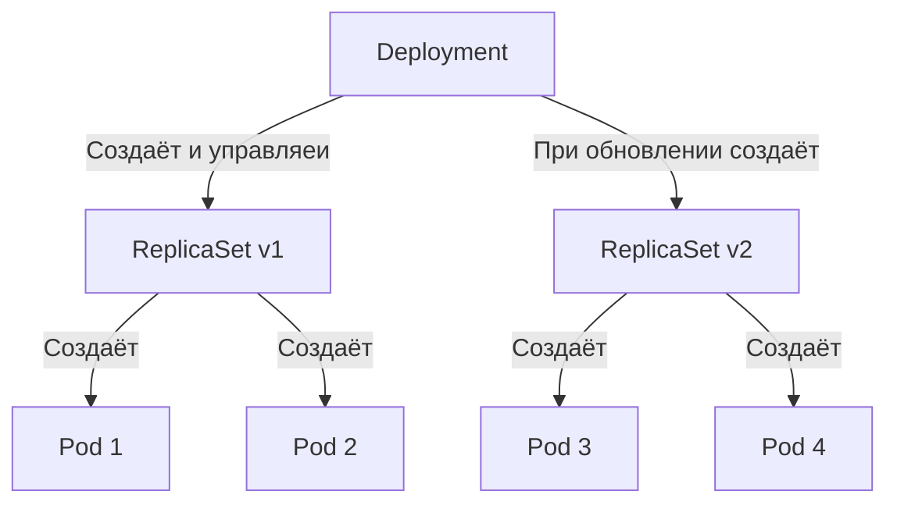

# Deployment — управление развёртыванием приложений

**Deployment** управляет набором Pod, в которых работает приложение. Обычно речь идёт о приложениях без собственного состояния.

Он позволяет декларативно обновлять Pod и ReplicaSet: вы описываете желаемое состояние, а контроллер постепенно приводит фактическое состояние к нему. При необходимости Kubernetes создаёт новые ReplicaSet, удаляет старые и принимает под управление их ресурсы.

> **Примечание**
> Не управляйте вручную объектами ReplicaSet, которыми владеет Deployment. Если твой сценарий не описан в документации, стоит открыть issue в основном репозитории Kubernetes.

---

1. [[#Для чего нужен Deployment|Для чего нужен Deployment]]
2. [[#Создание Deployment|Создание Deployment]]
	1. [[#Создание Deployment#Проверка и запуск|Проверка и запуск]]
	2. [[#Создание Deployment#Метка `pod-template-hash`|Метка `pod-template-hash`]]
3. [[#Обновление Deployment|Обновление Deployment]]
	1. [[#Обновление Deployment#Проверка результата|Проверка результата]]
4. [[#Несколько обновлений одновременно (rollover)|Несколько обновлений одновременно (rollover)]]
5. [[#Изменение селектора меток|Изменение селектора меток]]
6. [[#Откат Deployment|Откат Deployment]]
	1. [[#Откат Deployment#Просмотр истории обновлений|Просмотр истории обновлений]]
	2. [[#Откат Deployment#Откат к предыдущей ревизии|Откат к предыдущей ревизии]]
7. [[#Масштабирование Deployment|Масштабирование Deployment]]
	1. [[#Масштабирование Deployment#Пропорциональное масштабирование|Пропорциональное масштабирование]]
8. [[#Приостановка и возобновление обновления|Приостановка и возобновление обновления]]
9. [[#Состояние Deployment|Состояние Deployment]]
	1. [[#Состояние Deployment#Обновление выполняется|Обновление выполняется]]
	2. [[#Состояние Deployment#Обновление завершено|Обновление завершено]]
	3. [[#Состояние Deployment#Неудачное обновление|Неудачное обновление]]
	4. [[#Состояние Deployment#Работа с неудачным обновлением|Работа с неудачным обновлением]]
10. [[#Политика очистки старых ReplicaSet|Политика очистки старых ReplicaSet]]
11. [[#Canary-развёртывания|Canary-развёртывания]]
12. [[#Настройка Deployment|Настройка Deployment]]
	1. [[#Настройка Deployment#Шаблон Pod|Шаблон Pod]]
	2. [[#Настройка Deployment#Количество реплик|Количество реплик]]
	3. [[#Настройка Deployment#Селектор|Селектор]]
	4. [[#Настройка Deployment#Стратегия обновления|Стратегия обновления]]
		1. [[#Стратегия обновления#Стратегия Recreate|Стратегия Recreate]]
		2. [[#Стратегия обновления#Стратегия RollingUpdate|Стратегия RollingUpdate]]
		3. [[#Стратегия обновления#Максимальное количество недоступных Pod|Максимальное количество недоступных Pod]]
		4. [[#Стратегия обновления#Максимальное превышение количества Pod|Максимальное превышение количества Pod]]
	5. [[#Настройка Deployment#Предельное время обновления|Предельное время обновления]]
	6. [[#Настройка Deployment#Минимальное время готовности|Минимальное время готовности]]
	7. [[#Настройка Deployment#Завершающиеся Pod|Завершающиеся Pod]]
	8. [[#Настройка Deployment#Лимит истории ревизий|Лимит истории ревизий]]
	9. [[#Настройка Deployment#Приостановка|Приостановка]]

---
## Для чего нужен Deployment

Основные сценарии использования:

- Создание приложения. Deployment создаёт ReplicaSet, а тот — Pod. Проверить результат можно по статусу обновления.
- Обновление приложения. При изменении шаблона Pod создаётся новый ReplicaSet. Kubernetes постепенно увеличивает число новых Pod и уменьшает число старых, контролируя скорость замены. Каждое такое обновление создаёт новую ревизию.
- Откат. Если новая версия работает нестабильно, можно вернуться к предыдущей ревизии.
- Масштабирование. Можно увеличить число реплик, чтобы выдерживать большую нагрузку.
- Приостановка обновления. Можно внести несколько изменений в шаблон Pod, а затем применить их одним обновлением.
- Контроль состояния. Статус помогает определить, если обновление застопорилось.
- Очистка старых версий. Больше не нужные ReplicaSet можно удалять автоматически.

---




---
## Создание Deployment

Следующий пример создаёт ReplicaSet, который поддерживает три Pod с контейнером `nginx`.

```yaml
apiVersion: apps/v1
kind: Deployment
metadata:
  name: nginx-deployment
  labels:
    app: nginx
spec:
  replicas: 3
  selector:
    matchLabels:
      app: nginx
  template:
    metadata:
      labels:
        app: nginx
    spec:
      containers:
      - name: nginx
        image: nginx:1.14.2
        ports:
        - containerPort: 80
```

Что здесь происходит:

- Имя ресурса. `.metadata.name` задаёт имя `nginx-deployment`. Оно используется как основа для имён создаваемых ReplicaSet и Pod.
- Количество реплик. Поле `.spec.replicas` указывает, что необходимо поддерживать три экземпляра приложения.
- Селектор. `.spec.selector` определяет, какие Pod будет контролировать ReplicaSet. В этом примере используется метка `app: nginx`, заданная в шаблоне Pod. Допускаются и более сложные правила выбора, если сам шаблон им соответствует.

 > [!TIP] Примечание
   `.spec.selector.matchLabels` — это набор пар «ключ — значение». Каждая такая пара эквивалентна элементу `matchExpressions`, в котором `key` — имя ключа, `operator` имеет значение `"In"`, а массив `values` содержит единственное значение. Для совпадения должны выполняться все условия из `matchLabels` и `matchExpressions`.

- Шаблон Pod. Поле `.spec.template` содержит описание создаваемых Pod:
	 - `.metadata.labels` назначает им метку `app: nginx`.
    - `.spec` описывает контейнер `nginx`, использующий образ `nginx:1.14.2`.
    - `.spec.containers[0].name` задаёт имя контейнера — `nginx`.

### Проверка и запуск

Перед началом убедись, что кластер Kubernetes запущен.

Создайте ресурс:

```bash
kubectl apply -f https://k8s.io/examples/controllers/nginx-deployment.yaml
```

Проверьте его состояние:

```bash
kubectl get deployments
```

Пока создание не завершено, результат может выглядеть так:

```bash
NAME               READY   UP-TO-DATE   AVAILABLE   AGE
nginx-deployment   0/3     0            0           1s
```

Значения столбцов:

- `NAME` — имена Deployment в текущем пространстве имён.
- `READY` — количество готовых реплик относительно желаемого числа, в формате `готовые/желаемые`.
- `UP-TO-DATE` — число реплик, уже приведённых к желаемому состоянию.
- `AVAILABLE` — число реплик, доступных пользователям.
- `AGE` — время с момента создания ресурса.

Здесь желаемое количество реплик равно трём, что задано в `.spec.replicas`.

Дождись завершения обновления:

```bash
kubectl rollout status deployment/nginx-deployment
```

Пример вывода:

```bash
Waiting for rollout to finish: 2 out of 3 new replicas have been updated...
deployment "nginx-deployment" successfully rolled out
```

Повтори проверку через несколько секунд:

```bash
kubectl get deployments
```

Ожидаемый результат:

```bash
NAME               READY   UP-TO-DATE   AVAILABLE   AGE
nginx-deployment   3/3     3            3           18s
```

Теперь все три реплики созданы, используют актуальный шаблон Pod и доступны для работы.

Посмотри на созданный ReplicaSet:

```bash
kubectl get rs
```

Пример вывода:

```bash
NAME                          DESIRED   CURRENT   READY   AGE
nginx-deployment-75675f5897   3         3         3       18s
```

Значения столбцов:

- `NAME` — имя ReplicaSet.
- `DESIRED` — желаемое количество реплик, определённое конфигурацией.
- `CURRENT` — текущее количество реплик.
- `READY` — количество готовых реплик, доступных пользователям.
- `AGE` — время с момента создания.

Имя ReplicaSet формируется по шаблону `[DEPLOYMENT-NAME]-[HASH]`. Эта строка также служит основой для имён создаваемых Pod.

Значение `HASH` совпадает с меткой `pod-template-hash` у ReplicaSet.

Посмотри на метки Pod:

```bash
kubectl get pods --show-labels
```

Пример вывода:

```
NAME                                READY     STATUS    RESTARTS   AGE       LABELS
nginx-deployment-75675f5897-7ci7o   1/1       Running   0          18s       app=nginx,pod-template-hash=75675f5897
nginx-deployment-75675f5897-kzszj   1/1       Running   0          18s       app=nginx,pod-template-hash=75675f5897
nginx-deployment-75675f5897-qqcnn   1/1       Running   0          18s       app=nginx,pod-template-hash=75675f5897
```

Созданный ReplicaSet обеспечивает наличие трёх Pod с `nginx`.

> [!TIP] Примечание
> В конфигурации обязательно должны быть согласованы селектор и метки шаблона Pod — в этом примере используется `app: nginx`.
> Не допускай пересечения меток и селекторов с другими контроллерами, включая другие Deployment и StatefulSet. Kubernetes не запрещает такое пересечение, но несколько контроллеров с совпадающими селекторами могут конфликтовать и работать непредсказуемо.

### Метка `pod-template-hash`

> [!WARNING] Внимание
> Не изменяйте эту метку вручную.

Контроллер автоматически добавляет `pod-template-hash` каждому ReplicaSet, который создаёт или принимает под управление.

Метка предотвращает пересечение дочерних ReplicaSet. Её значение вычисляется хешированием `PodTemplate` ReplicaSet. Полученный хеш добавляется в селектор ReplicaSet, метки шаблона Pod и метки уже существующих Pod, которыми управляет этот ReplicaSet.

---
## Обновление Deployment

> [!TIP] Примечание
> Обновление запускается только при изменении шаблона Pod — `.spec.template`. Например, если изменить метки или образы контейнеров, Kubernetes начнёт новый rollout. Масштабирование само по себе обновление не запускает.

Допустим, нужно обновить образ `nginx` с `nginx:1.14.2` до `nginx:1.16.1`.

Выполняем команду:

```
kubectl set image deployment.v1.apps/nginx-deployment nginx=nginx:1.16.1
```

Либо используем сокращённую форму:

```
kubectl set image deployment/nginx-deployment nginx=nginx:1.16.1
```

Здесь `deployment/nginx-deployment` указывает ресурс, `nginx` — контейнер, а `nginx:1.16.1` — новый образ с тегом версии.

Пример вывода:

```
deployment.apps/nginx-deployment image updated
```

Вместо этого можно открыть конфигурацию на редактирование и заменить значение `.spec.template.spec.containers[0].image` с `nginx:1.14.2` на `nginx:1.16.1`:

```
kubectl edit deployment/nginx-deployment
```

При успешном изменении появится сообщение:

```
deployment.apps/nginx-deployment edited
```

Проверь ход обновления:

```
kubectl rollout status deployment/nginx-deployment
```

Пока процесс не завершён, вывод может выглядеть так:

```
Waiting for rollout to finish: 2 out of 3 new replicas have been updated...
```

После завершения:

```
deployment "nginx-deployment" successfully rolled out
```

### Проверка результата

После успешного обновления проверь состояние ресурса:

```
kubectl get deployments
```

Пример вывода:

```
NAME               READY   UP-TO-DATE   AVAILABLE   AGE
nginx-deployment   3/3     3            3           36s
```

Теперь посмотри на ReplicaSet:

```
kubectl get rs
```

Kubernetes создаёт новый ReplicaSet и увеличивает число его реплик до трёх, одновременно уменьшая число реплик старого до нуля.

```
NAME                          DESIRED   CURRENT   READY   AGE
nginx-deployment-1564180365   3         3         3       6s
nginx-deployment-2035384211   0         0         0       36s
```

Проверь Pod:

```
kubectl get pods
```

В списке должны остаться только Pod с новым образом:

```
NAME                                READY     STATUS    RESTARTS   AGE
nginx-deployment-1564180365-khku8   1/1       Running   0          14s
nginx-deployment-1564180365-nacti   1/1       Running   0          14s
nginx-deployment-1564180365-z9gth   1/1       Running   0          14s
```

При следующем обновлении достаточно снова изменить шаблон Pod.

Kubernetes контролирует количество Pod, которые могут быть недоступны во время обновления. По умолчанию допускается недоступность не более 25% от желаемого числа реплик (`maxUnavailable`).

Одновременно он ограничивает количество дополнительных Pod сверх желаемого числа. По умолчанию их может быть не более 25% (`maxSurge`).

Например, при трёх желаемых репликах Kubernetes сначала создаёт новый Pod, затем удаляет старый и продолжает замену. Старые Pod не удаляются, пока не запустится достаточное количество новых; новые не создаются бесконтрольно, пока не будет освобождено место в пределах заданных ограничений.

В этом примере поддерживается не менее трёх доступных Pod и не более четырёх одновременно. Если желаемое число реплик равно четырём, общее количество Pod во время обновления будет варьироваться от трёх до пяти.

Чтобы получить подробную информацию о ресурсе, выполни:

```bash
kubectl describe deployments
```

Пример вывода:

```bash
Name:                   nginx-deployment
Namespace:              default
CreationTimestamp:      Thu, 30 Nov 2017 10:56:25 +0000
Labels:                 app=nginx
Annotations:            deployment.kubernetes.io/revision=2
Selector:               app=nginx
Replicas:               3 desired | 3 updated | 3 total | 3 available | 0 unavailable
StrategyType:           RollingUpdate
MinReadySeconds:        0
RollingUpdateStrategy:  25% max unavailable, 25% max surge
Pod Template:
  Labels:  app=nginx
   Containers:
    nginx:
      Image:        nginx:1.16.1
      Port:         80/TCP
      Environment:  <none>
      Mounts:       <none>
    Volumes:        <none>
  Conditions:
    Type           Status  Reason
    ----           ------  ------
    Available      True    MinimumReplicasAvailable
    Progressing    True    NewReplicaSetAvailable
  OldReplicaSets:  <none>
  NewReplicaSet:   nginx-deployment-1564180365 (3/3 replicas created)
  Events:
    Type    Reason             Age   From                   Message
    ----    ------             ----  ----                   -------
    Normal  ScalingReplicaSet  2m    deployment-controller  Scaled up replica set nginx-deployment-2035384211 to 3
    Normal  ScalingReplicaSet  24s   deployment-controller  Scaled up replica set nginx-deployment-1564180365 to 1
    Normal  ScalingReplicaSet  22s   deployment-controller  Scaled down replica set nginx-deployment-2035384211 to 2
    Normal  ScalingReplicaSet  22s   deployment-controller  Scaled up replica set nginx-deployment-1564180365 to 2
    Normal  ScalingReplicaSet  19s   deployment-controller  Scaled down replica set nginx-deployment-2035384211 to 1
    Normal  ScalingReplicaSet  19s   deployment-controller  Scaled up replica set nginx-deployment-1564180365 to 3
    Normal  ScalingReplicaSet  14s   deployment-controller  Scaled down replica set nginx-deployment-2035384211 to 0
```

> Из вывода видно, что при первоначальном создании был создан ReplicaSet `nginx-deployment-2035384211`, сразу масштабированный до трёх реплик.

После обновления появился новый ReplicaSet `nginx-deployment-1564180365`. Сначала Kubernetes увеличил число его реплик до одной и дождался запуска Pod. Затем уменьшил старый ReplicaSet до двух реплик и увеличил новый до двух, сохраняя не менее трёх доступных Pod и не более четырёх созданных одновременно.

Далее процесс продолжился по той же стратегии: количество реплик старого ReplicaSet уменьшалось, нового — увеличивалось. В итоге новый ReplicaSet получил три доступные реплики, а старый был масштабирован до нуля.

> [!TIP] Примечание
> При вычислении `availableReplicas` Kubernetes не учитывает завершающиеся Pod. Число реплик может выходить за пределы диапазона `replicas - maxUnavailable` и `replicas + maxSurge`, пока не истечёт `terminationGracePeriodSeconds` завершающихся Pod. Поэтому во время обновления Pod и потребление ресурсов могут временно превышать ожидаемые значения.

## Несколько обновлений одновременно (rollover)

Каждый раз, когда контроллер обнаруживает новый Deployment, он создаёт ReplicaSet для запуска нужного количества Pod.

Если шаблон Pod изменяется, ReplicaSet, который управляет Pod с подходящими метками, но использует другой шаблон, масштабируется вниз. В конечном итоге новый ReplicaSet достигает значения `.spec.replicas`, а все старые масштабируются до нуля.

Если начать новое обновление, пока предыдущее ещё выполняется, Kubernetes создаст ещё один ReplicaSet и начнёт масштабировать его вверх. Предыдущий ReplicaSet станет старым и начнёт масштабироваться вниз.

Например, ты создал ресурс с пятью репликами `nginx:1.14.2`, а затем изменил образ на `nginx:1.16.1`, когда успели создаться только три Pod со старой версией.

Kubernetes немедленно начнёт удалять эти три старых Pod и создавать новые. Он не станет ждать, пока будут созданы все пять реплик старой версии, прежде чем переключиться на новую.

## Изменение селектора меток

Менять селектор меток обычно не рекомендуется — лучше заранее продумать его состав. После создания Deployment поле селектора неизменяемо: изменить его через `kubectl patch`, `kubectl edit`, `kubectl apply` или, например, `helm upgrade` нельзя.

Если селектор всё же необходимо изменить, ресурс придётся удалить и создать заново. По умолчанию удаление Deployment приводит и к удалению его Pod, что вызывает простой. Если нужно сохранить Pod работающими на время пересоздания, можно использовать `--cascade=orphan`. Однако перед этим важно учесть следующие последствия.

- Добавление меток. Если новый селектор становится более строгим, новый Deployment должен содержать подходящий шаблон Pod. При изменении существующего манифеста нужно добавить новые метки и в метаданные шаблона. Иначе API-сервер отклонит конфигурацию с ошибкой проверки. Поскольку селектор больше не совпадает со старым, новый ресурс не увидит прежние Pod: старый ReplicaSet останется без владельца (orphaned), а новый ReplicaSet будет создан отдельно.
    
- Изменение значения. Если изменить существующее значение в селекторе, например с `v1` на `v2`, результат будет таким же, как при добавлении метки: старый ReplicaSet останется без владельца, а новый будет создан.
    
- Удаление меток из селектора. Удаление существующего ключа не требует менять метки в шаблоне Pod. Новый селектор станет менее строгим и сможет совпасть со старыми Pod. В результате существующие ReplicaSet не останутся без владельца и новый ReplicaSet не создастся. При этом удалённая из селектора метка всё ещё будет присутствовать у уже существующих Pod и ReplicaSet. Очистить её можно, запустив новое обновление.
    

## Откат Deployment

Если новая версия работает нестабильно — например, контейнеры постоянно перезапускаются, — можно вернуться к предыдущей ревизии. По умолчанию Kubernetes хранит историю обновлений, поэтому откат доступен в любой момент. Количество сохраняемых ревизий можно изменить.

> Примечание
> 
> Новая ревизия создаётся только при изменении шаблона Pod (`.spec.template`), например при обновлении меток или образов контейнеров. Масштабирование не создаёт новую ревизию — это позволяет независимо выполнять ручное масштабирование и автомасштабирование.
> 
> При откате восстанавливается только шаблон Pod. Другие изменения, например количество реплик, автоматически не отменяются.

Предположим, при обновлении ты допустил опечатку и указал `nginx:1.161` вместо `nginx:1.16.1`:

```
kubectl set image deployment/nginx-deployment nginx=nginx:1.161
```

Команда сообщит об успешном изменении образа:

```
deployment.apps/nginx-deployment image updated
```

Однако обновление застопорится. Проверить это можно командой:

```
kubectl rollout status deployment/nginx-deployment
```

Пример вывода:

```
Waiting for rollout to finish: 1 out of 3 new replicas have been updated...
```

Нажми `Ctrl-C`, чтобы остановить наблюдение за статусом обновления.

Посмотри на ReplicaSet:

```
kubectl get rs
```

Пример вывода:

```
NAME                          DESIRED   CURRENT   READY   AGE
nginx-deployment-1564180365   3         3         3       25s
nginx-deployment-2035384211   0         0         0       36s
nginx-deployment-3066724191   1         1         0       6s
```

У старых ReplicaSet суммарно три реплики, а у нового — одна. Новый Pod не может запустить контейнер из-за ошибки загрузки образа.

Проверь Pod:

```
kubectl get pods
```

```
NAME                                READY     STATUS             RESTARTS   AGE
nginx-deployment-1564180365-70iae   1/1       Running            0          25s
nginx-deployment-1564180365-jbqqo   1/1       Running            0          25s
nginx-deployment-1564180365-hysrc   1/1       Running            0          25s
nginx-deployment-3066724191-08mng   0/1       ImagePullBackOff   0          6s
```

> Примечание
> 
> Контроллер Deployment автоматически останавливает неудачное обновление и прекращает масштабирование нового ReplicaSet. Поведение зависит от параметров `rollingUpdate`, в частности от `maxUnavailable`, значение которого по умолчанию равно 25%.

Получить подробную информацию о проблеме можно так:

```
kubectl describe deployment
```

Пример вывода:

```
Name:           nginx-deployment
Namespace:      default
CreationTimestamp:  Tue, 15 Mar 2016 14:48:04 -0700
Labels:         app=nginx
Selector:       app=nginx
Replicas:       3 desired | 1 updated | 4 total | 3 available | 1 unavailable
StrategyType:       RollingUpdate
MinReadySeconds:    0
RollingUpdateStrategy:  25% max unavailable, 25% max surge
Pod Template:
  Labels:  app=nginx
  Containers:
   nginx:
    Image:        nginx:1.161
    Port:         80/TCP
    Host Port:    0/TCP
    Environment:  <none>
    Mounts:       <none>
  Volumes:        <none>
Conditions:
  Type           Status  Reason
  ----           ------  ------
  Available      True    MinimumReplicasAvailable
  Progressing    True    ReplicaSetUpdated
OldReplicaSets:     nginx-deployment-1564180365 (3/3 replicas created)
NewReplicaSet:      nginx-deployment-3066724191 (1/1 replicas created)
Events:
  FirstSeen LastSeen    Count   From                    SubObjectPath   Type        Reason              Message
  --------- --------    -----   ----                    -------------   --------    ------              -------
  1m        1m          1       {deployment-controller }                Normal      ScalingReplicaSet   Scaled up replica set nginx-deployment-2035384211 to 3
  22s       22s         1       {deployment-controller }                Normal      ScalingReplicaSet   Scaled up replica set nginx-deployment-1564180365 to 1
  22s       22s         1       {deployment-controller }                Normal      ScalingReplicaSet   Scaled down replica set nginx-deployment-2035384211 to 2
  22s       22s         1       {deployment-controller }                Normal      ScalingReplicaSet   Scaled up replica set nginx-deployment-1564180365 to 2
  21s       21s         1       {deployment-controller }                Normal      ScalingReplicaSet   Scaled down replica set nginx-deployment-2035384211 to 1
  21s       21s         1       {deployment-controller }                Normal      ScalingReplicaSet   Scaled up replica set nginx-deployment-1564180365 to 3
  13s       13s         1       {deployment-controller }                Normal      ScalingReplicaSet   Scaled down replica set nginx-deployment-2035384211 to 0
  13s       13s         1       {deployment-controller }                Normal      ScalingReplicaSet   Scaled up replica set nginx-deployment-3066724191 to 1
```

Чтобы исправить ситуацию, откатись к предыдущей стабильной ревизии.

### Просмотр истории обновлений

Сначала посмотри, какие ревизии сохранены:

```
kubectl rollout history deployment/nginx-deployment
```

Пример вывода:

```
deployments "nginx-deployment"
REVISION    CHANGE-CAUSE
1           <none>
2           <none>
3           <none>
```

Поле `CHANGE-CAUSE` копируется из аннотации `kubernetes.io/change-cause` при создании ревизии. Задать сообщение можно тремя способами:

- Добавить аннотацию командой `kubectl annotate deployment/nginx-deployment kubernetes.io/change-cause="image updated to 1.16.1"`.
    
- Изменить манифест ресурса вручную.
    
- Использовать инструмент, который автоматически задаёт эту аннотацию.
    

> Примечание
> 
> В старых версиях Kubernetes для автоматического заполнения `CHANGE-CAUSE` можно было использовать флаг `--record` команд `kubectl`. Он устарел и будет удалён в одном из будущих выпусков.

Чтобы посмотреть подробности конкретной ревизии, выполни:

```
kubectl rollout history deployment/nginx-deployment --revision=2
```

Пример вывода:

```
deployments "nginx-deployment" revision 2
  Labels:       app=nginx
          pod-template-hash=1159050644
  Containers:
   nginx:
    Image:      nginx:1.16.1
    Port:       80/TCP
     QoS Tier:
        cpu:      BestEffort
        memory:   BestEffort
    Environment Variables:      <none>
  No volumes.
```

### Откат к предыдущей ревизии

Предположим, ты решил отменить последнее обновление и вернуться к ревизии 2.

Выполни:

```
kubectl rollout undo deployment/nginx-deployment
```

Пример вывода:

```
deployment.apps/nginx-deployment rolled back
```

Можно указать конкретную ревизию с помощью `--to-revision`:

```
kubectl rollout undo deployment/nginx-deployment --to-revision=2
```

Результат:

```
deployment.apps/nginx-deployment rolled back
```

Ресурс возвращается к предыдущей стабильной версии. Контроллер также создаёт событие `DeploymentRollback`, указывающее на откат к ревизии 2.

Проверь состояние:

```
kubectl get deployment nginx-deployment
```

```
NAME               READY   UP-TO-DATE   AVAILABLE   AGE
nginx-deployment   3/3     3            3           30m
```

Затем посмотри подробности:

```
kubectl describe deployment nginx-deployment
```

Пример вывода:

```
Name:                   nginx-deployment
Namespace:              default
CreationTimestamp:      Sun, 02 Sep 2018 18:17:55 -0500
Labels:                 app=nginx
Annotations:            deployment.kubernetes.io/revision=4
Selector:               app=nginx
Replicas:               3 desired | 3 updated | 3 total | 3 available | 0 unavailable
StrategyType:           RollingUpdate
MinReadySeconds:        0
RollingUpdateStrategy:  25% max unavailable, 25% max surge
Pod Template:
  Labels:  app=nginx
  Containers:
   nginx:
    Image:       nginx:1.16.1
    Port:        80/TCP
    Host Port:   0/TCP
    Environment:  <none>
    Mounts:      <none>
  Volumes:       <none>
Conditions:
  Type           Status  Reason
  ----           ------  ------
  Available      True    MinimumReplicasAvailable
  Progressing    True    NewReplicaSetAvailable
OldReplicaSets:  <none>
NewReplicaSet:   nginx-deployment-c4747d96c (3/3 replicas created)
Events:
  Type    Reason              Age   From                   Message
  ----    ------              ----  ----                   -------
  Normal  ScalingReplicaSet   12m   deployment-controller  Scaled up replica set nginx-deployment-75675f5897 to 3
  Normal  ScalingReplicaSet   11m   deployment-controller  Scaled up replica set nginx-deployment-c4747d96c to 1
  Normal  ScalingReplicaSet   11m   deployment-controller  Scaled down replica set nginx-deployment-75675f5897 to 2
  Normal  ScalingReplicaSet   11m   deployment-controller  Scaled up replica set nginx-deployment-c4747d96c to 2
  Normal  ScalingReplicaSet   11m   deployment-controller  Scaled down replica set nginx-deployment-75675f5897 to 1
  Normal  ScalingReplicaSet   11m   deployment-controller  Scaled up replica set nginx-deployment-c4747d96c to 3
  Normal  ScalingReplicaSet   11m   deployment-controller  Scaled down replica set nginx-deployment-75675f5897 to 0
  Normal  ScalingReplicaSet   11m   deployment-controller  Scaled up replica set nginx-deployment-595696685f to 1
  Normal  DeploymentRollback  15s   deployment-controller  Rolled back deployment "nginx-deployment" to revision 2
  Normal  ScalingReplicaSet   15s   deployment-controller  Scaled down replica set nginx-deployment-595696685f to 0
```

## Масштабирование Deployment

Чтобы изменить количество реплик вручную, используй команду:

```
kubectl scale deployment/nginx-deployment --replicas=10
```

Пример вывода:

```
deployment.apps/nginx-deployment scaled
```

Если в кластере включено горизонтальное автомасштабирование Pod, можно настроить автоматическое изменение количества реплик в зависимости от загрузки CPU. При этом задаются минимальное и максимальное количество Pod.

```
kubectl autoscale deployment/nginx-deployment --min=10 --max=15 --cpu-percent=80%
```

Результат:

```
deployment.apps/nginx-deployment scaled
```

### Пропорциональное масштабирование

При стратегии `RollingUpdate` одновременно могут работать несколько версий приложения. Если вручную или через автомасштабировщик изменить количество реплик, пока обновление выполняется или приостановлено, контроллер распределит дополнительные реплики между активными ReplicaSet, у которых есть Pod. Это позволяет снизить риски и называется пропорциональным масштабированием.

Например, приложение работает с десятью репликами, `maxSurge` равен 3, а `maxUnavailable` — 2.

Убедись, что все десять реплик запущены:

```
kubectl get deploy
```

```
NAME                 DESIRED   CURRENT   UP-TO-DATE   AVAILABLE   AGE
nginx-deployment     10        10        10           10          50s
```

Затем измени образ на тот, который недоступен из кластера:

```
kubectl set image deployment/nginx-deployment nginx=nginx:sometag
```

```
deployment.apps/nginx-deployment image updated
```

Начнётся новое обновление, создающее ReplicaSet `nginx-deployment-1989198191`, но оно остановится из-за ограничения `maxUnavailable`.

```
kubectl get rs
```

```
NAME                          DESIRED   CURRENT   READY     AGE
nginx-deployment-1989198191   5         5         0         9s
nginx-deployment-618515232    8         8         8         1m
```

Теперь поступает новый запрос на масштабирование: автомасштабировщик увеличивает количество реплик до 15. Контроллер должен решить, куда добавить пять новых Pod.

Без пропорционального масштабирования все пять реплик добавились бы в новый ReplicaSet. При пропорциональном масштабировании они распределяются между всеми ReplicaSet, у которых есть реплики. Чем больше реплик у ReplicaSet, тем большую долю он получит. Остаток добавляется в ReplicaSet с наибольшим числом реплик. ReplicaSet с нулём реплик не масштабируются вверх.

В этом примере три реплики добавляются в старый ReplicaSet, а две — в новый. Если новые Pod станут работоспособными, процесс обновления в конечном итоге перенесёт все реплики в новый ReplicaSet.

Проверь состояние:

```
kubectl get deploy
```

```
NAME                 DESIRED   CURRENT   UP-TO-DATE   AVAILABLE   AGE
nginx-deployment     15        18        7            8           7m
```

Распределение реплик между ReplicaSet можно проверить отдельно:

```
kubectl get rs
```

```
NAME                          DESIRED   CURRENT   READY     AGE
nginx-deployment-1989198191   7         7         0         7m
nginx-deployment-618515232    11        11        11        7m
```

## Приостановка и возобновление обновления

Можно приостановить обновление до внесения одного или нескольких изменений, а затем возобновить его, когда всё будет готово. Это позволяет внести несколько исправлений подряд, не запуская отдельный rollout после каждого изменения.

Предположим, ресурс уже создан. Проверь его состояние:

```
kubectl get deploy
```

```
NAME      DESIRED   CURRENT   UP-TO-DATE   AVAILABLE   AGE
nginx     3         3         3            3           1m
```

Посмотри на ReplicaSet:

```
kubectl get rs
```

```
NAME               DESIRED   CURRENT   READY   AGE
nginx-2142116321   3         3         3       1m
```

Приостанови обновление:

```
kubectl rollout pause deployment/nginx-deployment
```

```
deployment.apps/nginx-deployment paused
```

Теперь измени образ контейнера:

```
kubectl set image deployment/nginx-deployment nginx=nginx:1.16.1
```

```
deployment.apps/nginx-deployment image updated
```

Новое обновление пока не начнётся. Это можно проверить по истории:

```
kubectl rollout history deployment/nginx-deployment
```

```
deployments "nginx"
REVISION  CHANGE-CAUSE
1   <none>
```

Убедись, что ReplicaSet не изменился:

```
kubectl get rs
```

```
NAME               DESIRED   CURRENT   READY   AGE
nginx-2142116321   3         3         3       2m
```

Пока обновление приостановлено, можно вносить и другие изменения, например обновить требования к ресурсам:

```
kubectl set resources deployment/nginx-deployment -c=nginx --limits=cpu=200m,memory=512Mi
```

```
deployment.apps/nginx-deployment resource requirements updated
```

Приложение продолжит работать в исходном состоянии, существовавшем до приостановки. Новые изменения конфигурации не приведут к обновлению Pod, пока rollout остаётся приостановленным.

Возобнови обновление:

```
kubectl rollout resume deployment/nginx-deployment
```

```
deployment.apps/nginx-deployment resumed
```

Теперь Kubernetes создаст новый ReplicaSet с учётом всех внесённых изменений.

Следить за процессом можно в режиме реального времени:

```
kubectl get rs --watch
```

Пример вывода:

```
NAME               DESIRED   CURRENT   READY   AGE
nginx-2142116321   2         2         2       2m
nginx-3926361531   2         2         0       6s
nginx-3926361531   2         2         1       18s
nginx-2142116321   1         2         2       2m
nginx-2142116321   1         2         2       2m
nginx-3926361531   3         2         1       18s
nginx-3926361531   3         2         1       18s
nginx-2142116321   1         1         1       2m
nginx-3926361531   3         3         1       18s
nginx-3926361531   3         3         2       19s
nginx-2142116321   0         1         1       2m
nginx-2142116321   0         1         1       2m
nginx-2142116321   0         0         0       2m
nginx-3926361531   3         3         3       20s
```

Когда обновление завершится, проверь итоговое состояние:

```
kubectl get rs
```

```
NAME               DESIRED   CURRENT   READY   AGE
nginx-2142116321   0         0         0       2m
nginx-3926361531   3         3         3       28s
```

> Примечание
> 
> Нельзя откатить приостановленный Deployment, пока не возобновишь его обновление.

## Состояние Deployment

В течение жизненного цикла ресурс может находиться в нескольких состояниях:

- В процессе обновления (`Progressing`). Kubernetes создаёт или масштабирует ReplicaSet.
    
- Завершён (`Complete`). Все реплики обновлены, доступны, а старые больше не работают.
    
- Обновление не продвигается (`Failed`). Процесс не может завершиться успешно.
    

### Обновление выполняется

Kubernetes отмечает ресурс как `Progressing`, когда происходит одно из следующих событий:

- Создан новый ReplicaSet.
    
- Увеличивается количество реплик нового ReplicaSet.
    
- Уменьшается количество реплик старых ReplicaSet.
    
- Новые Pod переходят в состояние готовности или становятся доступными — то есть остаются готовыми не менее времени, заданного параметром `MinReadySeconds`.
    

При начале обновления контроллер добавляет условие в `.status.conditions` со следующими атрибутами:

- `type: Progressing`
    
- `status: "True"`
    
- `reason: NewReplicaSetCreated`, `reason: FoundNewReplicaSet` или `reason: ReplicaSetUpdated`
    

Отслеживать процесс можно командой `kubectl rollout status`.

### Обновление завершено

Kubernetes считает обновление завершённым, когда выполняются все условия:

- Все реплики соответствуют последней заданной версии.
    
- Все реплики доступны.
    
- Старые реплики больше не работают.
    

После завершения контроллер устанавливает в `.status.conditions` следующие значения:

- `type: Progressing`
    
- `status: "True"`
    
- `reason: NewReplicaSetAvailable`
    

Условие `Progressing` остаётся со значением `"True"` до начала следующего обновления. Изменение доступности реплик само по себе его не сбрасывает — за доступность отвечает отдельное условие `Available`.

Проверить результат можно командой:

```
kubectl rollout status deployment/nginx-deployment
```

Пример успешного вывода:

```
Waiting for rollout to finish: 2 of 3 updated replicas are available...
deployment "nginx-deployment" successfully rolled out
```

Код завершения команды будет равен `0`, что означает успех:

```
echo $?
```

```
0
```

### Неудачное обновление

Обновление может застрять на попытке развернуть новый ReplicaSet и так и не завершиться. Возможные причины:

- Недостаточная квота.
    
- Ошибки проверок готовности (readiness probes).
    
- Ошибки загрузки образа.
    
- Недостаточно прав.
    
- Ограничения диапазонов ресурсов (LimitRange).
    
- Неправильная конфигурация приложения во время выполнения.
    

Чтобы обнаруживать такие ситуации, можно задать в конфигурации параметр `.spec.progressDeadlineSeconds`. Он определяет, сколько секунд контроллер будет ждать продвижения обновления, прежде чем сообщить в статусе ресурса, что процесс застопорился.

Например, следующая команда устанавливает срок в 10 минут:

```
kubectl patch deployment/nginx-deployment -p '{"spec":{"progressDeadlineSeconds":600}}'
```

```
deployment.apps/nginx-deployment patched
```

Если срок истечёт, контроллер добавит в `.status.conditions` условие со следующими атрибутами:

- `type: Progressing`
    
- `status: "False"`
    
- `reason: ProgressDeadlineExceeded`
    

Условие также может перейти в состояние ошибки раньше, например при `ReplicaSetCreateError`. После завершения обновления срок больше не учитывается.

> Примечание
> 
> Если обновление застопорилось, Kubernetes сам по себе не предпринимает никаких действий, кроме установки условия `ProgressDeadlineExceeded`. Системы более высокого уровня могут использовать этот сигнал для автоматических действий, например для отката к предыдущей версии.

> Примечание
> 
> Пока обновление приостановлено, Kubernetes не проверяет его продвижение относительно заданного срока. Можно приостановить процесс посередине, а затем возобновить его без срабатывания условия о превышении срока.

Временные ошибки могут возникать из-за слишком короткого тайм-аута или других устранимых причин. Например, предположим, что для пространства имён недостаточно квоты.

Посмотри описание ресурса:

```
kubectl describe deployment nginx-deployment
```

Пример вывода:

```
<...>
Conditions:
  Type            Status  Reason
  ----            ------  ------
  Available       True    MinimumReplicasAvailable
  Progressing     True    ReplicaSetUpdated
  ReplicaFailure  True    FailedCreate
<...>
```

Статус можно также получить в формате YAML:

```
kubectl get deployment nginx-deployment -o yaml
```

Пример вывода:

```
status:
  availableReplicas: 2
  conditions:
  - lastTransitionTime: 2016-10-04T12:25:39Z
    lastUpdateTime: 2016-10-04T12:25:39Z
    message: Replica set "nginx-deployment-4262182780" is progressing.
    reason: ReplicaSetUpdated
    status: "True"
    type: Progressing
  - lastTransitionTime: 2016-10-04T12:25:42Z
    lastUpdateTime: 2016-10-04T12:25:42Z
    message: Deployment has minimum availability.
    reason: MinimumReplicasAvailable
    status: "True"
    type: Available
  - lastTransitionTime: 2016-10-04T12:25:39Z
    lastUpdateTime: 2016-10-04T12:25:39Z
    message: 'Error creating: pods "nginx-deployment-4262182780-" is forbidden: exceeded quota:
      object-counts, requested: pods=1, used: pods=3, limited: pods=2'
    reason: FailedCreate
    status: "True"
    type: ReplicaFailure
  observedGeneration: 3
  replicas: 2
  unavailableReplicas: 2
```

Когда срок продвижения истечёт, статус изменится:

```
Conditions:
  Type            Status  Reason
  ----            ------  ------
  Available       True    MinimumReplicasAvailable
  Progressing     False   ProgressDeadlineExceeded
  ReplicaFailure  True    FailedCreate
```

Проблему с квотой можно решить несколькими способами:

- Уменьшить количество реплик этого Deployment.
    
- Уменьшить количество реплик других контроллеров.
    
- Увеличить квоту пространства имён.
    

После устранения проблемы контроллер сможет завершить обновление. Условие `Progressing` снова получит значение `True`, а причиной станет `NewReplicaSetAvailable`:

```
Conditions:
  Type          Status  Reason
  ----          ------  ------
  Available     True    MinimumReplicasAvailable
  Progressing   True    NewReplicaSetAvailable
```

Значения условий означают следующее:

- `type: Available` и `status: "True"` — достигнут минимальный уровень доступности, определяемый стратегией обновления.
    
- `type: Progressing` и `status: "True"` — обновление выполняется успешно либо уже завершено и необходимое количество новых реплик доступно. Конкретное состояние определяется значением `reason`. Например, `NewReplicaSetAvailable` означает, что обновление завершено.
    

Проверить, не превышен ли срок продвижения, можно командой:

```
kubectl rollout status deployment/nginx-deployment
```

Пример вывода при ошибке:

```
Waiting for rollout to finish: 2 out of 3 new replicas have been updated...
error: deployment "nginx" exceeded its progress deadline
```

В этом случае код завершения команды будет равен `1`:

```
echo $?
```

```
1
```

### Работа с неудачным обновлением

Для неудачного обновления доступны те же действия, что и для успешно завершённого: можно увеличить или уменьшить число реплик, откатиться к предыдущей ревизии или приостановить обновление, чтобы внести несколько изменений в шаблон Pod.

## Политика очистки старых ReplicaSet

Поле `.spec.revisionHistoryLimit` задаёт количество старых ReplicaSet, которые нужно сохранять. Остальные Kubernetes удаляет в фоновом режиме. По умолчанию сохраняются 10.

> Примечание
> 
> Если установить значение `0`, вся история будет очищена, и откатиться к предыдущим ревизиям не получится.

Очистка начинается только после завершения обновления. Даже если `.spec.revisionHistoryLimit` равен `0`, во время обновления Kubernetes сначала создаст новый ReplicaSet и лишь затем удалит старый.

В некоторых случаях ReplicaSet может оказаться больше, чем заданный лимит. Например, если Pod постоянно перезапускаются и за это время запускается несколько обновлений, ресурс может так и не достичь завершённого состояния. Тогда старые ReplicaSet не удаляются, даже если их количество превышает `.spec.revisionHistoryLimit`.

## Canary-развёртывания

Чтобы выпускать новую версию приложения только для части пользователей или серверов, можно создать несколько Deployment — по одному на каждую версию. Такой подход называется canary deployment («канареечное развёртывание»).

## Настройка Deployment

Как и любая другая конфигурация Kubernetes, Deployment должен содержать поля `.apiVersion`, `.kind` и `.metadata`.

При создании новых Pod имя ресурса (`.metadata.name`) используется как основа для их имён. Оно должно соответствовать правилам DNS-поддомена, однако это может приводить к неожиданным результатам при формировании имён хостов Pod. Для лучшей совместимости рекомендуется придерживаться более строгих правил DNS-меток.

Также обязательно наличие секции `.spec`.

### Шаблон Pod

В `.spec` обязательны только два поля: `.spec.template` и `.spec.selector`.

`.spec.template` — это шаблон Pod. Его схема совпадает со схемой обычного Pod, но он вложен в другой ресурс и не содержит полей `apiVersion` и `kind`.

Помимо обязательных полей Pod, шаблон должен задавать подходящие метки и политику перезапуска. Метки не должны пересекаться с селекторами других контроллеров.

Единственная допустимая политика перезапуска — `Always`. Она используется по умолчанию, если значение не указано:

`.spec.template.spec.restartPolicy`

### Количество реплик

Поле `.spec.replicas` задаёт желаемое число Pod. Оно необязательно и по умолчанию равно `1`.

Если изменить количество реплик вручную, например командой `kubectl scale deployment deployment --replicas=X`, а затем применить манифест через `kubectl apply -f deployment.yaml`, значение из манифеста перезапишет ручное изменение.

Если масштабированием управляет HorizontalPodAutoscaler или другой механизм горизонтального масштабирования, не задавай `.spec.replicas` вручную. Позволь управляющему контуру Kubernetes изменять это поле автоматически.

### Селектор

Обязательное поле `.spec.selector` определяет, какие Pod ресурс должен контролировать, выбирая их по меткам.

Селектор должен соответствовать меткам `.spec.template.metadata.labels`. В противном случае API-сервер отклонит конфигурацию.

В API-версии `apps/v1` поля `.spec.selector` и `.metadata.labels` не получают значения по умолчанию из `.spec.template.metadata.labels`. Поэтому их необходимо задавать явно. После создания ресурса селектор также становится неизменяемым.

Если метки Pod совпадают с селектором, но шаблон отличается от `.spec.template`, либо количество таких Pod превышает `.spec.replicas`, Kubernetes может завершить лишние или неподходящие Pod. Если же их меньше желаемого количества, он создаст недостающие экземпляры по текущему шаблону.

> Примечание
> 
> Не создавай другие Pod с теми же метками, которые подходят под этот селектор, — ни напрямую, ни через другой Deployment, ReplicaSet или ReplicationController.
> 
> В противном случае первый Deployment может решить, что создал эти Pod сам. Kubernetes не запрещает такую конфигурацию, но контроллеры с пересекающимися селекторами будут конфликтовать и работать неправильно.

### Стратегия обновления

Поле `.spec.strategy` определяет, как старые Pod заменяются новыми. Доступны две стратегии:

- `Recreate` — сначала завершаются все старые Pod, затем создаются новые.
    
- `RollingUpdate` — старые Pod постепенно заменяются новыми. Это стратегия по умолчанию.
    

#### Стратегия Recreate

При значении `.spec.strategy.type==Recreate` все существующие Pod завершаются до создания новых.

> Примечание
> 
> Такая гарантия относится к обновлению версии. При обновлении Deployment все Pod предыдущей ревизии будут немедленно завершены, а создание Pod новой ревизии начнётся после успешного удаления старых.
> 
> Но если вручную удалить отдельный Pod, ReplicaSet немедленно создаст замену — даже если старый Pod ещё находится в состоянии `Terminating`.
> 
> Если необходимо гарантировать, что одновременно будет существовать не более определённого количества Pod, рассмотри использование StatefulSet.

#### Стратегия RollingUpdate

При значении `.spec.strategy.type==RollingUpdate` Kubernetes постепенно уменьшает число реплик старых ReplicaSet и увеличивает число реплик нового.

Управлять процессом позволяют два параметра: `maxUnavailable` и `maxSurge`.

#### Максимальное количество недоступных Pod

`.spec.strategy.rollingUpdate.maxUnavailable` задаёт максимальное количество Pod, которые могут быть недоступны во время обновления.

Значение можно указать абсолютным числом, например `5`, или процентом от желаемого количества Pod, например `10%`. Процент преобразуется в целое число округлением вниз.

Параметр не может быть равен `0`, если `.spec.strategy.rollingUpdate.maxSurge` также равен `0`. Значение по умолчанию — `25%`.

Например, при значении `30%` старый ReplicaSet можно сразу уменьшить до 70% от желаемого количества Pod. По мере готовности новых экземпляров старые можно удалять дальше, постепенно увеличивая число реплик нового ReplicaSet. При этом во время обновления должно оставаться доступным не менее 70% желаемого количества Pod.

#### Максимальное превышение количества Pod

`.spec.strategy.rollingUpdate.maxSurge` задаёт максимальное количество Pod, которое можно создать сверх желаемого числа.

Значение указывается абсолютным числом, например `5`, или процентом, например `10%`. При преобразовании процента в целое число выполняется округление вверх.

Если `maxUnavailable` равен `0`, значение `maxSurge` не может быть `0`. По умолчанию используется `25%`.

Например, при значении `30%` новый ReplicaSet может быть сразу увеличен при запуске обновления, но суммарное количество старых и новых Pod не должно превышать 130% от желаемого числа. После удаления старых Pod новый ReplicaSet можно масштабировать дальше, сохраняя этот предел.

Примеры конфигурации стратегии `RollingUpdate`:

Только `maxUnavailable`:

```
apiVersion: apps/v1
kind: Deployment
metadata:
 name: nginx-deployment
 labels:
   app: nginx
spec:
 replicas: 3
 selector:
   matchLabels:
     app: nginx
 template:
   metadata:
     labels:
       app: nginx
   spec:
     containers:
     - name: nginx
       image: nginx:1.14.2
       ports:
       - containerPort: 80
 strategy:
   type: RollingUpdate
   rollingUpdate:
     maxUnavailable: 1
```

Только `maxSurge`:

```
apiVersion: apps/v1
kind: Deployment
metadata:
 name: nginx-deployment
 labels:
   app: nginx
spec:
 replicas: 3
 selector:
   matchLabels:
     app: nginx
 template:
   metadata:
     labels:
       app: nginx
   spec:
     containers:
     - name: nginx
       image: nginx:1.14.2
       ports:
       - containerPort: 80
 strategy:
   type: RollingUpdate
   rollingUpdate:
     maxSurge: 1
```

Оба параметра одновременно:

```
apiVersion: apps/v1
kind: Deployment
metadata:
 name: nginx-deployment
 labels:
   app: nginx
spec:
 replicas: 3
 selector:
   matchLabels:
     app: nginx
 template:
   metadata:
     labels:
       app: nginx
   spec:
     containers:
     - name: nginx
       image: nginx:1.14.2
       ports:
       - containerPort: 80
 strategy:
   type: RollingUpdate
   rollingUpdate:
     maxSurge: 1
     maxUnavailable: 1
```

### Предельное время обновления

Необязательное поле `.spec.progressDeadlineSeconds` задаёт, сколько секунд контроллер будет ждать продвижения обновления, прежде чем сообщить, что оно застопорилось.

При превышении срока в статусе ресурса появляется условие со значениями:

- `type: Progressing`
    
- `status: "False"`
    
- `reason: ProgressDeadlineExceeded`
    

Контроллер при этом продолжает повторные попытки обновления. Значение по умолчанию — `600` секунд.

Если параметр задан явно, его значение должно быть больше `.spec.minReadySeconds`.

### Минимальное время готовности

Поле `.spec.minReadySeconds` задаёт минимальное количество секунд, в течение которых новый Pod должен оставаться готовым, не допуская сбоев контейнеров, прежде чем Kubernetes начнёт считать его доступным.

По умолчанию значение равно `0`: Pod считается доступным сразу после перехода в состояние готовности.

### Завершающиеся Pod

Состояние функции: Beta начиная с Kubernetes v1.35; включена по умолчанию.

Чтобы видеть завершающиеся Pod, функция `DeploymentReplicaSetTerminatingReplicas` должна быть включена на API-сервере и в `kube-controller-manager`.

Pod, которые завершаются из-за удаления или уменьшения количества реплик, могут оставаться в процессе завершения достаточно долго и продолжать потреблять ресурсы. Поэтому общее количество Pod может временно превышать `.spec.replicas`.

Отслеживать такие экземпляры можно через поле `.status.terminatingReplicas`.

### Лимит истории ревизий

История ревизий хранится в ReplicaSet, которыми управляет ресурс.

Необязательное поле `.spec.revisionHistoryLimit` задаёт количество старых ReplicaSet, которые необходимо сохранить для возможности отката. Они занимают место в `etcd` и увеличивают количество записей в выводе `kubectl get rs`.

Конфигурация каждой ревизии хранится в соответствующем ReplicaSet. Если старый ReplicaSet удалён, откатиться к его ревизии уже невозможно.

По умолчанию сохраняются 10 старых ReplicaSet. Оптимальное значение зависит от частоты обновлений и стабильности выпускаемых версий.

Если установить `0`, все старые ReplicaSet с нулевым количеством реплик будут удалены. В результате отменить новое обновление будет невозможно, поскольку история ревизий очищается.

### Приостановка

Необязательное булево поле `.spec.paused` позволяет приостанавливать и возобновлять обновления.

Главное отличие приостановленного ресурса заключается в том, что изменения шаблона Pod (`PodTemplateSpec`) не запускают новый rollout, пока приостановка действует.

По умолчанию новый Deployment создаётся в активном, не приостановленном состоянии.