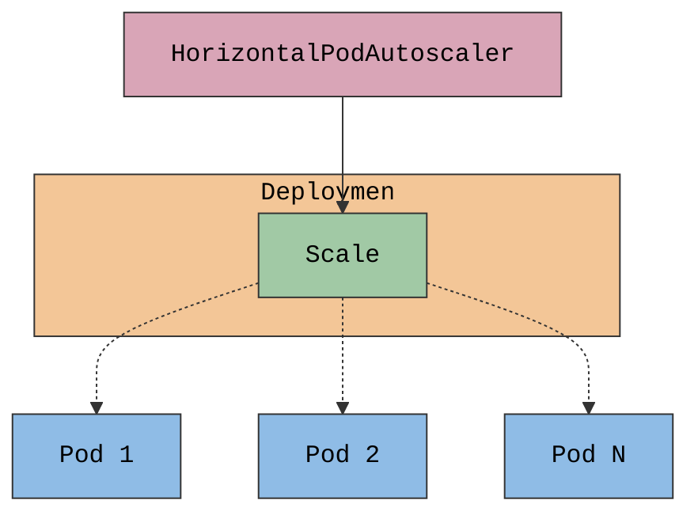

# Horizontal Pod Autoscaling (HPA)

1. [[#Назначение и общая модель|Назначение и общая модель]]
2. [[#Как работает HPA|Как работает HPA]]
3. [[#Алгоритм|Алгоритм]]
	1. [[#Алгоритм#Обработка Pod'ов, отсутствующих метрик и not-ready|Обработка Pod'ов, отсутствующих метрик и not-ready]]
	2. [[#Алгоритм#Консервативный пересчёт|Консервативный пересчёт]]
	3. [[#Алгоритм#Несколько метрик|Несколько метрик]]
	4. [[#Алгоритм#Стабилизация scale down|Стабилизация scale down]]
4. [[#Pod readiness и метрики автоскейлинга|Pod readiness и метрики автоскейлинга]]
5. [[#API-объект|API-объект]]
6. [[#Стабильность масштаба (thrashing/flapping)|Стабильность масштаба (thrashing/flapping)]]
7. [[#Autoscaling во время rolling update|Autoscaling во время rolling update]]
8. [[#Resource metrics|Resource metrics]]
9. [[#Container resource metrics (стабильно с v1.30)|Container resource metrics (стабильно с v1.30)]]
10. [[#Custom, multiple metrics и metrics APIs|Custom, multiple metrics и metrics APIs]]
11. [[#Configurable scaling behavior (стабильно с v1.23)|Configurable scaling behavior (стабильно с v1.23)]]
	1. [[#Configurable scaling behavior (стабильно с v1.23)#Scaling policies|Scaling policies]]
	2. [[#Configurable scaling behavior (стабильно с v1.23)#Stabilization window|Stabilization window]]
	3. [[#Configurable scaling behavior (стабильно с v1.23)#Tolerance (стабильно с v1.37)|Tolerance (стабильно с v1.37)]]
	4. [[#Configurable scaling behavior (стабильно с v1.23)#Поведение по умолчанию|Поведение по умолчанию]]
12. [[#Масштабирование до нуля и обратно (Beta с v1.37, включено по умолчанию)|Масштабирование до нуля и обратно (Beta с v1.37, включено по умолчанию)]]
13. [[#Миграция Deployment и StatefulSet на горизонтальное автоскейлинг|Миграция Deployment и StatefulSet на горизонтальное автоскейлинг]]
14. [[#Поддержка HPA в kubectl|Поддержка HPA в kubectl]]

---
## Назначение и общая модель

`HorizontalPodAutoscaler` (HPA) автоматически обновляет workload-ресурс (например, Deployment или StatefulSet) с целью масштабирования ёмкости в соответствии со спросом. Горизонтальное масштабирование означает развёртывание большего числа Pod'ов в ответ на рост нагрузки — в отличие от вертикального, которое назначает больше ресурсов (CPU, memory) уже работающим Pod'ам. Если нагрузка падает, а число Pod'ов выше настроенного минимума, HPA даёт workload-ресурсу команду уменьшить масштаб .

HPA **не применяется к объектам, которые нельзя масштабировать** — например, к DaemonSet.

HPA реализован как API-ресурс Kubernetes и контроллер. Контроллер работает в плоскости управления и периодически корректирует желаемый масштаб цели, чтобы соответствовать наблюдаемым метрикам: средней утилизации CPU, средней утилизации памяти или любой указанной пользовательской метрике .

## Как работает HPA




HPA реализован как **периодически запускаемый контур управления**, а не непрерывный процесс. Интервал задаётся параметром `--horizontal-pod-autoscaler-sync-period` у kube-controller-manager; значение по умолчанию — **15 секунд** .

На каждом цикле controller manager:

1. Запрашивает утилизацию ресурсов по метрикам, указанным в каждом определении HPA.
2. Находит целевой ресурс, указанный в `scaleTargetRef`.
3. Выбирает Pod'ы по меткам `.spec.selector` целевого ресурса.
4. Получает метрики из resource metrics API (для per-pod resource метрик) или custom metrics API (для остальных).

Для **per-pod resource метрик** (например, CPU) контроллер получает метрики для каждого Pod'а через resource metrics API. Если задано целевое значение утилизации, контроллер вычисляет утилизацию как процент от эквивалентного `resources.requests` контейнеров Pod'а. Если задано целевое «сырое» значение, используются сырые значения метрик. Затем берётся среднее по всем целевым Pod'ам, и формируется отношение для расчёта числа желаемых реплик .

**Критически важно**: если некоторые контейнеры Pod'а не имеют соответствующего `resources.requests`, утилизация CPU для этого Pod'а **не определена**, и autoscaler не предпринимает действий по этой метрике .

Для **per-pod custom метрик** контроллер работает аналогично, но с сырыми значениями, а не с утилизацией. Для **object и external метрик** извлекается одна метрика, описывающая объект; она сравнивается с целевым значением, формируя отношение. В `autoscaling/v2` это значение может опционально делиться на число Pod'ов перед сравнением .

HPA обычно настраивают на получение метрик из агрегированных API: `metrics.k8s.io`, `custom.metrics.k8s.io` или `external.metrics.k8s.io`. API `metrics.k8s.io` обычно предоставляется add-on'ом **Metrics Server**, который нужно запускать отдельно .

HPA обращается к ресурсам, поддерживающим масштабирование (Deployment, StatefulSet), у которых есть субресурс `scale` — интерфейс для динамической установки числа реплик и просмотра их текущих состояний .

## Алгоритм

Базовая формула:

```
desiredReplicas = ceil(currentReplicas × (currentMetricValue / desiredMetricValue))
```

Пример: если текущее значение метрики `200m`, желаемое `100m`, число реплик удваивается (200/100 = 2.0). Если текущее `50m` — число реплик уменьшается вдвое (50/100 = 0.5). Плоскость управления **пропускает масштабирование, если отношение достаточно близко к 1.0** — в пределах настраиваемого допуска, по умолчанию **0.1** (10%) .

### Обработка Pod'ов, отсутствующих метрик и not-ready

Перед проверкой допуска и принятием окончательного решения плоскость управления учитывает:

- **Отсутствующие метрики**: Pod'ы с отсутствующими метриками откладываются; они используются для корректировки итогового масштаба.
- **Удаляемые Pod'ы**: Pod'ы с `deletionTimestamp` (в процессе завершения) игнорируются для per-pod resource метрик; failed Pod'ы отбрасываются. Для external и object метрик число реплик считается по Running и Ready Pod'ам; terminating, но всё ещё Ready Pod'ы продолжают учитываться.
- **Not-ready Pod'ы при масштабировании по CPU**: если Pod ещё не стал ready (инициализируется или unhealthy), либо последняя точка метрики была до того, как он стал ready, Pod откладывается.

**Техническое ограничение**: контроллер не может точно определить первый момент готовности Pod'а. Вместо этого Pod считается «ещё не готовым», если он unready и перешёл в ready в течение короткого настраиваемого окна с момента запуска — `--horizontal-pod-autoscaler-initial-readiness-delay`, по умолчанию **30 секунд**. После того как Pod стал ready, любой переход в ready считается первым, если он произошёл в течение более длительного настраиваемого окна — `--horizontal-pod-autoscaler-cpu-initialization-period`, по умолчанию **5 минут** .

### Консервативный пересчёт

Если были отсутствующие метрики, плоскость управления пересчитывает среднее более консервативно, предполагая, что эти Pod'ы потребляли **100% желаемого значения при scale down и 0% при scale up**. Это снижает величину потенциального масштабирования.

Если присутствовали not-ready Pod'ы и workload масштабировался бы вверх без их учёта, контроллер консервативно предполагает, что not-ready Pod'ы потребляют **0% желаемой метрики**, дополнительно снижая величину scale up.

После учёта not-ready Pod'ов и отсутствующих метрик контроллер пересчитывает отношение. Если новое отношение меняет направление масштабирования или попадает в допуск — масштабирование не выполняется. В остальных случаях новое отношение используется для решения об изменении числа Pod'ов.

**Важно**: исходное значение средней утилизации возвращается через статус HPA **без учёта** not-ready Pod'ов и отсутствующих метрик, даже когда используется новое отношение .

### Несколько метрик

Если в HPA указано несколько метрик, расчёт выполняется для каждой, затем выбирается **наибольшее** значение `desiredReplicas`. Если какая-либо метрика не может быть преобразована в число реплик (например, ошибка получения метрики) и при этом метрики, которые удалось получить, предлагают scale down — масштабирование пропускается. HPA по-прежнему способен масштабировать вверх, если хотя бы одна метрика даёт `desiredReplicas` больше текущего значения.

### Стабилизация scale down

Прямо перед масштабированием рекомендация записывается. Контроллер рассматривает все рекомендации в настраиваемом окне и выбирает наибольшую из этого окна. Параметр `--horizontal-pod-autoscaler-downscale-stabilization`, по умолчанию **5 минут**. Это означает, что scale down происходит постепенно, сглаживая влияние быстро колеблющихся метрик .

## Pod readiness и метрики автоскейлинга

Две опции командной строки влияют на сбор CPU-метрик с Pod'ов при старте :

| Опция | По умолчанию | Назначение |
|---|---|---|
| `--horizontal-pod-autoscaler-cpu-initialization-period` | 5 минут | Временное окно после запуска Pod'а, в течение которого его CPU-использование игнорируется, если Pod не в Ready или метрика взята не полностью в период Ready. Помогает исключить вводящее в заблуждение высокое CPU при инициализации (например, прогрев Java-приложений) |
| `--horizontal-pod-autoscaler-initial-readiness-delay` | 30 секунд | Короткая задержка после запуска Pod'а, в течение которой HPA считает текущие Unready Pod'ы всё ещё инициализирующимися, даже если они ранее кратко переходили в Ready. Защищает от Pod'ов, которые быстро колеблются между Ready и Unready |

Обе опции задаются **только на уровне кластера**.

**Ключевые поведения**:
- Если Pod Ready и остаётся Ready — он учитывается в метриках даже внутри задержки.
- Если Pod быстро переключается между Ready и Unready — метрики игнорируются, пока Pod не станет стабильно Ready.

**Хорошая практика**: настроить `startupProbe`, который не проходит до окончания высокого CPU, или `readinessProbe` с `initialDelaySeconds`, чтобы Ready отдавался только после спада CPU-пика; и задать `--horizontal-pod-autoscaler-cpu-initialization-period` с запасом на длительность старта.

## API-объект

HPA — API kind в группе `autoscaling`. Текущая стабильная версия — `autoscaling/v2`, поддерживающая масштабирование по памяти и кастомным метрикам. Новые поля из `autoscaling/v2` сохраняются как аннотации при работе с `autoscaling/v1` .

Имя HPA должно быть валидным DNS-subdomain именем.

## Стабильность масштаба (thrashing/flapping)

При управлении масштабом группы реплик через HPA число реплик может часто колебаться из-за динамической природы оцениваемых метрик. Это называется **thrashing** или **flapping**; аналог гистерезиса в кибернетике .

## Autoscaling во время rolling update

При настройке автоскейлинга для Deployment HPA привязывается к одному Deployment и управляет его полем `replicas`. Deployment controller отвечает за установку `replicas` у нижележащих ReplicaSet'ов так, чтобы в сумме получалось подходящее число во время rollout и после него .

При rolling update StatefulSet с автоскейлингом StatefulSet напрямую управляет своим набором Pod'ов (без промежуточного ресурса вроде ReplicaSet).

## Resource metrics

Любая цель HPA может масштабироваться по использованию ресурсов Pod'ов. В спецификации Pod'а должны быть указаны `resources.requests` для `cpu` и `memory`; они используются для определения утилизации .

```yaml
type: Resource
resource:
  name: cpu
  target:
    type: Utilization
    averageUtilization: 60
```

С такой метрикой HPA поддерживает среднюю утилизацию Pod'ов на уровне 60%. Утилизация — отношение текущего использования ресурса к `resources.requests` Pod'а.

**Важное ограничение**: поскольку использование ресурсов всех контейнеров суммируется, общая утилизация Pod'а может неточно отражать использование отдельного контейнера. Возможна ситуация, когда один контейнер работает с высокой нагрузкой, но HPA не масштабирует, так как общая утилизация Pod'а в пределах допустимого .

## Container resource metrics (стабильно с v1.30)

HPA API поддерживает container metric source, позволяющий отслеживать использование отдельных контейнеров в наборе Pod'ов. Это даёт возможность задавать пороги для наиболее важных контейнеров Pod'а. Например, для веб-приложения с sidecar-контейнером логирования можно масштабироваться по использованию веб-приложения, игнорируя sidecar .

```yaml
type: ContainerResource
containerResource:
  name: cpu
  container: application
  target:
    type: Utilization
    averageUtilization: 60
```

**Порядок при переименовании контейнера**: если изменить имя контейнера, отслеживаемого HPA, нужно сначала обновить HPA, чтобы он отслеживал и старое, и новое имя. Это позволит HPA вычислять рекомендацию на протяжении всего процесса обновления. После rollout удалить старое имя контейнера из спецификации HPA .

## Custom, multiple metrics и metrics APIs

- **Масштабирование по custom метрикам** (стабильно с v1.23): HPA может масштабироваться по метрике, не встроенной в Kubernetes или его компоненты. Контроллер запрашивает эти метрики из Kubernetes API .
- **Масштабирование по нескольким метрикам** (стабильно с v1.23): можно указать несколько метрик; HPA оценивает каждую и берёт максимальную рекомендацию (если она не превышает общий максимум) .

Для доступа к метрикам администратор кластера должен обеспечить: включённый API aggregation layer; зарегистрированные API — `metrics.k8s.io` (обычно Metrics Server; HPA поддерживает `metrics.k8s.io/v1beta1`, но пока не `metrics.k8s.io/v1`), `custom.metrics.k8s.io` (adapter от поставщика метрик), `external.metrics.k8s.io` (может предоставляться тем же adapter'ом) .

## Configurable scaling behavior (стабильно с v1.23)

В `autoscaling/v2` поле `behavior` позволяет настроить отдельно scale-up и scale-down через `scaleUp` и `scaleDown`. Scaling policies управляют скоростью изменения реплик; два параметра предотвращают flapping: **stabilization window** (сглаживание) и **tolerance** (игнорирование колебаний ниже порога) .

### Scaling policies

```yaml
behavior:
  scaleDown:
    policies:
    - type: Pods
      value: 4
      periodSeconds: 60
    - type: Percent
      value: 10
      periodSeconds: 60
```

`periodSeconds` — длина периода в прошлом, в течение которого политика должна соблюдаться. **Максимум — 1800 секунд (30 минут)**. Первая политика разрешает не более 4 реплик за минуту; вторая — не более 10% текущих реплик за минуту. По умолчанию выбирается политика, допускающая **наибольшее изменение**. Поэтому вторая политика применяется только при числе Pod'ов > 40; при 40 и менее — первая. Пример: при 80 репликах и цели scale down до 10 за первый шаг удаляется 8 реплик; на следующей итерации при 72 репликах 10% = 7.2, округляется вверх до 8. Когда число реплик падает ниже 40, применяется первая политика — по 4 реплики за раз .

`selectPolicy` меняет выбор: `Min` — политика с наименьшим изменением; `Disabled` — полностью отключает масштабирование в этом направлении.

### Stabilization window

```yaml
behavior:
  scaleDown:
    stabilizationWindowSeconds: 300
```

Когда метрики указывают на необходимость scale down, алгоритм смотрит на ранее вычисленные желаемые состояния и использует **наибольшее значение** из указанного интервала. В примере учитываются все желаемые состояния за последние 5 минут. Это приближает rolling maximum и предотвращает частые удаления Pod'ов с последующим пересозданием эквивалентного Pod'а .

### Tolerance (стабильно с v1.37)

Поле `tolerance` задаёт порог колебаний метрики, ниже которого автоскейлер не масштабирует. Определяется как величина отклонения вокруг желаемого значения метрики, при которой масштабирование не происходит. Например, при цели 100 MiB и tolerance 5% для scale up HPA рассмотрит масштабирование только если потребление выше 105 MiB .

```yaml
behavior:
  scaleUp:
    tolerance: 0.05
```

Если поле не задано, применяется кластерный допуск по умолчанию **10%**; его можно изменить для scale-up и scale-down через `--horizontal-pod-autoscaler-tolerance` у kube-controller-manager (через API это значение не настраивается).

### Поведение по умолчанию

```yaml
behavior:
  scaleDown:
    stabilizationWindowSeconds: 300
    policies:
    - type: Percent
      value: 100
      periodSeconds: 15
  scaleUp:
    stabilizationWindowSeconds: 0
    policies:
    - type: Percent
      value: 100
      periodSeconds: 15
    - type: Pods
      value: 4
      periodSeconds: 15
    selectPolicy: Max
```

Для scale down stabilization window — 300 секунд (или значение `--horizontal-pod-autoscaler-downscale-stabilization`). Единственная политика разрешает удалить 100% текущих реплик — то есть цель может быть уменьшена до минимально допустимого числа. Для scale up stabilization window отсутствует: при сигнале к увеличению масштаб растёт немедленно. Две политики: не более 4 Pod'ов или 100% текущих реплик каждые 15 секунд до достижения устойчивого состояния.

## Масштабирование до нуля и обратно (Beta с v1.37, включено по умолчанию)

Для HPA, масштабирующихся по custom (object) или external метрикам, можно установить `spec.minReplicas: 0`. Workload масштабируется до нуля при отсутствии нагрузки и обратно вверх, когда метрика указывает, что нужна хотя бы одна реплика. Полезно для workload'ов, простаивающих длительное время и дорогих в поддержании (потребители редко используемой очереди, задачи на выделенном оборудовании вроде GPU) .

**Ограничения**:
- Scale to zero поддерживается **только для object и external метрик**, не для resource метрик (CPU/memory), так как их можно измерить только на работающих Pod'ах.
- `minReplicas: 0` требует хотя бы одной object или external метрики; иначе API-сервер отклоняет HPA.

Управляется feature gate `HPAScaleToZero`, включённым по умолчанию; должен быть включён и на kube-apiserver (разрешает `minReplicas: 0`), и на kube-controller-manager (выполняет масштабирование).

Пока HPA удерживает workload на нуле, он записывает condition `ScaledToZero=True` в статус HPA. Это отличает workload, который HPA сам отмасштабировал до нуля (и вернёт вверх при возврате метрики), от workload'а, вручную деактивированного установкой replicas в 0. После масштабирования вверх condition становится `False` с причиной `NotScaledToZero`.

**Неявная деактивация в maintenance-mode**: если желаемое число реплик цели установлено в 0, а `minReplicas` HPA больше 0, HPA перестаёт корректировать цель (и устанавливает condition `ScalingActive=False`), пока вы не реактивируете его вручную, изменив replicas цели или `minReplicas` HPA.

## Миграция Deployment и StatefulSet на горизонтальное автоскейлинг

При включённом HPA **рекомендуется удалить `spec.replicas`** из манифестов Deployment и/или StatefulSet. Иначе любое применение изменения к объекту (например, `kubectl apply -f deployment.yaml`) даст Kubernetes команду масштабировать текущее число Pod'ов до значения `spec.replicas`, что может привести к thrashing/flapping при активном HPA.

**Важно**: удаление `spec.replicas` может вызвать **разовую деградацию** числа Pod'ов, так как значение по умолчанию для этого поля — 1. При обновлении все Pod'ы, кроме одного, начнут завершаться. Последующие применения будут вести себя нормально и соблюдать конфигурацию rolling update.

Способы избежать деградации:

**Client Side Apply (по умолчанию)**:
1. `kubectl apply edit-last-applied deployment/<deployment_name>`
2. В редакторе удалить `spec.replicas`. При сохранении `kubectl` применит обновление; число Pod'ов на этом шаге не изменится.
3. Удалить `spec.replicas` из манифеста и закоммитить изменения в систему контроля версий.
4. Дальше можно применять манифест обычным способом.

**Server Side Apply**: удалить `spec.replicas` из манифеста и применить через `kubectl apply --server-side`; поле, которым управляет HPA, не будет конфликтовать, так как SSA отслеживает владение полями.

## Поддержка HPA в kubectl

```bash
kubectl create -f hpa.yaml
kubectl get hpa
kubectl describe hpa <name>
kubectl delete hpa <name>

# Специальная команда для быстрого создания
kubectl autoscale rs foo --min=2 --max=5 --cpu=80%
```