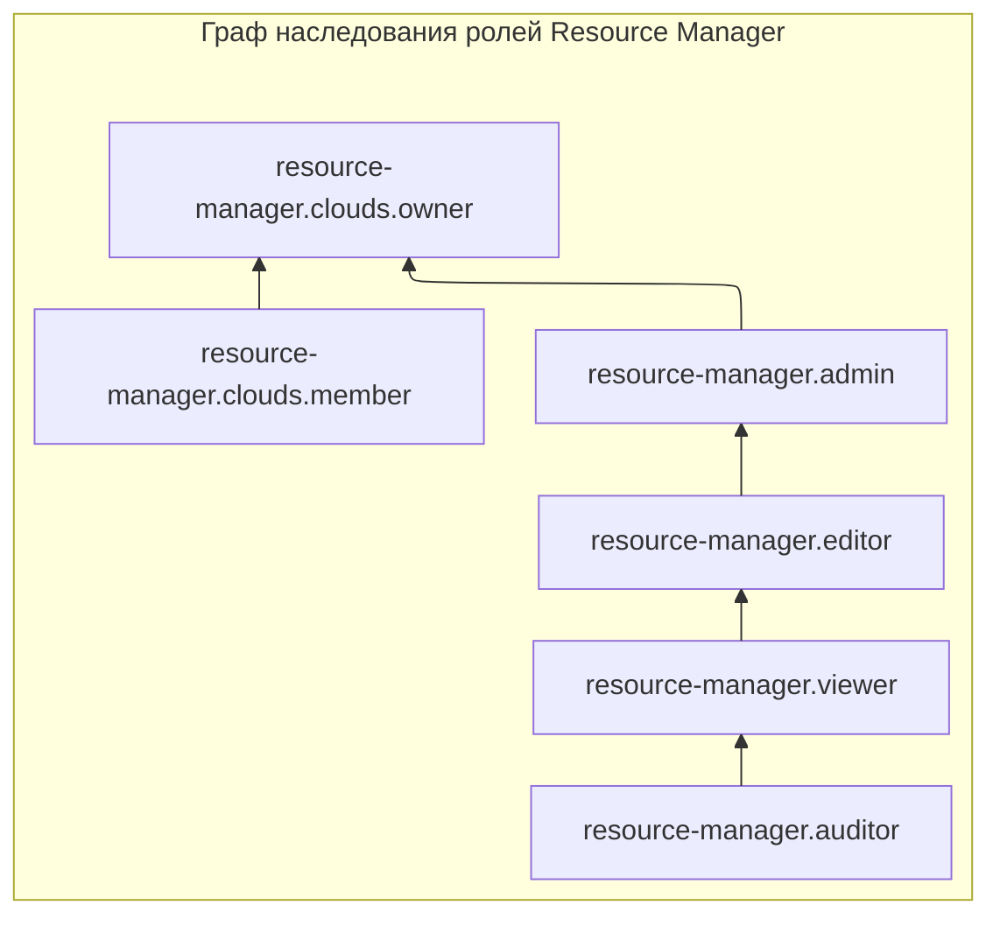

# Управление доступом и ролевая модель в Yandex Cloud (Resource Manager)

> **Сфера применения:** Проектирование систем безопасности корпоративного уровня, аутентификация и авторизация в IAM, администрирование ресурсов и аудит информационной безопасности в Yandex Cloud.
> 
> **Цель документа:** Предоставить исчерпывающий технический разбор модели контроля доступа (Access Control), иерархии назначения прав, механики наследования ролей, полного списка сервисных и примитивных ролей Resource Manager, а также детальную матрицу необходимых привилегий для выполнения любых административных операций.

---
## Содержание

1. [[#Архитектурные принципы контроля доступа|Архитектурные принципы контроля доступа]]
	1. [[#Архитектурные принципы контроля доступа#Категории субъектов доступа|Категории субъектов доступа]]
	2. [[#Архитектурные принципы контроля доступа#Субъекты, имеющие право назначать роли|Субъекты, имеющие право назначать роли]]
2. [[#Иерархия назначения и политики авторизации|Иерархия назначения и политики авторизации]]
	1. [[#Иерархия назначения и политики авторизации#Приоритет политик авторизации|Приоритет политик авторизации]]
3. [[#Полный классификатор ролей Resource Manager|Полный классификатор ролей Resource Manager]]
	1. [[#Полный классификатор ролей Resource Manager#Дерево наследования сервисных ролей|Дерево наследования сервисных ролей]]
	2. [[#Полный классификатор ролей Resource Manager#1. Сервисные роли (Рекомендуемые к использованию)|1. Сервисные роли (Рекомендуемые к использованию)]]
		1. [[#1. Сервисные роли (Рекомендуемые к использованию)#`resource-manager.auditor`|`resource-manager.auditor`]]
		2. [[#1. Сервисные роли (Рекомендуемые к использованию)#`resource-manager.viewer`|`resource-manager.viewer`]]
		3. [[#1. Сервисные роли (Рекомендуемые к использованию)#`resource-manager.editor`|`resource-manager.editor`]]
		4. [[#1. Сервисные роли (Рекомендуемые к использованию)#`resource-manager.admin`|`resource-manager.admin`]]
		5. [[#1. Сервисные роли (Рекомендуемые к использованию)#`resource-manager.clouds.member`|`resource-manager.clouds.member`]]
		6. [[#1. Сервисные роли (Рекомендуемые к использованию)#`resource-manager.clouds.owner`|`resource-manager.clouds.owner`]]
	3. [[#Полный классификатор ролей Resource Manager#2. Примитивные роли (Устаревшие / Глобальные)|2. Примитивные роли (Устаревшие / Глобальные)]]
4. [[#Детальная матрица необходимых ролей для административных задач|Детальная матрица необходимых ролей для административных задач]]

---
## Архитектурные принципы контроля доступа

Все без исключения операции в экосистеме Yandex Cloud проходят проверку разрешений через службу **Yandex Identity and Access Management (IAM)**. Если у запрашивающего субъекта отсутствуют необходимые привилегии, платформа блокирует операцию и возвращает ошибку доступа.

### Категории субъектов доступа

Назначать роли можно следующим типам субъектов:

- **Аккаунтам на Яндексе** (паспортным учетным записям физических лиц);
- **Сервисным аккаунтам** (используются приложениями, скриптами, системами CI/CD и Terraform);
- **Локальным пользователям**;
- **Федеративным пользователям** (интеграция с корпоративными провайдерами идентификации через SAML / SSO);
- **Группам пользователей** (управление доступом на уровне подразделений компании);
- **Системным и публичным группам** (например, для предоставления публичного доступа к бакетам или ресурсам).

### Субъекты, имеющие право назначать роли

Право выдавать, изменять или отзывать роли на конкретный ресурс имеют исключительно те пользователи или сервисные аккаунты, у которых на этот ресурс назначена хотя бы одна из следующих административных ролей:

- `admin`;
- `resource-manager.admin`;
- `organization-manager.admin`;
- `resource-manager.clouds.owner`;
- `organization-manager.organizations.owner`.
---
## Иерархия назначения и политики авторизации

Роли в Resource Manager назначаются на трех уровнях иерархии: **организация**, **облако** и **каталог**. Назначение роли на верхнем уровне (например, на облако) автоматически распространяет все включенные в нее разрешения на все вложенные дочерние ресурсы (каталоги и объекты внутри них).

### Приоритет политик авторизации

Независимо от наличия у пользователя разрешений, предоставленных ролью, выполнение любой операции может быть жестко заблокировано, если для организации, облака или каталога настроена специальная **политика авторизации** (Access Policy), запрещающая это действие. Политики безопасности имеют абсолютный приоритет над ролевой моделью.

---
## Полный классификатор ролей Resource Manager

Роли делятся на две основные группы: **сервисные роли** (обеспечивающие гибкое разделение прав по принципу наименьших привилегий) и **примитивные роли** (устаревшие глобальные роли платформы).

### Дерево наследования сервисных ролей

### 1. Сервисные роли (Рекомендуемые к использованию)

#### `resource-manager.auditor`

- **Назначение:** Аудит конфигурации и прав доступа.
- **Доступные действия:** Просмотр метаинформации об облаках и каталогах, их настройках, а также аудит назначенных прав доступа (`access bindings`), политик авторизации и квот сервиса. Не предоставляет доступа к данным самих вычислительных ресурсов.

#### `resource-manager.viewer`

- **Назначение:** Чтение структуры облака и каталогов.
- **Доступные действия:** Полный просмотр информации об облаках, каталогах, их конфигурациях, правах доступа и политиках авторизации. Включает все разрешения роли `resource-manager.auditor`.

#### `resource-manager.editor`

- **Назначение:** Управление структурой облаков и каталогов.
- **Доступные действия:** Создание, модификация и удаление облаков и каталогов, а также просмотр их настроек, квот и назначенных прав доступа. Включает все разрешения роли `resource-manager.viewer`.

#### `resource-manager.admin`

- **Назначение:** Полное административное управление облаками, каталогами и доступом к ним.
- **Доступные действия:** Создание, изменение и удаление облаков и каталогов, просмотр и изменение назначенных прав доступа (привязок ролей), а также создание, назначение и отзыв политик авторизации. Включает все разрешения роли `resource-manager.editor`.

#### `resource-manager.clouds.member`

- **Назначение:** Базовый доступ к облаку для участников команды.
- **Особенности:** Назначается **исключительно на уровень облака**. Не предоставляет никаких прав на создание или изменение вычислительных ресурсов. Позволяет просматривать общую информацию об облаке, а также создавать, закрывать и комментировать обращения в техническую поддержку Yandex Cloud.

#### `resource-manager.clouds.owner`

- **Назначение:** Полное владение облаком.
- **Особенности:** Назначается только на уровень облака (создатель облака получает ее автоматически). Позволяет выполнять абсолютно любые действия в облаке и дочерних ресурсах. Дает право управлять привязкой облака к платежному аккаунту (при наличии прав на сам платежный аккаунт). Включает разрешения примитивной роли `admin` и сервисной роли `resource-manager.clouds.member`. По умолчанию получает системные уведомления о событиях в облаке.
### 2. Примитивные роли (Устаревшие / Глобальные)

Примитивные роли действуют во **всех сервисах** Yandex Cloud одновременно и не соответствуют принципу минимальных привилегий. Рекомендуется заменять их сервисными ролями.

- **`auditor`:** Чтение конфигураций, метаданных и списка операций любых ресурсов Yandex Cloud без доступа к данным. Максимально безопасная примитивная роль.
- **`viewer`:** Чтение информации о любых ресурсах платформы (включая доступ к данным в режиме чтения). Включает разрешения роли `auditor`.
- **`editor`:** Управление любыми ресурсами во всех сервисах Yandex Cloud (создание, изменение, удаление), за исключением назначения ролей, удаления ключей KMS и операций с организацией. Включает разрешения роли `viewer`.
- **`admin`:** Полное управление ресурсами во всех сервисах и право назначать любые роли (кроме ролей владельца организации или облака). Требует повышенных мер защиты привилегированных аккаунтов. 

---
## Детальная матрица необходимых ролей для административных задач

Для выполнения конкретных операций в сервисе Resource Manager требуются строго определенные минимальные роли, указанные в таблице:

|**Категория задачи**|**Операция / Конкретный метод API**|**Необходимая минимальная роль и область применения**|
|---|---|---|
|**Просмотр информации**|Чтение информации о любом ресурсе (`get`, `list`)|`viewer` на этот конкретный ресурс|
|**Просмотр информации**|Просмотр информации об облаке или каталоге|`resource-manager.viewer` на целевой каталог или облако|
|**Просмотр информации**|Просмотр метаинформации и аудит прав|`resource-manager.auditor` на целевой каталог или облако|
|**Управление облаком**|Создание нового облака (`create`)|`resource-manager.editor` (или `editor`) на **организацию** (создатель организации получает права автоматически)|
|**Управление облаком**|Изменение настроек облака (`update`)|`editor` или `resource-manager.editor` на это **облако**|
|**Управление облаком**|Удаление облака (`delete`)|`editor` или `resource-manager.editor` на это **облако**|
|**Управление каталогом**|Создание каталога в облаке (`create`)|`editor` или `resource-manager.editor` на родительское **облако**|
|**Управление каталогом**|Изменение каталога (`update`)|`editor` или `resource-manager.editor` на этот **каталог**|
|**Управление каталогом**|Удаление каталога (`delete`)|`editor` или `resource-manager.editor` на этот **каталог**|
|**Управление доступом**|Приглашение пользователя в организацию|`organization-manager.admin` на организацию|
|**Управление доступом**|Назначение владельца облака (`setAccessBindings`)|`resource-manager.clouds.owner` на это **облако**|
|**Управление доступом**|Просмотр назначенных ролей (`listAccessBindings`)|`viewer` на ресурс ИЛИ `resource-manager.auditor` на каталог/облако|
|**Управление доступом**|Назначение или отзыв ролей (`grant` / `revoke`)|`admin` или `resource-manager.admin` на целевой каталог или облако|